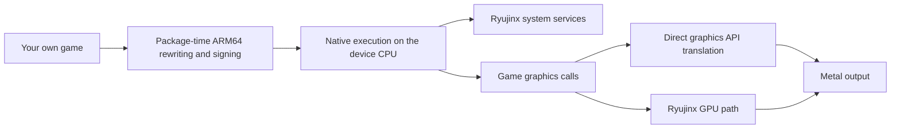

<p align="center">
  
</p>
<h1 align="center">S2Arm</h1>
<p align="center">Bring your own Switch games to iPhone, iPad, and Mac.</p>

<p align="center">English · <a href="README.zh-CN.md">简体中文</a></p>

S2Arm packages your own Switch games on a Mac for use on your target device. Its native launcher manages and runs games on Mac, and can build IPA packages and resource bundles for iPhone and iPad.

[Download](https://github.com/jhaizhou-ops/S2Arm/releases) · [Getting started](#getting-started) · [Compatibility](#platforms-and-compatibility) · [Contribute](#feedback-and-contributions)

- **Mac launcher**: Import NSP / XCI files, manage base games, updates, and DLC, and view packaging progress and errors.
- **Mobile apps**: Build an IPA and resource bundle with shaders prepared for the target device. Touch controls and system-supported controllers are available.
- **Native execution**: Game ARM64 code is rewritten during packaging. Switch system services use Ryujinx, while graphics on Apple platforms are presented through Metal.

## Screenshots

| Game library | Packaging tasks |
| --- | --- |
|  |  |

## Getting started

Download `S2Arm.zip`, the Mac launcher, from the [releases page](https://github.com/jhaizhou-ops/S2Arm/releases). Check the requirements below before using it. Game compatibility and behavior across devices are still being verified.

| Goal | Requirements |
| --- | --- |
| Prepare and run games on Mac | An Apple Silicon Mac. The launcher opens on macOS 15 or later; games are validated on macOS 26 (main Metal 4 path), while macOS 15–25 use the Metal 3 compatibility path, which is still being validated. Preparing games also requires full Xcode and its Metal compiler components. |
| Run games on iPhone / iPad | A package built on a Mac, a target device with an A14 / M1 or newer chip running iOS / iPadOS 18 or later (iOS 18–25 use the Metal 3 compatibility path), and your own Apple ID for installation. |
| Games and keys | `prod.keys` exported from your own Switch, and NSP / XCI game files you have the right to use. Import updates and DLC as needed. |

1. Extract `S2Arm.zip` and move the app to Applications. If macOS blocks the first launch, allow it in System Settings → Privacy & Security.
2. Follow the welcome screen to check the environment, import your keys and games, and start packaging.

### Let an AI do it for you

Copy the text below, as is, into an AI assistant that can run commands on this Mac (Claude, ChatGPT, Codex and so on). It downloads, installs and **opens** S2Arm, so you can watch the launcher window and every step it takes. It then follows the operator manual built into the launcher to import your games, export them, install them on your iPhone and troubleshoot problems. For anything only you can do (system permission prompts, signing in to your Apple ID, tapping Trust on your phone) it stops and tells you. If the launcher is already installed, open **Settings → Let AI operate S2Arm** and click **Copy prompt for AI** instead.

```text
Please install and use S2Arm (https://github.com/jhaizhou-ops/S2Arm) on this Mac to turn my own Switch games into versions I can play on my iPhone / iPad, and install them on my phone.
1. Download S2Arm.zip from the newest "S2Arm 内测版" release (every release is a pre-release and some are test saves: pick the version with gh release list --repo jhaizhou-ops/S2Arm, then gh release download <tag> --repo jhaizhou-ops/S2Arm --pattern S2Arm.zip; if I'm not signed in to the GitHub CLI, tell me to download it in my browser), unzip it and move S2Arm.app to Applications.
2. Run /Applications/S2Arm.app/Contents/Resources/s2armctl start to open the S2Arm window (don't run it headless; I want to watch it). If macOS says it can't verify the developer, tell me to click "Open Anyway" in System Settings → Privacy & Security.
3. Read the built-in operator manual /Applications/S2Arm.app/Contents/Resources/skill/s2arm-operator/SKILL.md in full, then keep running s2armctl next and follow the manual step by step.
4. Ask me for anything only I have (where my prod.keys and game files are); for things only I can do, stop and tell me exactly what to do. Work only on this Mac, never upload, copy elsewhere or print my keys or game files, and ask me before deleting anything.
```

- **On Mac**: Once packaging finishes, select the game in the library and click **Launch game**.
- **On iPhone / iPad**: Choose **Pack for iPhone** to build an IPA and resource bundle, then follow the guide to sign, install, and import the resources.

The IPA and resource bundle must be installed and imported separately on the mobile device. The [user guide](docs/内测教程.md) covers signing, required entitlements, and renewal, and is currently in Chinese. Initial packaging compiles shaders; its duration depends on the game, hardware, and available caches.

S2Arm does not provide games, firmware, or keys. Keep your existing game library and saves when updating or troubleshooting.

## Platforms and compatibility

| Platform | Current scope |
| --- | --- |
| macOS | Launcher, game preparation, and execution on Apple Silicon; command-line iPhone packaging on Intel Macs. |
| iOS / iPadOS | Per-game apps and resource bundles built on Mac. Device model, OS, memory, and game version affect the result. |
| Android | Integration and game execution testing are in progress on [`android/integration`](https://github.com/jhaizhou-ops/S2Arm/tree/android/integration). |
| HarmonyOS | Prototyping and runtime adaptation are in progress. |

S2Arm targets **64-bit ARM games**; AArch32 games are unsupported. Compatibility varies by game version and device. Successful packaging does not establish correct rendering or stable gameplay. Recorded results are in the [compatibility list](docs/兼容性清单.md) (Chinese).

Switch 2 Pro support on iOS / iPadOS is **off by default** and must be enabled separately in each game's system settings. Reconnecting may require the controller's top SYNC button.

## How it works

Game ARM64 code is rewritten and signed during packaging, then executes natively on the device CPU. Switch system services use Ryujinx. Graphics can be translated directly to Metal or processed through the Ryujinx GPU path.



The direct path translates NVN / Vulkan / OpenGL calls and prepares shaders ahead of time to reduce runtime work. Coverage and validation differ across frontends and releases.

## Feedback and contributions

Before [reporting an issue](https://github.com/jhaizhou-ops/S2Arm/issues/new/choose), search existing reports. Include the game and version, device and OS, package build number, reproduction steps, and redacted logs. Do not upload keys, game files, firmware, resource bundles, or saves.

Reproduction reports, documentation fixes, and code contributions are welcome. The [contribution guide](CONTRIBUTING.md) covers development setup, checks, and the PR workflow, and is currently in Chinese.

## Source layout

| Directory | Contents |
| --- | --- |
| `runtime/` | Loader, ARM64 rewriter, system calls, threading and memory management, and the iOS shell |
| `services/` | C# / NativeAOT system service integration |
| `compat/` | Pinned upstream sources, patch series, and verification tools |
| `graphics/` | Graphics frontends, Metal backend, shader tools, and aspect-ratio handling |
| `platforms/` | Mac launcher and other platform integrations |
| `pack/`, `tools/`, `tests/` | Packaging, developer tools, and validation |
| `docs/` | User guides, designs, interfaces, standards, and research notes |

## Acknowledgments

- [Ryujinx](https://github.com/Ryujinx/Ryujinx): Switch system services and GPU processing.
- [the reference port](): NVN-to-Metal graphics implementation and related design references, including the pipeline prewarm's prepare step before the first frame (`warm_prepare`, MIT); the save transaction (clonefile working directory, atomic `renamex_np` swap on commit); the thermal-state frame-rate cap (`thermal_capped`, MIT).
- [MacNativeGames](https://github.com/ly05010419/MacNativeGames): the per-pipeline Metal binary archive (one file per pipeline, `FailOnBinaryArchiveMiss` lookup, removal of the build folders Metal leaves behind; `totk_pipeline_archive.h`, MIT).
- [super-mario-odyssey-ios](https://github.com/NicholasDominici/super-mario-odyssey-ios): the same clonefile + atomic swap save transaction (MIT).
- [ns2pro-bridge](https://github.com/DanielZhangyc/ns2pro-bridge): Switch 2 Pro protocol, Bluetooth transport, and rumble encoding.
- [LumaDock](https://github.com/Xc1Ym/LumaDock): Mac launcher interface and interaction design.
- [libvpx](https://chromium.googlesource.com/webm/libvpx) / [dav1d](https://code.videolan.org/videolan/dav1d) / [libopus](https://opus-codec.org): Video and audio decoding.
- See [third-party dependencies](docs/第三方依赖.md) for other components, font sources, versions, and licenses.

## License

S2Arm is licensed under the Apache License, Version 2.0. See [LICENSE](LICENSE), [NOTICE](NOTICE), and [third-party licenses](docs/第三方依赖.md). Third-party components retain their own copyright and license notices.

S2Arm is not affiliated with or endorsed by Nintendo. Game names, trademarks, and materials shown in screenshots belong to their respective owners.
