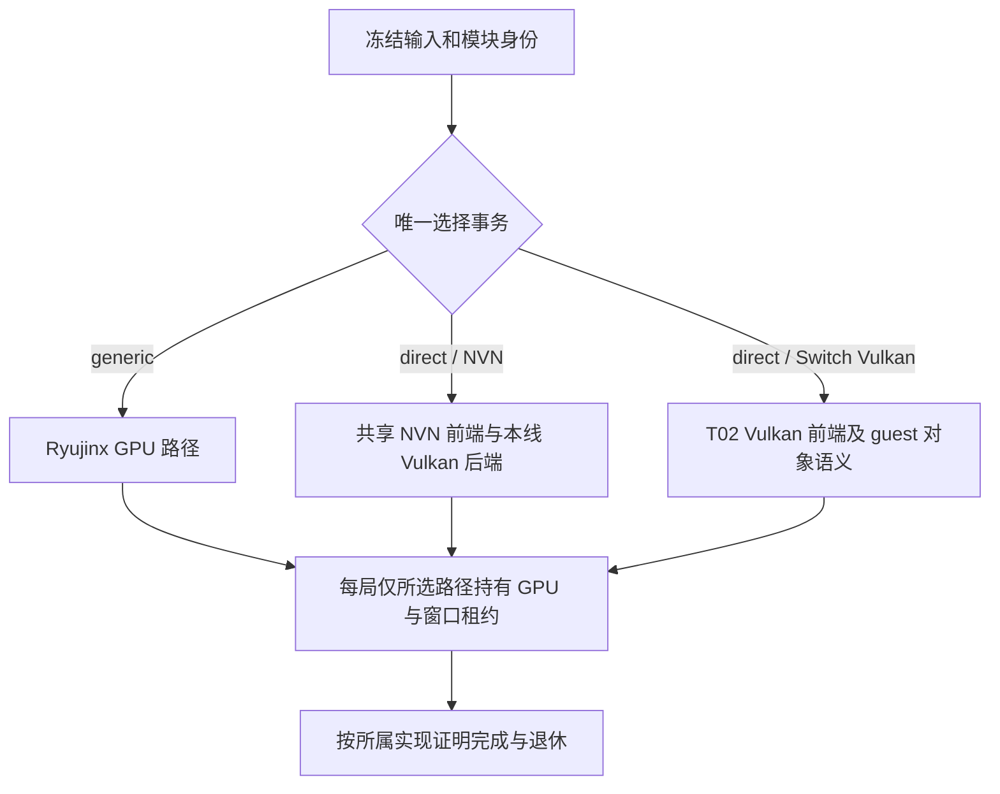

# Android 直连与 T02/main 合并分析（2026-10-28）

> 本文按时间保留历史分析；开头及 §1–§14 的“尚未合并/未处理”等状态属于当时快照。PR #868 本轮同步 main 的处理和验证见 **§15**；历史 T02 预演不参与本轮冲突决策。

本文分析 `android/direct-mode-d2r` 如何汇入 `codex/t02-android-to-main`，并继续与 main 合流。结论基于冻结提交、源码对照和隔离合并预演；尚未解决实际分支冲突，未构建合并后的 APK，未新增设备通过结论。

按用户要求，本专题明细独立维护，[统一方案 §7.6](fast-generic-v3.md#android-merge-boundaries)仅引用本文。产品路线、当前完成状态及下一交付仍以[统一方案](fast-generic-v3.md)为准；跨界 ABI 以[实施契约](direct-mode-contracts.md)为准。本文中的接口调整和合入单元是待实施建议，不能仅凭文档变更视为已有功能或已改变合同。

## 1. 结论与范围

现有 NVN/Vulkan 核心可以保留。合流的主要工作是统一共享前端、模式准入、宿主生命周期、构建源清单和出包身份。后续开发应集中在独立后端目录，公共接缝的变更单独审查、同步全部调用方，尽早形成集成候选。

**合并前能否先拆独立文件，详见[第 12 节](#android-premerge-extraction)**：给出可先做的具体拆分、不能分成两套实现的共享语义、逐文件分类及双边保真条件。已执行一项隔离演练：抽取打包校验的 76 行后，两版各 22 项测试通过，合成包字节一致；合并冲突仍为 48 路径、打包器仍为 4 段。因此“拆开后便于独立开发”有局部验证，“拆开就自动消掉当前冲突”不成立；不能据此宣称整个 T02 或游戏行为已等效。

五项必须同时成立：

1. T02 的 Switch Vulkan 前端与本线 NVN→Vulkan 是不同前端，能力都要保留；每局只启用选中的一条执行路径。
2. mode、lookup、故障 attempt、窗口租约和收尾协调各有唯一权威来源，前端不再独立决定全局模式。
3. 共享 NVN 的记录生产者与所有回放消费者按同一布局工作；没有文本冲突也要核兼容。
4. T02 的输入冻结、单库/JNI 检查与本线的图形描述、完整身份、补编/缓存校验同时保留。
5. 合并后的功能和性能重新验证。两边各自通过的证据只能说明其原候选，不能拼成新候选已通过。

本次没有修改运行时代码、切换工作树、安装 APK 或触碰设备。最初分析时工作树另有 driver cache 开发改动；写作期间它与计时修订进入 `93fe941d9`，本轮已追加预演，见第 2 节的 A2。正式合流前仍须针对当时的新提交重新冻结。

## 2. 冻结基线和提交关系

| 名称 | 完整提交 | 含义 |
|---|---|---|
| 本线 A | `5ac1affaae05e6414a78bba0cdf5f2cc879e9c25` | 本次分析的 Android NVN 直连候选 |
| T02 B | `36e1f6d00062f2a4ce1be58b45c7e5751d046ffb` | Android/main 汇总分支，提交时间 10-27 20:26 +0800 |
| 追加本线 A2 | `93fe941d92df2e0c6515f4b6de918a8730e18808` | 写作期间纳入 driver cache 与计时修订，再次预演 |
| 共同祖先 C | `2d9c77043c62cf8cb6a2d07af6b77ef5297bcb4c` | 两边三方比较基线 |
| 对照 main M | `17b618748dcebb75ff7d80daa473e7219f57d758` | 本轮 fetch 所见 main，10-28 07:34 +0800 |
| T02 已含 main 基线 | `4d4e6afa9` | 10-27 18:54 的主线提交，已经是 B 的祖先 |
| T02 已含 Android 集成头 | `7e4c265e8` | 本轮远端 `android/integration`，已经是 B 的祖先 |

源码入口：[本线冻结树](https://github.com/jhaizhou-ops/S2Arm/tree/5ac1affaae05e6414a78bba0cdf5f2cc879e9c25)、[T02 冻结树](https://github.com/jhaizhou-ops/S2Arm/tree/36e1f6d00062f2a4ce1be58b45c7e5751d046ffb)、[main 对照树](https://github.com/jhaizhou-ops/S2Arm/tree/17b618748dcebb75ff7d80daa473e7219f57d758)。分支名会移动，复核应使用完整提交号。

| 比较 | 左侧独有提交 | 右侧尚未进入左侧历史的提交 |
|---|---:|---:|
| B … A | 2256 | 330 |
| B … A2 | 2256 | 332 |
| B … M | 568 | 206 |
| B … `origin/android/integration@7e4c265e8` | 793 | 0 |

这些是提交可达性计数，包含 merge 和文档，不是功能数。此前 329 的读数针对 `d9ef64083`；本线新增 `5ac1affaa` 文档提交后为 330。挑选提交、改写实现可能有等价内容，因此不能单凭计数判某项功能不存在；本文另做树内容和源码核对。

**写作期间追加核验 A2**：本线进入 `93fe941d9` 后重新执行三方预演，48 个冲突路径集合完全相同；共同改动/相同结果/不同结果仍为 679/458/221。A2 相对 C 改动路径变为 1068，独立 `native/nvn` 新文件变为 50 个（新增 driver cache C/H）；原 CPU 反例涉及的 `OP_BIND_VBUF` 分支原文 SHA-256 在 A/A2 均为 `04595b10d0690f7b06961322b56216fc9c767552d10d26365041cedab025c8a4`。这只更新静态合流范围，不验证新 driver cache 或计时的运行行为。

**实际集成应分两次预演**：先在独立集成工作树固定 T02 与当时 main 的接收基线，再与本线冻结头合流。下面的 48 路径只属于 A/B，不能当作加入 main 的 206 个后续提交后仍然不变的总冲突数。

**自审追加快照（2026-10-28）**：再次 fetch 后，T02 B 和 Android 集成头未变，main 已到 `a27e99945840404c00e32572b2acfe01076ec588`，相对上表 M 多 47 个可达提交；B…新 main 为 568/253。本线已提交头冻结为 `ec6e94e685d404431d57936478c6dae23311ff05`，另有未提交纹理缓存改动，不包含在此次预演中。临时 bare 重演：A3 `697d4f6d4` 对 B、本次本线头对 B 均为原表相同的 48 路径；B 对新 main 为 35 个冲突路径。两次配对的冲突数不能相加；尚未解决 B/main 冲突并生成接收候选，因此没有三方最终整合的总冲突数。第 10 节仍是冻结 A/B 清单，不是 main 最新合流清单。

## 3. 文件差异与合并预演结果

Linux x86_64 / Git 2.56.0；临时 bare 仓库通过 alternates 读取源仓库对象，预演生成的树和对象写在 `/tmp`，开发工作树和索引未变。

| 指标 | 结果 | 解释 |
|---|---:|---|
| B 相对 C 改动路径 | 2180 | 逐路径比较树；新增、删除及 mode 改动均计入 |
| A 相对 C 改动路径 | 1064 | A2 为 1068；口径同上 |
| 两边共同改动 | 679 | 不能把这些都叫冲突 |
| 共同改动且最终 blob/mode 相同 | 458 | 已得出相同树内容 |
| 共同改动但最终结果不同 | 221 | 其中一部分能自动合并 |
| Git 报告冲突路径 | 48 | 44 个内容冲突，4 个仅权限位冲突 |
| Android 下冲突路径 | 23 | 包含源码、测试和文档 |

这里统一按树路径计数。此前 `git diff --name-only` 默认启用重命名识别，B 输出 2175 行；重命名的旧/新路径会折为一条，因此与逐路径树比较的 2180 不同。679/458/221 与冲突路径结果不受此次口径澄清影响。

四个仅权限位不同的文件：`graphics/tools/shbake/pak_crypto.py`、`tools/jobtoken.c`、`tools/progress.py`、`tools/progress.sh`。两边 blob 相同，本线 mode 为 100755、T02 为 100644；根据实际直接执行、解释器调用或 source 方式确定最终 mode，不需要重写业务内容。Git 将其列为 add/add，不能因此认定实现相互冲突。

本线新增且 T02 不存在的文件中：`android/native/direct/` 48 个、`android/native/nvn/` 48 个、`graphics/tools/direct/compiler/` 14 个。它们本次没有同名文本冲突，但会受共享头文件、构建、服务 ABI 与生命周期变化影响，不能只复制目录便宣布接入完成。

## 4. 架构归属：保留两种前端，统一会话控制

### 4.1 源码已经存在的两条路径

| 事项 | 本线 A | T02 B | 合流要求 |
|---|---|---|---|
| 图形前端 | 共享 NVN API/对象/命令记录 | guest Vulkan 入口与动态查询、VI 窗口 | 按实际输入识别前端，分别保留 |
| 执行 | `native/nvn/nvn_vk_*` 与 `native/direct/vk_record.c` | `native/direct_vk.c`、`direct_objects.inc`、`direct_wsi.inc`、guest callback | 不把 guest Vulkan handle 当 NVN 后端对象 |
| 准入 | `direct/selection.c`、descriptor、attempt、provider | `direct_session.c` 的 requested/frozen/mode 与 `direct-vulkan.txt` | 将前端准入接入同一权威选择事务，迁移全部消费者 |
| 图形模式查询 | `plat_android.c::s2a_gfx_mode/s2a_direct_lookup` | game 下由 `direct_session.c` 定义同名全局符号 | 最终只定义一次，按已冻结前端分派 |
| HLE 组合 | services v2 显式携带图形表；direct 禁用 generic GPU 循环 | services v1 启动中查询 `Native.GfxMode`；direct service renderer | 统一版本和启动顺序，保留必要 HLE 外壳 |
| 退出 | 正常/失败分类、attempt、NVN 批次与窗口回收 | cooperative applet Exit、Vulkan token/反向 allocator 排空 | 请求退出、停止新入口、真正完成和销毁分开证明 |

T02 Vulkan 在运行时会处理 guest 发起的实例/设备创建；NVN 路径由 provider 准备实际设备。适配时必须先确定各前端的 Prepare/Activate/Ready、能力与 owner 计数的真实时机，不能在 guest 尚未创建 Vulkan device 时伪造 enabled profile 或宣布已创建设备。生命周期接口可以共用，设备/句柄语义不能强行套同一种实现。



图中三条分支互斥；共同遵守的是选择和所有权合同，不要求三条路径交换各自的裸 GPU 对象。

### 4.2 建议固定的职责

- **选择事务**：唯一决定 mode、frontend、实现身份、失败退回与 session。沿现有 selection/attempt 演进；不要保留两个互相猜测的 `direct` 布尔或两个各自冻结的 mode。
- **宿主**：输入冻结、模块装载、HLE/Host UI、窗口事件、poll/Stop 和首错传播；不加入 draw/cache 实现。
- **前端/后端**：消费所属 API，维护真实资源与提交；通过所选会话接入窗口和失败处理。
- **共享服务**：v1/v2 的 size/version、所有权和能力必须显式核验。现有实施契约 v1 只用于 generic、v2 携带 direct 表；T02 的 v1 direct 调用需迁移或先正式修订合同，不能静默改变旧入口含义。
- **平台内存和跟踪**：继续使用已有 dispatcher、VM/backing、readonly-copy 与 host write 接点。合并不能安装第二套 fault handler 或用空回调掩盖缺接口。

## 5. 必须先解决的行为兼容风险

### 5.1 NVN 命令记录：没有文本冲突也会失配

T02 的 `nvn_obj.h/hle_nvn.c` 已新增紧凑 `p_bind_vbuf_single`、`p_draw_idx_single` 及 `bind_vbuf_rec/draw_idx_rec`。本线 `vk_record.c` 仍独立读取旧结构；该文件在本次预演中没有冲突标记。

已执行一组抽取生产代码的 CPU 反例：

| 输入/检查 | 独立期望 | 实际 |
|---|---|---|
| 旧完整 vbuf 记录 | n=1，地址 0x123400，大小 4096 | 旧分支成功，控制例通过 |
| T02 16 B 紧凑 vbuf payload 交旧分支 | 恢复相同绑定 | 将 size=4096 当成 n，夹具返回 INVALID=-1 |
| 同一紧凑 payload 交 T02 共享 helper | n=1，地址/大小正确 | 通过 |

组合反例退出 1。只抽取了实际分支、两版类型和共享 helper，外围状态/错误是最小夹具；未调用完整 record 执行器、GPU 或游戏。证据见[坑记录](../../docs/坑记录.md#android-merge-record-layout)。

indexed draw 同样需要审查：紧凑记录省去 base_instance/instances，旧 memcpy 不会自动恢复隐含的 0/1。另有本线 `p_bind_program.stage_of[6]`，用于分阶段 BindProgram 合并；T02 对应结构不含该字段。最终需逐 opcode 核生产者、payload 长度、解码 helper、所有消费者，记录布局变化与解码同批交付。至少覆盖完整/紧凑 vbuf、完整/紧凑 indexed draw、分次 VS/FS 绑定、program finalize/reuse、CALL/JUMP、截断和超界负例。

### 5.2 模式、services ABI 与单库符号

`s2a_gfx_mode`、`s2a_direct_lookup` 已在两边不同文件中定义。构建若同时加两套源会重复定义；若只靠弱符号或删一套源消除链接错误，又可能丢掉另一前端。先确定唯一分派入口和前端私有实现，再接源清单。

`runtime/services_abi.h`、`CoreLink.cmake`、`cs/aot/S2A.Android.Aot.csproj` 等虽能自动合并，仍是人工审核入口：本线存在 80 B v2 request，T02 的服务路径以 v1 为基础；runtime/managed 两侧布局、版本校验、启动方式和编译器登记必须一起对齐。所有回调上下文、NativeAOT 入口和墓碑保活按原合同执行。

### 5.3 启动与 UI：应合并能力

- `GameSession.FrozenStart`：本线增加 modePreference，T02 增加 moduleSha256/输入冻结。最终冻结对象要携带两者；不得因模式选择丢失模块绑定，也不得为接受输入冻结而删除显式 direct 调试入口。
- `MainActivity/AndroidManifest`：T02 有 LibraryActivity/GameActivity 路由与进程出生记录；本线有诊断、模式、资源重绑定与恢复接点。沿目标的生产 Activity 分工整合；测试入口集中 helper/测试工具，旧 engine 清理按统一方案 §3.1，不能把历史探针重新接成产品后端。
- `AndroidHostUi`：本线玩家选择注入与 T02 ControllerAppletAnswer 分别覆盖不同 applet，均保留。IME、确认/取消、手柄与玩家选择分别回归。
- `NativeBridge/bridge.cpp`：两边 native 声明和停止参数合并后，必须重新生成 JNI ABI 摘要，重编 NativeAOT/原生库并验证最终 APK；不能复用另一组 Java 声明对应的库。

### 5.4 退出、窗口与 guest 回调

本线 `stop_normal` 用于区分正常 Stop 与失败 attempt；T02 `cooperative_exit` 用于先向游戏发送 applet Exit。两者不是同一状态，不能互相替代。

T02 的 Vulkan 驱动调用可能反向进入 guest allocator，并进入 SVC 或等待虚拟核。其 quiesce→排空已受理调用→不可逆 writer/SVC 终局→terminal drain 的顺序，需要与本线“收尾线程有界等待内存 SVC 串行锁”合并。不可在持有 guest/VM/adapter 全局锁时等另一侧归还同一资源；unknown/timeout 保留资源并失败，不用返回 0 解除阻塞。

重点位置是 `runtime/src/lifecycle.c`、`runtime/fault/thread_android.inc`、`runtime/platform/lifecycle_android.*` 及对应测试。T02 的 serial-owner/gap/hang、guest-owner-exit/break、Vulkan 反向回调用例与本线 serial-held、正常 Stop/失败/attempt、HOME 恢复用例都要保留；重新命名函数时同步负控脚本的源位置匹配。

本线 NVN 呈现提交 fence 与呈现资源退休证明的已知差异仍按统一方案 §6.1 收口；引入 T02 的窗口代码不自动补齐 NVN 的退休证明。cooperative Exit 成功也不能宣布 GPU/WSI 已退休。

### 5.5 构建、编译器与包身份

采用 T02 `core-link/LinkSources.cmake` 的单一源清单，给 NVN/direct/编译器及测试增加独立源组，生产 target、源码符号审计与真实链接探针读取同一份列表。保留 T02 的 JNI hash、单库与真实 libavc 归档闭包检查，同时保留本线 NDK 宿主解析和 Linux 构建能力。

Android shader 生产继续消费 `s2a-direct-program-v1`。T02 `direct_lib.sh` 的 Metal 容器、Apple 缓存与并行出库机制是其他消费者需要的成果；不能为了 Android 替换共享输出格式，也不能让 Android 恢复 XGS。Android 请求/库桥接通过平台工具接共享抽取和同一编译核心。

`make_pack.py` 两边分别将第四参数扩展成 graphics 和 frozen_input。建议新增可并存的命名参数，迁移所有调用方：模块/输入身份、图形描述文件清单、APK/签名、index/artifact 一起校验、最后发布。坏 input + 好 graphics、好 input + 坏 graphics、旧 APK 绑定都必须拒绝；旧无 direct 描述的 generic 包单独回归。

## 6. 当前开发怎样减少后续冲突

| 工作位置 | 后续变更方式 | 不应扩散的内容 |
|---|---|---|
| `native/nvn/`、`native/direct/` | 渲染、缓存、编译和资源细节继续在独立模块；通过既有 provider/adapter 接入 | 不往 UI/runtime 添加逐 draw 开关和实现分支 |
| `graphics/nvn` | 对齐目标 `nvn_be_*`；Android 源捕获/阶段事实保留最小钩子，所有记录消费者同批更新 | 不大范围改名或重排共享文件，不回退目标 API 成果 |
| CMake/单库 | 新后端文件只登记到约定源组，审计复用生产清单 | 不在多个脚本复制一份独立文件列表 |
| runtime/managed/Java 接缝 | 一个语义变更同步头文件、调用方、生成摘要和负例，独立提交 | 不通过约定未声明的整数、reserved 位或全局变量传第二种含义 |
| `make_pack.py` 与共享抽取 | 共用流程保留通用输入和发布，Android 专有桥接收敛到平台工具 | 不把 Android 包格式写进 Apple 出库主路径 |
| 公共工具/服务/VM | 两边修复按语义合并，共用修复优先落目标基线后合回开发线 | 不在两边手工复制并改写同一个补丁，不复制另一套调度/跟踪框架 |
| 性能改动 | 一个机制一份提交和原候选证据；合并后重新做同场景测量 | 不把合流重构、清理、性能开关混成一个难归因补丁 |

独立模块无须为减少 Git 冲突提前搬目录。真正需要提前对齐的是共享记录 ABI、选择事务与生命周期；它们未定时，不继续扩大同一公共文件内的分支逻辑。

这里“无须搬目录”指已有独立后端不必重新命名/迁移；公共大文件里的本线私有增量可以先提取。具体目标文件、保留调用点、共享状态限制、演练及验收见[第 12 节](#android-premerge-extraction)。

## 7. 合入单元和依赖

这些是审查/实现单元，不表示每项可在接口未齐时单独发布。必要的 producer/consumer/测试同批修改；未拼齐的候选标 blocked/待接，不用 stub 伪通过。

| 单元 | 交付 | 前置/完成条件 |
|---|---|---|
| M0 基线冻结 | 固定接收分支、main、本线后续提交号；未提交成果先独立保存 diff/摘要，纳入时另冻结候选，保存原候选证据并重新预演 | 本文旧统计可复算；新增 main 冲突另列，工作树使用互不干扰 |
| M1 共享 NVN/记录 | 对齐 `nvn_be_*`、阶段事实、完整/紧凑记录和全部回放消费者 | CPU 真实生产回放断言及畸形负例通过；Apple 消费者行为不变证据 |
| M2 模块/构建 | 合入独立 NVN/编译器模块，接 LinkSources、单库/JNI 检查 | diagnostic/game 配置的符号定义与引用一致，ARM64 真实链接；不启用未接好的 frontend |
| M3 选择/services | 唯一 mode/lookup/attempt，services v2 与所选前端适配 | 重定位前冻结；generic、NVN、Switch Vulkan 的真实准备/失败路径分别验，能力未知不宣布 Ready |
| M4 生命周期/UI | 合并 frozen start、Activity/JNI、applet、窗口和退出协调 | UI 测试、生产收尾负控、guest 回调/放核、窗口无后续帧退休与 attempt 矩阵 |
| M5 出包 | frozen_input + graphics + APK/资源发布闭合，保留其他平台出库 | 好/坏身份交叉负例、不同前端输入、旧 generic 包、Linux/macOS 路径验证 |
| M6 集成验收 | 冻结同一最终 APK/profile/资源/设置，完成首款路线与其他已有前端回归 | 冷暖局、漏项补编/缓存、故障下局 generic、真实 IME/生命周期、性能各给独立回执 |

M1/M2 的实现可以在已确定接口上并行，M3/M4 必须以同一冻结选择和生命周期合同拼合。F5/性能后续可继续分片，不等待所有优化完成才首次合流。合流后保留双方提交来源；若为审查摘取补丁，需要逐项核等价、避免随后 merge 时重复应用，不把摘取部分误报为全部历史已合入。

接收端为 T02/main 的事实决定宿主接线以目标现行接口为整合落点；本线新增功能及独立负例必须保留。这里的“以目标为落点”不等于对所有冲突整文件选择 T02，特别是 VM/权限、NVN 语义、身份与缓存不能按文件新旧裁决。

## 8. 验证矩阵与执行入口

下面是合并候选的待执行检查。本次只执行了三方预演和第 5.1 的 CPU 反例，没有执行这张整合验收表。

| 验证层 | 必查结果 | 证据限制 |
|---|---|---|
| 静态/CPU | 无冲突标记；单库符号、services/JNI ABI、record、选择/attempt、源引用/身份/P1/管线/worker/cache 负例 | 源码审计、宿主测试不能证明驱动或游戏 |
| ARM64 链接 | diagnostic/game 两种构建，NativeAOT 入口/编译器、编解码器与全部选中源，最终 ELF 无缺符号/重复定义 | NDK 编译成功不等于设备通过 |
| APK/输入 | APK ABI/对齐/JNI/license；模块输入与资源/图形身份；升级重绑定；安装 revision 不变 | 文件存在不等于离线库已消费 |
| generic | 冷启动、可操作、保存/重进、输入/声音、正常退出 | 不能用 generic 结果代替 direct |
| NVN direct | 新身份冷局/暖局、源生命周期、P1 自检、管线、draw/clear/query、漏项补编与失败 | 当前 shader/cache 版本已改，原磁盘命中数字不能直接沿用 |
| Switch Vulkan direct | 实际 guest API/动态查询、VI/window、allocator callback、设备/呈现/退休/Stop | fixture 通过不等于真实游戏前端已经交付 |
| 生命周期 | HOME/恢复、旋转、无 Surface、无后续帧 Stop、长编译、驱动超时、SIGKILL/下局 generic，同存档 | 未知退休保留对象/lease，失败退出不能写“正常清理” |
| UI/applet | 玩家选择、手柄 applet、真实 IME 中文组字/Unicode/确认/取消/Stop | preview/selftest 不算游戏内闭环 |
| 其他平台 | 共享 NVN、抽取、Apple 出库与工具的针对性检查 | 需要设备的检查留给对应维护者，不用 Android 数值外推 |
| 性能 | 同候选实际模式、同路线/画质/缓存温度，present 节拍与显示证据分开，帧时/首遇/日志开销、热状态/充电 | 合并后重测；能耗至少 3 局中位；等待墙钟不当完整 GPU 时间 |

已核对的入口示例（在未来已整合工作树中执行，按改动选取）：

```bash
# 宿主 direct 回归；仍须先构建所选目标。
cmake -S android -B /tmp/s2a-merge-host -DCMAKE_BUILD_TYPE=Debug
cmake --build /tmp/s2a-merge-host --parallel 2
ctest --test-dir /tmp/s2a-merge-host --output-on-failure -R '^android_direct_'

# runtime/managed 组合层（合成端点；不证明 GPU/guest 游戏）。
python3 android/core-link/runtime-tests/run.py --out /tmp/s2a-merge-runtime

# T02 提供的单库/JNI 接点；--no-link 只做源码级，真实链接另跑。
python3 android/core-link/link_symbols.py --mode all --no-link --report /tmp/s2a-merge-symbols.json
python3 android/native/jni_abi.py android/app/src/main/java/org/s2arm/android/NativeBridge.java android/app/src/main/java/org/s2arm/android/TouchInputBridge.java

# T02 真实 Vulkan 实现的宿主 fake-driver 收尾合同。
python3 android/native/direct-vk-tests/run_shutdown_contract.py

# T02 版本还要求 --vulkan-include；根目录下须有 vulkan/vulkan_core.h、
# vulkan/vulkan_android.h、vulkan/vulkan_vi.h。
# 先设置 S2A_MERGE_VK_INCLUDE 为已准备的头文件根目录（例如 NDK sysroot/usr/include），
# 并核验上述三份头文件齐全；不在验收命令中自动下载依赖。
# Linux ARM64 原生收尾消费者；x86_64 不具备该环境时标未执行。
python3 android/native/runtime/platform/tests/run_shutdown_consumer.py --out /tmp/s2a-merge-shutdown --vulkan-include "${S2A_MERGE_VK_INCLUDE:?须先设置真实 Vulkan include 根目录}"
```

最终 APK 按 `android/verify-apk.py <app.apk>` 核验，实际构建参数按合流后唯一 host/build.sh 与源码清单确定。不要复制两边整段构建命令形成新的长期入口。贡献检查按仓库流程在提交冻结后执行 `bash tools/contrib_check.sh`，PR 贴摘要；本文没有把未执行的门禁填绿。

## 9. 预演复现与证据保存

以下只在新的临时 bare 仓库写对象，不 checkout/reset 开发树，不会执行真实分支 merge。要求源仓库已有第 2 节的提交；首次抓取远端应在复核前单独完成。

```bash
S2A_MERGE_REVIEW=$(mktemp -d /tmp/s2a-merge-review.XXXXXX)
git clone --bare --shared . "$S2A_MERGE_REVIEW/repo.git"
git -C "$S2A_MERGE_REVIEW/repo.git" -c core.quotePath=false merge-tree --write-tree --name-only --messages 5ac1affaae05e6414a78bba0cdf5f2cc879e9c25 36e1f6d00062f2a4ce1be58b45c7e5751d046ffb > "$S2A_MERGE_REVIEW/merge-tree.txt"
```

需要复算 A2 时，将命令中的本线提交换成 `93fe941d92df2e0c6515f4b6de918a8730e18808`，其余输入不变。

这组输入的 `merge-tree` 退出 1 是“有冲突”的预期结果，不是完成合并。不要在 `set -e` 脚本中把它当作应当继续发布的绿灯；先保留退出码与输出，再解析冲突路径。临时 bare 使用源对象目录作为 alternates；长期留证应保存完整提交身份、可复现命令和去敏回执，不依赖 `/tmp` 常驻或预演树 hash 跨 Git 版本恒定。

本轮局部原件在 `/tmp/s2a-merge-review-20261028/`，均为代码/元数据，不包含游戏资产。核心数据已写入本文，临时原件不能代替正式 PR/设备回执。

| 原件 | 字节数 | SHA-256 |
|---|---:|---|
| comparison.json | 32340 | `6d6abb11314e21364271bdea36eacdf4f8d6b2ebc28b207f9e46c64f11d911e4` |
| conflicts.json | 2205 | `c0622742fb5564c34bea7eb631094c3c4b7ff000c3b44bf45ef9bbe4926ef837` |
| merge-tree-readable.txt | 8714 | `a538c8c04dc0e503a32fb981562becb70ffda298f9cc6e797738933807843647` |
| vbuf_decode_counterexample.c | 2719 | `30a18224514e26009efe402d6d3cc1cf885f72fda3ecc1c1d4612a979f5c42d9` |
| vbuf_decode_result.txt | 116 | `1845fe583b4a04dd2d43d4eac601e738c9a0f9dbe1c0aabe568cda8211f32d3e` |
| comparison-93fe941d.json | 611 | `dea8c88451d10aea650db806b977a7a15e63a24240e78dafe4ec5b3655eb70fc` |
| merge-tree-93fe941d-readable.txt | 8714 | `6ff14d79402279be831292a14886780ad2ad53362215fafbb2a0d66f436f022c` |

### 9.1 CPU 布局反例的完整夹具

为避免临时目录消失后只剩结论，保留本次实际执行的夹具原文。它从冻结版本抽取旧 vbuf 回放分支、两版记录类型和目标共享 helper，外围状态/错误由测试提供；不是正式门禁，也不能代替修复后真实 record 入口的测试。

将下面代码保存为临时 `vbuf_decode_counterexample.c`，在本仓根目录执行：

```bash
cc -std=c11 -O2 -Wall -Wextra -Werror -Igraphics/nvn/gfx/nvn/include /tmp/vbuf_decode_counterexample.c -o /tmp/vbuf_decode_counterexample
/tmp/vbuf_decode_counterexample
```

本轮输出 `old_full_decode=0 compact_payload_bytes=16 old_compact_decode=-1 shared_helper_n=1 expected_compact_decode=0`，反例退出 1；它证明旧分支与紧凑格式不兼容。下列常量 INVALID=-1 属于夹具错误码。

<details>
<summary>展开已执行的完整 C 夹具</summary>

```c
#include <stdint.h>
#include <stdio.h>
#include <string.h>
#include <assert.h>
#include "nvn.h"
#define OP_BIND_VBUF 1
#define S2A_RECORD_INVALID (-1)
typedef struct {uint32_t op, size;} op_hdr;
struct result {int ignored;};
struct state {struct {int vb_first,vb_n;uint64_t vbuf_addr[16],vbuf_size[16];} st;};
static int fail(struct result *r,int rc,uint32_t op,const char *why) {(void)r;(void)op;(void)why;return rc;}
typedef struct { int32_t first, n; NVNbufferRange r[16]; } p_bind_vbuf;
typedef struct { int32_t first; uint32_t size; uint64_t addr; } p_bind_vbuf_single;
static inline const p_bind_vbuf *bind_vbuf_rec(const void *a, uint32_t size, p_bind_vbuf *t) {
    if (size - 8 != sizeof(p_bind_vbuf_single)) return a;
    const p_bind_vbuf_single *s = a;
    *t = (p_bind_vbuf){.first = s->first, .n = 1, .r = {{s->addr, s->size}}};
    return t;
}
static int old_decode(const void *payload,uint32_t size,struct state *S) {
 op_hdr header={OP_BIND_VBUF,size}; struct result result_value,*result=&result_value;
 switch(header.op) {
        case OP_BIND_VBUF: {
            p_bind_vbuf v;
            if (header.size < sizeof(op_hdr) + 8) return fail(result, S2A_RECORD_INVALID, header.op, "bind-vertex-buffer payload too small");
            memset(&v, 0, sizeof v); memcpy(&v, payload, 8);
            if (v.n < 0 || v.n > 16 || header.size < sizeof(op_hdr) + 8 + (uint32_t)v.n * 16u)
                return fail(result, S2A_RECORD_INVALID, header.op, "vertex-buffer count outside the record");
            memcpy(&v, payload, 8 + (size_t)v.n * 16u);
            S->st.vb_first = v.first; S->st.vb_n = v.n;
            for (int i = 0; i < v.n; i++) {
                int index = v.first + i;
                if (index >= 0 && index < 16) {
                    S->st.vbuf_addr[index] = (uint64_t)(uintptr_t)v.r[i].address;
                    S->st.vbuf_size[index] = v.r[i].size;
                }
            }
            break;
        }

 default:return -2;
 }return 0;
}
int main(void) {
 p_bind_vbuf full={0};full.first=0;full.n=1;full.r[0].address=0x123400;full.r[0].size=4096;
 struct state a={0},b={0};
 int full_rc=old_decode(&full,8+8+16,&a);
 assert(full_rc==0 && a.st.vbuf_addr[0]==0x123400 && a.st.vbuf_size[0]==4096);
 p_bind_vbuf_single small={0,4096,0x123400};
 int compact_rc=old_decode(&small,8+sizeof small,&b);
 p_bind_vbuf tmp; const p_bind_vbuf *decoded=bind_vbuf_rec(&small,8+sizeof small,&tmp);
 assert(decoded->n==1 && decoded->r[0].address==0x123400 && decoded->r[0].size==4096);
 printf("old_full_decode=%d compact_payload_bytes=%zu old_compact_decode=%d shared_helper_n=%d expected_compact_decode=0\n",full_rc,sizeof small,compact_rc,decoded->n);
 return compact_rc!=0 ? 1 : 0;
}
```

</details>

## 10. 完整冲突处理清单

下表逐项覆盖预演的 48 个路径。处理建议必须在合并后的生产入口验证；“保留双方”表示合并各自能力和负例，不是把两份实现同时初始化。mode-only 四项只决定调用方式与权限位。

| # | 类型 | 文件 | 合并处理 | 单元 | 先行处理（第 12 节） |
|---|---|---|---|---|---|
| 1 | 内容 | `.gitignore` | 合并两边生成物规则；核新增后端/编译器源码未被忽略，不扩大到源码目录。 | M2 | 核对生成物规则，不拆实现 |
| 2 | 内容 | `graphics/vulkan/core/tests/RuntimeFeatureTests.cs` | 保留本线 Vulkan 1.1 shaderDrawParameters feature-chain 断言，并与合并后实际设备创建链一致；不通过删断言解决。 | M2 | 共同设备 feature 链和真实断言 |
| 3 | 内容 | `compat/改动清单.md` | 按真实合入的 patch/源码合并索引，保留来源与验证范围，和 series 顺序相符。 | M0 | 保留双方证据/来源，状态引用统一方案 |
| 4 | 内容 | `docs/坑记录.md` | 保留双方原始设备/版本/期望/实测与修复段；消歧同题记录，历史失败不改成新候选通过。 | M0 | 保留双方证据/来源，状态引用统一方案 |
| 5 | 内容 | `docs/性能与开发测试经验.md` | 保留各候选测量身份与局数，区分旧窗口、新口径及未测项，不拼接性能结论。 | M0 | 保留双方证据/来源，状态引用统一方案 |
| 6 | 内容 | `graphics/nvn/gfx/nvn/hle_nvn.c` | 对齐 nvn_be 调用、记录编码和目标 API 扩展，保留 Android 强类型入口、源捕获/阶段来源及真实设备状态。 | M1 | S8 私有捕获可提取；记录/API 共同核 |
| 7 | 内容 | `graphics/nvn/gfx/nvn/nvn_obj.h` | 合并 pool/nvmap、紧凑 vbuf/indexed draw、TF 等新增字段与本线 stage_of；同步所有记录消费者及尺寸检查。 | M1 | 共同 ABI；禁止平行类型副本 |
| 8 | 内容 | `graphics/tools/direct/direct_lib.sh` | 保留目标 Metal 库容器、缓存原子发布和失败分类；接回本线跨宿主能力，Android 走自己的统一 program 消费者。 | M5 | S9 仅宿主准备；共享出库语义整合 |
| 9 | 内容 | `graphics/tools/direct/extract.sh` | 合并源身份/依赖闭包、退出分类与 Linux 工具解析；共享抽取输出继续供各平台消费。 | M5 | S9 平台探测可分；输入/依赖共同核 |
| 10 | 内容 | `graphics/tools/direct/merge_extract.py` | 核对真实表字段、控制段事实与确定性输出；名称/注释变化和功能修复分开处理，保留各消费者兼容。 | M5 | 已有纯数据单元，直接合并语义 |
| 11 | 内容 | `graphics/tools/direct/tests/t_merge_extract.py` | 合并双方表结构/事实/输出测试，独立期望对应最终生产者，避免仅改预期掩盖行为丢失。 | M5 | 合并真实断言，不复制被测实现 |
| 12 | mode-only | `graphics/tools/shbake/pak_crypto.py` | 两边内容相同；按脚本实际调用方式确定执行位，业务内容直接保留。 | M5 | mode-only，不拆代码 |
| 13 | 内容 | `runtime/src/lifecycle.c` | 整合目标的关闭准入/排空/终局时序与本线有界串行锁等待、退出码/logcat；由同一协调者推进。 | M4 | 共同协调/锁顺序，不拆第二实现 |
| 14 | 内容 | `pack/refresh.sh` | 保留目标零配置直连优先、失败分类/阶段安排与共享流程；合入本线通用依赖修复，不把旧手写档变为准入条件。 | M5 | 共享阶段/发布语义，不分叉流程 |
| 15 | 内容 | `pack/stage_direct.sh` | 保留目标缓存/依赖、预算、退出码和平台目标处理；核本线键表消费者，Android program 不复用 Metal 产物身份。 | M5 | Android 新消费者独立；共享流程整合 |
| 16 | 内容 | `pack/stage_extract.sh` | 保留目标内容身份和依赖清单/闭包，兼顾本线实际模块/追加内容；同输入重复执行不重抽，变化必须失效。 | M5 | 共享内容身份/闭包保持一份 |
| 17 | 内容 | `android/CMakeLists.txt` | 采用 LinkSources 单一源清单，加入 NVN/direct/统一编译器，保留 JNI hash、单库检查；诊断/产品源和旧 engine 边界明确。 | M2 | S1 源组可先提取；同一 target/属性 |
| 18 | 内容 | `android/app/src/main/AndroidManifest.xml` | 对齐目标 LibraryActivity/GameActivity 生产路由，保留必要测试入口与配置变更处理；与 MainActivity/打包入口同批。 | M4 | 共同生产路由；不另造 flavor 避冲突 |
| 19 | 内容 | `android/app/src/main/java/org/s2arm/android/GameSession.java` | FrozenStart 同时携带 modePreference 与 moduleSha256；参数、异常、调用方及冻结时序一起改。 | M3/M4 | 同一 FrozenStart 合并字段，不复制 |
| 20 | 内容 | `android/app/src/main/java/org/s2arm/android/MainActivity.java` | 合并目标路由/输入冻结/进程身份与本线模式、恢复/重绑定、TouchPad；诊断代码收敛 helper，不重造入口。 | M4 | S4 诊断/选项提取；生命周期共同核 |
| 21 | 内容 | `android/app/src/main/java/org/s2arm/android/NativeBridge.java` | 保留双方实际 native 接口，统一模式/stop 参数；同步 JNI 实现、生成摘要、库加载与 APK 验证。 | M3/M4 | 保留 Java 声明；native 实现按 S2/S5 分 |
| 22 | 内容 | `android/codecs/build.sh` | 采用目标 avc/opus/vpx 分层与输入/缓存闭包，同时保留 Linux/macOS NDK 解析；真实归档与最终单库都检查。 | M2 | S9 接已有分层/NDK helper，不复制构建器 |
| 23 | 内容 | `android/core-link/runtime-tests/runtime_test.c` | 合并本线 v2/attempt/前端选择与目标启动/输入身份夹具；服务/内存桩仅覆盖声明范围，不伪造 GPU 通过。 | M3 | 用例可分组；共用生产入口和唯一状态夹具 |
| 24 | 内容 | `android/core-runtime/AndroidGameRuntime.cs` | 统一 direct/generic 组合与 services 版本，保留 generic 帧节拍与本线用户选择/编译入口；只启动所选 GPU 路径。 | M3/M4 | S3 v2 入口可先提取；组合/Stop 共同核 |
| 25 | 内容 | `android/core-runtime/AndroidHostUi.cs` | 同时保留 PlayerSelect 注入与 ControllerAppletAnswer，IME/停止经同一 broker；未实现 applet 仍准确失败。 | M4 | 60 行小单元，直接合并双方 applet 能力 |
| 26 | 内容 | `android/docs/CHANGELOG.md` | 保留既有时间顺序和来源，区分分支实施与 main 发布；合流不凭文档新增设备通过。 | M0 | 保留双方证据/来源，状态引用统一方案 |
| 27 | 内容 | `android/docs/STATUS.md` | 状态引用统一方案和各冻结证据，消除冲突的当前结论，旧事实保留身份。 | M0 | 保留双方证据/来源，状态引用统一方案 |
| 28 | 内容 | `android/docs/readback-registration-fix.md` | 合并独立追加的源码分析/回归证据，核其接口是否仍适用，不把文档差异当运行时修复。 | M0 | 保留双方证据/来源，状态引用统一方案 |
| 29 | 内容 | `android/native/bridge.cpp` | 分开正常 Stop 分类和 cooperative applet Exit，统一 writer/cleanup/退出日志；JNI 参数与 Java 同步。 | M4 | S2/S5 可提取；Host/Stop owner 不分裂 |
| 30 | 内容 | `android/native/plat_android.c` | mode/lookup 只保留一个权威定义；按所选 NVN/Vulkan 实现分派，diagnostic 仍准确报告能力。 | M3 | 共同 mode/lookup 定义，不能各放一份 |
| 31 | 内容 | `android/native/runtime/fault/thread_android.inc` | 整合目标 host-wait/admission/epoch 与本线非 guest 收尾串行锁等待；核锁顺序和绝对预算，保留两组交错负例。 | M4 | 共同 roster/epoch/锁，不先拆两份 |
| 32 | 内容 | `android/native/runtime/platform/lifecycle_android.h` | 为最终收尾/host-wait 接口统一声明和消费者，不用弱空实现补缺；同步 lifecycle/线程实现。 | M4 | 共同接口，声明/实现/负控同步 |
| 33 | 内容 | `android/native/runtime/platform/tests/lifecycle.c` | 夹具函数名/返回值对齐真实终局接口，同时保留错误/会话/Stop 校验。 | M4 | 用例可分组；共用生产入口和唯一状态夹具 |
| 34 | 内容 | `android/native/runtime/platform/tests/run_lifecycle.py` | 同步生产入口及 skip-writers 负控位置；确认变异真正生效，不能仅让脚本找到新字符串。 | M4 | 用例可分组；共用生产入口和唯一状态夹具 |
| 35 | 内容 | `android/native/runtime/platform/tests/run_shutdown_consumer.py` | 保留 serial-held 和目标 serial-owner/gap/hang、guest-owner、Vulkan allocator/SVC 交错；按架构标实际执行范围。 | M4 | 用例可分组；共用生产入口和唯一状态夹具 |
| 36 | 内容 | `android/native/runtime/platform/tests/shutdown_consumer.c` | 合并上述真实消费者的测试线程与同步屏障，预期退出码/超时独立定义；不以删场景消除冲突。 | M4 | 用例可分组；共用生产入口和唯一状态夹具 |
| 37 | 内容 | `android/native/runtime/runtime.c` | 将目标 Vulkan prepare 与本线选择事务整合；重定位前唯一选择，合法服务版本/前端只启动一次，失败保留首错。 | M3 | S6 私有启动块可分；单一发布与首错 |
| 38 | 内容 | `android/test.sh` | 组合目标链接/输入/JNI/前端矩阵和本线 direct 测试；缺架构/依赖准确报告未执行，避免整套重复跑。 | M2/M6 | 独立测试目标；总入口调用真实消费者 |
| 39 | 内容 | `android/tools/make_pack.py` | frozen_input 和 graphics 改为可并存命名参数，逐层迁移 write_pack/write_artifact/CLI/调用方及负例。 | M5 | S7 先提取 validator；参数/发布共同核 |
| 40 | 内容 | `compat/patches/series` | 按仓库 patch_new/verify 规则解决编号/顺序，保留两边实际语义补丁；源码与补丁清单一致。 | M2 | 共同顺序清单，不拆第二 series |
| 41 | 内容 | `tests/stage_extract_test.sh` | 合并内容变更失效、抽取只做一次及生产依赖闭包负例；Apple/Android 消费者分别覆盖。 | M5 | 共同闭包负例，按平台补用例 |
| 42 | 内容 | `tools/clonedir.py` | 保留 T02 EXDEV/ENOTSUP 回退普通复制与本线跨宿主能力，权限/软链/mtime 正确，不吞其他复制失败。 | M5 | S9 能力适配接既有复制接口 |
| 43 | 内容 | `tools/cores.sh` | 保留目标预算口径并合入 nproc/ProcFS 等 Linux 分支；macOS 原计算和显式变量覆盖不变。 | M2 | S9 平台探测可分，预算口径保持 |
| 44 | 内容 | `tools/jobpool.py` | 保留目标共享内存预算及队列语义，合并本线平台适配；验证并发/超预算/退出令牌回收。 | M2 | 单一预算/令牌协议，不复制平台池 |
| 45 | 内容 | `tools/jobpool.sh` | 统一目标 run root 与本线 SHA 工具/目录覆盖适配，同一 token 二进制缓存身份，避免两套调度入口。 | M2 | S9 路径/SHA 适配，单一 token 入口 |
| 46 | mode-only | `tools/jobtoken.c` | 两边内容相同；这是编译输入，执行位单独确定，不修改 token 协议。 | M2 | mode-only，不拆代码 |
| 47 | mode-only | `tools/progress.py` | 两边内容相同；核调用方是解释器还是直接执行，再决定执行位。 | M2 | mode-only，不拆代码 |
| 48 | mode-only | `tools/progress.sh` | 两边内容相同；核 source/直接运行方式，再决定执行位。 | M2 | mode-only，不拆代码 |

## 11. 启动实际合流前需要确认的接口事项

1. **接收基线**：由执行合流的人固定 T02/main/本线的新提交，重新计算冲突并纳入后续成果；driver cache 已包含在追加 A2 预演中。本文清单是冻结差异索引，不能替代之后的新预演。
2. **Switch Vulkan 准入适配**：明确选择/attempt 与其 guest 创建 device 的时机、Ready/profile/窗口计数如何对应；当前 v1 direct 调用不得绕过 v2 合同后声称已统一。
3. **记录与回放**：确定最终结构/helper 与所有消费者，保留本线阶段来源，紧凑记录先过真实回放再起游戏。
4. **收尾协调者**：明确 applet 请求、Vulkan 已受理 driver 调用、NVN 编译/提交、writer 终局与窗口退休的顺序及总预算；所有锁和迟到回调的 owner 可追溯。
5. **出包与兼容**：输入冻结、graphics、ABI/profile/闭包、APK/资源更新同时校验；旧 generic 能启动，新 direct 准入准确，旧 XGS 不重新消费。

这些是执行前必须有代码/合同答案的设计问题，不是要求玩家填配置。完成合流要以新候选的检查与路线回执为准，不能由“48 个标记都删掉了”或“原分支各自可玩”推断。

<a id="android-premerge-extraction"></a>

## 12. 合并前先拆独立文件：具体方案与双边保真

本节进一步核对本线 `697d4f6d477e2cb9e22fb082111f31294b8d658c` 与冻结 T02 B。除第 12.7 的隔离演练外，以下均为待实施建议，没有在开发工作树进行运行时重构；后续提交不能自动视为已包含本节检查。

### 12.1 先区分三种工作

| 类别 | 可以怎么做 | 不能借拆文件改变的事情 |
|---|---|---|
| 纯结构提取 | 将已有代码和私有常量原样移到独立文件，原位置保留稳定调用/导出；先验证原分支等效 | 不顺手改变条件、错误码、执行时机、线程、锁、超时、模式默认值或支持范围 |
| 接缝适配 | 接收分支和本线使用同一调用约定，平台私有代码独立维护 | 需要同步 producer/consumer 与明确版本，不能将适配冒充纯移动 |
| 共享语义整合 | 模式、record ABI、退出/退休、输入冻结与图形身份等共同确定一份实现 | 不能在两个文件各保留一份权威状态，再靠调用顺序碰巧选中一边 |

“不影响两边效果”的检查对象是：本线原有 NVN/direct/generic 行为、T02 原有 generic/Switch Vulkan/输入冻结/单库能力，以及合并后的组合行为。把其中一条路径关掉、删掉负例或降低校验，均不算保真。

文件拆分不是复制代码：旧实现删除、调用者连到唯一实现、旧导出和数据来源不变。Git 首次三方合并仍可能报告原位置的删改冲突；先在目标接缝达成一致并合回开发线，之后两边才不会反复修改同一块。应测实际预演结果，不能从“多了几个文件”推算冲突下降比例。

### 12.2 九个候选单元：拆到哪里、原文件留下什么

以下新文件名均为建议，实际实施前须核没有现成同职责实现。并非要求把九项都先做；S1/S2/S3 的纯入口部分与 S7 校验部分优先，其余依赖相关合同。已有 `DirectSession.cs`、`DirectRenderer.cs`、`DirectCompileNative.cs` 等继续沿用，不再包一层同功能对象。

| 单元 | 当前代码/位置 | 建议独立位置 | 原位置保留 | 先做范围与风险 |
|---|---|---|---|---|
| S1 构建源组 | `CMakeLists.txt` 的 direct/NVN 源、include、define、source properties | `core-link/NvnDirect.cmake`，接入目标已有 `LinkSources.cmake` | 同一 target 的源组组合及一次 include/调用 | 优先；仅组织清单，不能变成另一 static/OBJECT 库或切换 backend 开关 |
| S2 补编诊断 JNI | `bridge.cpp` 的 `direct_compile_sink` 与 `Java_org_s2arm_android_NativeBridge_directCompile` | `runtime/direct/direct_compile_jni.cpp` | Java 原 native 声明；CMake 增加同一 DSO 的源 | 优先；该函数不依赖 AndroidHost 单例，适合整段提取；仍只作诊断 |
| S3 managed direct 启动入口 | `AndroidGameRuntime.cs` 的 `StartV2`、`V1Request` | 同目录 `AndroidGameRuntime.Direct.cs`，使用同一个 partial class | `StartCore` 的单一组合与原有启动/收尾调用 | 优先提取入口；RendererFactory/AfterBoot/StopGpu 的双边语义先保留共同审查 |
| S4 Java 诊断与启动选项 | `MainActivity.onCreate` 的统一编译自检、`graphicsModeFromIntent` 等 | `DirectLaunchDiagnostics.java` 等小 helper；选项沿既有启动对象传递 | 冷启动原位置的一次调用，以及原 Activity/Surface 生命周期 | 可局部做；不复制 Activity/静态 owner，不把旧 XGS 引擎入口迁移成新长期诊断链 |
| S5 退出诊断 | `bridge.cpp` 的 exitlog 路径、unwind、`__wrap_exit/__wrap__exit` | `runtime/exit_diagnostics.cpp/.h` | 唯一 `JNI_OnLoad` 中原顺序的一次诊断初始化 | 第二批；只移诊断，正常/失败分类及真正退出协调不跟着搬 |
| S6 native 图形启动适配 | `runtime.c::run_common` 中 configure→select→publish→services 字段填充 | `runtime/runtime/graphics_start.c/.h`，私有宿主接点 | 重定位之前的一次调用、原 `failed()`/phase/HostApi 首错处理 | 需接口核对；不新建 g_status、mode 或另一个 selection owner |
| S7 graphics 打包校验 | `make_pack.py` 的常量/`load_graphics`，后续可包含 graphics 元数据生成 | `tools/direct_graphics.py`，与 T02 已有 `frozen_input.py` 并列 | 旧符号兼容入口、统一 `write_pack/write_artifact` 和最终发布 | 校验部分已做隔离演练；写盘和两个身份参数的合并仍必须统一 |
| S8 NVN 源捕获 | `hle_nvn.c` 的 Android source/pending/stage 读取辅助及 SetShaders/Bind 接线 | `runtime/nvn/nvn_frontend_capture.c/.h`，通过少量明确钩子连接共享前端 | 在原 SetShaders/Bind 时刻调用，`nvn_obj.h` 仍为唯一记录定义 | 需源生命周期与公共 ABI 检查；不能把捕获延后到回放或另拷一份记录结构 |
| S9 跨宿主构建能力 | codecs/cores/jobpool/克隆脚本中的 Linux/macOS 差异 | 优先使用已有 `ndk_toolchain.sh`、`filecopy.py` 和目标 codecs 分层；必要时补小型宿主探测 helper | 目标现有构建/预算/令牌流程 | 保留一个预算和缓存协议；不新建 jobpool_linux/jobpool_mac 两套调度器 |

#### S1：源清单迁移必须保持构建图

本线 CMake 已同时包含无条件 direct 基础源、条件前端源和两种旧 backend 分支。首次结构提取原样保留这些条件、源顺序、编译选项、include 次序、visibility、链接库/参数及 `--wrap=exit/_exit`。旧 engine/XGS 删除属于已约定的独立清理，不与“等效移清单”混为一项。

新文件继续给同一 `s2arm_android` target 提供源组，不通过新建归档来改变 dead-strip、whole-archive、NativeAOT 保活或对象抽取顺序。路径按调用方根目录解析，不能因 cmake 文件挪到 core-link 而改变相对路径含义。目标 `LinkSources` 和符号审计读取同一份源组，不能各自维护一个看起来相同的列表。

目标 `link_symbols.py` 实际通过 `cmake -P` include `LinkSources.cmake` 并调用 `s2a_android_link_sources`，此时没有工程 target。因此新模块的 include 阶段只能定义可求值的源组/配置函数，不能立即执行 `target_sources/target_compile_*`，否则产品配置可能通过、源码审计却失败。源组函数返回相对 `android` 的列表；target 属性的应用仍由产品配置在 target 创建后显式调用。审计求值与产品构建须传入相同的 mode/backend/功能选项，不能靠 `if(TARGET ...)` 静默跳过新后端，使审计只看到较小清单。

验收比对的是配置展开后的源、defines/options/include、链接输入及导出集合，而非 CMake 文本长得相似。diagnostic、generic、NVN 和 Switch Vulkan 的配置分别验证；新增源遗漏、重复符号和弱桩顶替都应被拒绝。

#### S2/S5：C++ 文件可以分，JNI/退出 owner 不能多一份

`directCompile` 是实际可拆的小单元：保持 Java 类名/方法签名和原 `extern C` JNI 符号、输入长度限制、JNI 异常处理、emit 拷贝与失败返回。当前诊断调用的 session/generation=1/1 不因此成为生产游戏编译入口；生产继续使用实际 provider/context。

退出诊断的 path/计数和 wrapper 只定义一份；`JNI_OnLoad` 仍只有一个，stderr 重定向与 exitlog/atexit 注册次序保持。不得新加静态构造器提前注册，也不得在两个 TU 各放一个 `once`。`AndroidHost`、`g_game_host`、host/lease 生命周期与 `stop_normal` 不为给新文件访问而改成无约束公共全局变量。新文件若需要整个 host 私有状态，说明提取边界过大，应缩回独立诊断块。

#### S3：用同一 partial class 保留 managed 身份

建议声明为同一 `public static unsafe partial class AndroidGameRuntime`。`State`、`CleanupLock`、`_host/_gpu/_direct`、ThreadStatic 附着身份和每个停止/清理标记各只有一份；不能为新文件创建新的 Runtime/State 实例。`UnmanagedCallersOnly` 的 EntryPoint、调用约定、参数布局、属性及 public 方法签名原样保留。

首次只提取 v2 校验/适配入口，`StartCore` 仍决定唯一组合。T02 的 v1/direct 查询与本线 v2 表传递之差、`Exports.RendererFactory/AfterBoot/BeforeShutdown` 的注册顺序，以及 StopGpu 与 HLE 清理顺序，不能靠 partial 自动解决。后续适配仍在同一协调者内一次完成，不注册第二个 callback 或线程。

生产 AOT 使用 `core-runtime/*.cs`，部分测试也使用显式 Compile 列表；需逐个核最终 MSBuild Compile 集合，避免新 partial 只进测试或只进产品。NativeAOT 导出/符号和真实组合测试均要验证，单纯 JIT 编译通过不够。

#### S4/S6：提取调用时机属于合同

诊断 helper 只在原冷启动位置按相同线程启动；原先自检异步进行后继续构造 UI，不能变成提前 return。图形偏好保持 auto/generic/direct 的值和未知值处理，不在 onNewIntent 中重新冻结本局模式。原 FrozenStart 仍同时携带目标 moduleSha256 与本线 modePreference，不新建两个竞争的 FrozenStart。

native 启动 helper 使用当前 session、revision/module 来源、stateDir、lease 和已解析 descriptor，返回相同选择结果/错误与稳定已发布 selection 引用。状态与 `failed()` 由原 caller 持有，不让 helper 和 caller 各请求一次 Stop。必须保持 configure→select/attempt→publish→构造 services→load_modules 的因果顺序，不能因拆函数提前装载、重复配置、延长栈上指针寿命假设或漏掉显式 direct 的错误拒绝。

#### S7：先拆校验，最终发布继续只有一个

第一步只迁移常量/`load_graphics`，原模块继续导出相同名称。函数签名、原返回字典、异常/拒绝文本、读取上限和相对导入行为保持，现有 importlib 调用者也必须可用。不能让校验 helper 接管 manifest/index/artifact 写入。

第二步如提取 graphics extension 生成，只返回已经校验的元数据；冻结输入由目标已有 `frozen_input.py` 处理，`write_artifact` 合并两者后统一写出。第四参数 graphics/frozen_input 的含义冲突仍需一次明确的调用方迁移（建议命名参数），不能由两个独立文件分别覆盖同名字段或各发布一次 manifest。

#### S8：源捕获位置和记录定义必须共同检查

只提取 source/pending/stage 的平台私有工作，调用点仍在真实 control/code 可读、program serial 与绑定信息明确的原位置。保留完整源摘要、真实长度、C1、引用令牌、代际/歧义与锁的所有权；不能从原调用时的复制改为保存裸指针、等 worker 再读。缺前端钩子/强弱符号的处理若要变化，属于独立接口修订，不能藏在移动代码里。

`p_bind_program.stage_of`、紧凑 draw/vbuf、pool/nvmap 等记录/对象字段仍在共享定义中对齐。不能建立 `nvn_obj_android.h` 的平行布局，也不能以 `#define` 或改名方式绕开真正的 opcode/payload 差异。新钩子不应增加每 draw 的跨语言跳转或另一个资源注册表。

### 12.3 哪些地方应先保持一份，小文件也不必强拆

| 位置 | 判断 | 原因/处理 |
|---|---|---|
| `nvn_obj.h` 与 opcode 解码 | 共同协议，不能平行实现 | 类型/布局/长度/隐含字段必须相同；按第 5.1 节合并生产者及所有消费者 |
| mode/lookup/selection 与 services ABI | 必须共同确定 | 拆成两个 mode 文件会产生重复符号或两个冻结结果；最终一份分派，前端实现独立 |
| fault/VM/writer 终局 | 先合语义 | 依赖同一 roster、epoch、锁和 allocator 回调；不能为减少冲突各持一份锁/超时 |
| `runtime/src/lifecycle.c`（冻结版本 111 行） | 保留一个协调流程 | 文件不大，冲突集中于实际执行顺序；按目标已有平台接点收敛，不能另起第二条 shutdown |
| `AndroidHostUi.cs`（冻结版本 60 行） | 直接合并小构造函数与能力 | PlayerSelect 与 ControllerAppletAnswer 是并存需求，为一个构造冲突拆 factory/接口收益小且易漏能力 |
| `GameSession.FrozenStart` | 同一不可变启动结果 | 将 mode 与 moduleSha256 分散成两个启动对象会改变冻结/校验时机 |
| `make_pack.write_pack/write_artifact` | 单一写入/发布 | validator 可分，但输入/graphics/index/APK 仍须同一事务发布 |
| `compat/patches/series` | 保持一份顺序清单 | 两份系列会破坏补丁重放、来源和冲突处置；用既有 patch 工具合并 |
| 4 个 mode-only 文件 | 不提取实现 | 已经内容相同，只处理执行位 |
| 历史证据文档与测试负例 | 保留来源和断言 | 不为减少冲突把失败、场景或负控删除；测试可按功能分组，仍调用真实生产入口 |

公共文件出现 `#ifdef` 或少量委托调用不等于设计失败；应隔离的是经常独立变化的实现，而不是复制其所依赖的共享状态。避免用一个装满任意回调/void 指针的“通用上下文”把所有私有依赖搬到新头文件，这只会扩大接口和测试难度。

### 12.4 “不影响两边”的逐项保真条件

纯提取的比较要分别针对两个原基线：本线 before→after，T02 before→after；之后再比较合并候选。T02 原本没有本线 NVN 能力，不能把“缺该旧路径”当成其原行为已通过；其原有 generic/Vulkan/输入冻结/构建能力均有自己的保留回归。

| 必须保留的对象 | 比对方式 | 不合格表现 |
|---|---|---|
| 外部接口 | C/JNI/UCO 符号、size/version/offset、调用约定、公开字段和消费者清单 | 仅改 Java 类名/managed 类型造成 native 入口改变，弱桩补缺后仍判通过 |
| 选择与来源 | 固定请求下的 mode/frontend/session、descriptor、路径与 attempt key 一致 | 重定位后才选择、两次冻结、显式 direct 坏身份变成 generic 成功 |
| 调用顺序 | 用相同输入/受控返回记录 prepare/publish/load/start/stop/retire 及首错轨迹 | 改注册顺序、回调重复、错线程调用或同一错误两次请求 Stop |
| 状态和资源 | 单一状态/锁/once；相同创建销毁与引用轨迹；无新增 owner | 移到新文件后另建 static 单例、提早释放、重复 device 或 lease |
| 编译/缓存 | 同一规范输入下结果/反射/依赖一致，变体/缺事实仍准确拒绝 | 用旧短键或默认事实来消除适配错误，挪动后漏掉完整输入 |
| 包输出 | 固定 SOURCE_DATE_EPOCH、相同源/设置，逐文件字节及 index/artifact/manifest 比较 | metadata 或校验丢失、坏身份出现完成 manifest |
| 原有 UI/功能 | 玩家/手柄/IME、TouchPad、选择偏好、视频声音、存档与退出路线分别回归 | 为启用一边功能关闭另一边功能，改变错误为成功 |
| 窗口/异常 | 旋转、HOME、无 Surface、无后续帧、长编译和 driver callback 交错 | 有调用返回便当完成；删超时/负例、未知退休却释放 |
| 性能 | 热路径不得新增不必要虚调用/复制；有变动就同场景测帧时与热状态 | 只看调用次数减少，不量新增检查/间接调用成本；合并两候选数值充当 A/B |

结构移动会改变源码路径/堆栈行号、构建输入摘要，重编后的 ELF/APK 字节也可能变化。这些不是可跳过身份绑定的理由：按现有出包工具重建 APK/artifact/revision 绑定，缓存是否失效遵守其闭包/版本合同；性能对比保持相同缓存温度，不清存档/attempt 或复用不兼容键掩盖差异。

### 12.5 建议先行顺序与每个补丁的边界

1. **留基线**：冻结双方源码/构建设置/已有设备证据；为实际提取列出入口、引用者、私有状态和输出。没有必要新建整套框架。
2. **纯提取补丁**：优先 S1、S2、S3 的 v2 入口和 S7 校验；一次一个单元。只移动并保持相同调用，S3 不同时重写 renderer/Stop，S7 不同时变更参数和包 schema。
3. **原分支等效检查**：先用结构/ABI/真实消费者与受控差分验证；涉及实际图形/收尾的部分按第 8 节跑设备。未验证的对象准确留待验，不能宣称双方都无影响。
4. **接收端接缝**：目标采用同一调用点/清单/导出。只将相关代码与必要调用方对齐到目标接口，分别回归目标原路径，然后合回开发线，避免两份私有副本继续漂移。
5. **再整合共享语义**：M1/M3/M4/M5 按依赖解决 ABI、模式、生命周期和发布；每次与“纯移动”分提交，保持改动可归因。
6. **重新预演和验收**：记录冲突路径/内容段、需要人工判断的接口、原文件新增改动范围，以及编译/功能/性能结果。冲突数不下降但边界更清晰时如实写，不用删除测试、改文件名或降低校验来做数字。

调用点和独立模块必须同批进入/撤回；不得只恢复旧 caller 而留下第二份定义。回退代码不回退保存的数据、不删除失败记录，也不绕过已发布资源身份。合流完成以第 8 节新候选证据为准，不以拆分数量为准。

### 12.6 对当前 48 个冲突的具体预处理分类

第 10 节逐文件表新增“先行处理”列。标 S1–S9 的位置可以提取其私有部分，但同一个文件的共享入口仍可能有冲突；“共同语义”要求按 M 单元整合；“保留/核对”与 mode-only 不通过拆分制造新文件。该分类是审查建议，不是已经消除的冲突数。

### 12.7 实际隔离演练：graphics validator 提取

**输入与方法**：Linux x86_64 / Python 3.14；本线 `697d4f6d477e2cb9e22fb082111f31294b8d658c`，T02 仍为 B。将本线 `make_pack.py` 的 graphics 常量和 `load_graphics` 共 **76 行**原样提取到临时 `graphics_extension_rehearsal.py`，旧模块保留同名 import 导出。没有迁移写盘逻辑、修改 schema、改变第四参数或接入 T02 `frozen_input`。通过原路径上下文载入前后模块，执行相同现有测试及合成输出差分。

| 检查 | 拆分前 | 拆分后 | 范围 |
|---|---|---|---|
| 现有 `direct_pack_test.py` | 6/6 | 6/6 | 包描述、拒绝及真实 native descriptor 消费者 |
| 现有 `sysdata_pack_test.py` | 16/16 | 16/16 | 合成系统数据与真实共享出包策略 |
| generic 合成包 | 109 个文件 | 109 个文件逐字节相同 | 固定时间戳，同源/同路径；含 metadata/index/manifest |
| direct 合成包 | 110 个文件 | 110 个文件逐字节相同 | 同上；只有合成数据，不是真实 shader/游戏资产 |
| validator 正确/错误输入 | 12 组结果 | 返回值或异常类型/文本逐组相同 | 包括坏格式/字段、空/超限输入 |
| 与 B 的 Git 冲突路径 | 48 | 48 | 临时 bare 预演 |
| `make_pack.py` 冲突段 | 4 | 4 | 原参数/发布/CLI 差异仍在 |

每版是相同的 22 个现有测试，不是新增 44 个独立用例；均无失败、错误或跳过。本次验证了本线“校验逻辑提取”这一步的局部保真。**未构建 APK、未跑游戏，也未在 T02 完整组合中验证新模块或合并候选**；不能宣称两边完整行为已无影响。fixture 的 descriptor 仅用于包格式/消费端检查，不证明真实离线 shader 文件已经完整交付。

**自审补查导入路径**：上述 22 项演练用 `ModuleType` 载入并预先登记新模块，单凭它不能证明实际文件导入/CLI 可用。另将原/提取后的 packer、冻结的同目录 `filecopy.py` 与新 helper 写入临时目录，在无 `PYTHONPATH`、不同 cwd 的独立 Python `-I` 进程中运行：两版 `--help` 均退出 0，帮助输出 SHA-256 相同（`e2f5461ecf38cd243d03ec9775df44b88ec31bb7064f99438aedbe4caaf0ff9a`）；两版经 `importlib` 从真实路径导入后，对相同坏 descriptor 返回完全相同的 schema 拒绝文本。暂时移走新 helper 的负控按预期触发 `ModuleNotFoundError`，确认检查依赖实际文件而非预装模块。此项仅补导入/帮助启动覆盖，没有增加完整 CLI 出包、T02 组合或设备通过结论。

结论是可以将校验独立维护，但它没有消除原 `graphics/frozen_input` 参数和统一发布语义的四段冲突。收益首先是后续职责清楚、改动局部化；首次合流仍需要共同适配。

证据在 `/tmp/s2a-extraction-review-20261028/`，结果 SHA-256：`summary.json` 为 `93d2f13434feabdf099734ef7e12086edde7284400dbd47b5df3de2cf610f535`；原 packer 为 `d4f8b4183d620b29074e22dee2f1cef2961e77c0194a5ff19abb6f27eb77510f`，提取后 facade 为 `fc6822570396f9c7e306ef004d8a3f6fc5f46b787eda8cf499e9eb4ab24e6de0`，新校验模块为 `a8a5f245726958147909e392085a2cb8b06b28d7a64da5b4c8e60994ab104bdb`，演练脚本为 `ef283ff5cdd41726f14258287db70747772a709ab20eba734004b2d7d50d2e1a`。模拟提交 `62bc8f53eefacc9ed9d3926a5a674b7226680e89` 只在临时 bare 对象库中，未写开发分支；其身份不是产品交付。正式提交应附可重建的提取 diff、测试/差分命令及去敏回执，不能依赖临时目录长期存在。

本次自审追加原件在 `/tmp/s2a-merge-self-audit-20261028/`：`baseline-check.json` SHA-256 为 `1ecbca5a81dd07339bd46f4340a8a4c44d8274876a0d7a716aa99bca7e960435`，`import-check.json` 为 `f5538ebf73afc3eaa8bdf16dbe581feae8946fe5468f54b87bc9519e450608d3`。事实与限制已写入本文；临时文件不替代正式交付的可复现检查。


## 13. 从当前开发线实际合并最新 main（2026-10-28）

本节是新的冻结点，不替换前文针对 T02 的 48 路径历史证据。目标改为实际 `origin/main`，不能将 T02 未合入内容当作 main 已有能力。

- 来源：`android/direct-mode-d2r@785a9b1a842d2803c936f197adf7b890841cbaa1`。
- 目标：本轮 fetch 后的 `origin/main@75653d533375b93262a012f87643ef897e9da08d`。
- 共同祖先：`2d9c77043c62cf8cb6a2d07af6b77ef5297bcb4c`。
- 独立分支：`android/direct-main-merge-20261028`；工作区：`.worktrees/direct-main-merge-20261028`。
- 实际执行：从来源建立 worktree，再运行 `git merge --no-commit --no-ff 75653d533375b93262a012f87643ef897e9da08d`。原开发工作区未切换、未修改。

### 13.1 实际冲突规模与处理判断

Git 索引共有 **146 个未合并路径、472 个文本冲突段**：48 个双方修改、98 个同名新增。4 个同名新增文件 blob 相同，只差执行位，所以实际内容存在差异的是 142 个文件。数字来自真实 merge 索引，不是仅按双方改动路径求交集；同名新增不代表实现可直接覆盖。

| 分组 | 路径数 | 能否由我们处理 | 处理条件 |
|---|---:|---|---|
| 仅权限位 | 4 | 可以直接核对 | 内容相同；根据脚本执行/导入调用确定执行位 |
| 文档/证据 | 17 | 可以 | 当前状态统一为本次候选事实，双方历史证据保留并标基线 |
| 出包/公共工具/对应测试 | 24 | 可以 | 合并 Android direct/systemdata 与 main 地址需求采集、模块校验及工具能力；保持一个发布事务 |
| 通用 Vulkan 后端/测试 | 19 | 可以，需适配回归 | 保留 main 缓存/profile/运行时改进，同时保留本线设备特性接线，不整文件覆盖 |
| Android 宿主/构建/运行时/测试 | 61 | 可以，需适配回归 | v1/v2 接口、单一模式选择与生命周期所有者、构建清单和测试一起迁移 |
| 共享原生/平台/写跟踪 | 13 | 可以，需适配回归 | 合并 main 原生修复及本线退出诊断，核对锁/终局顺序，验证 Apple 原路径 |
| 共享 NVN 记录/API | 2 | 可以，必须连消费者处理 | 共同记录格式、backend 命名、源捕获和预取能力兼容；无冲突消费者也需审查 |
| Ryujinx/服务 | 6 | 可以，必须核对补丁与 ABI | 保留两边服务能力；patch series 按依赖重放，不能仅拼接数字编号 |

“可以处理”是源码层面的可行性判断，不是已解冲突或已验证两边行为一致；共享目录仍需正常 PR 审查，Apple/真机证据按第 8 节提供。首次试合并统计时未解决/暂存任何冲突；后续处理见 §13.5。未生成合并提交、未推送本分支，未对冲突候选声称编译或运行通过。

### 13.2 已核实的具体合并点

1. `AndroidHostUi.cs`：本线 `PlayerSelect` 及唯一实际用户选择，与 main 的 `ControllerAppletAnswer` 是两个需要同时保留的能力。合并同一个构造函数和两个 applet 入口，不选整份文件。
2. `CoreLink.cmake`：main 允许显式 link probe，本线要求游戏 static services。按 main 的 probe 限定条件保留诊断入口，真实游戏路径仍维持 static 要求。`Runtime.cmake` 还需接入 main 新增的 `cpatch`，核对实现与构建参数。
3. `hle_nvn.c`：main 使用 `nvn_be_*` 并新增 shader prefetch；本线保留 Android 强类型函数入口、源/control 自持与 window/depth 编译事实。需将 backend 改名和这些钩子一起合并，不能丢任一边调用。
4. **无文本冲突也会错的实际位置**：合并结果的 `hle_nvn.c` 生成 `p_bind_vbuf_single`；共享 `nvn_obj.h` 已有 `bind_vbuf_rec`，Metal 消费者已调用它。但本线 `android/native/direct/vk_record.c` 的 `OP_BIND_VBUF` 仍把 payload 前 8 字节读成 `first,n`。紧凑布局第二字段是 `size`，会被误认为数量并拒绝或错误解码；这个消费者未出现在冲突列表。indexed draw 的紧凑记录也必须按独立期望检查，不能仅以解决头文件冲突作为完成。
5. `runtime.h` / `services_abi.h`：保留本线 160 字节 runtime v2、80 字节 services v2 及 size/offset 断言；同时接入 main 的 applet exit 接口。对应 C#、JNI、符号导出和 generic v1 行为必须同步验证。
6. `runtime/src/lifecycle.c`：main 新增 threaded 收尾调度、阶段计时和有界 VM 诊断；本线有退出码 125 的 logcat 证据及 writer 终局接线。需要核对 shutdown owner、取消服务等待、GPU drain、writers terminal、托管清理的先后与失败处理；禁止简单合并两套清场流程。
7. `make_pack.py`：本线有 direct graphics 描述与系统数据选择；main 有地址需求收集、模块验证和路径处理。统一 argparse/调用签名并保留所有校验，再由一个写包事务发布。
8. `ProgramBinaryProfile.cs`：main 有 storage-window flags 与 frozen identity 扩展；须保留旧格式规范性与新身份闭包，不能为了通过编译删除新增 capability 字段或校验。
9. `compat/patches/series`：两边存在相同序号、不同 patch 名称；序号不是去重依据。按实际补丁内容、依赖及已修改 tree 重放核对，再确认清单能重建目标树。
10. `AndroidWindow.cs` 当前唯一文本冲突是呈现线程语义注释；应由最终 renderer 包装方式决定说明文字，不能据此推断整个后端其他自动合并文件已经正确。

### 13.3 后续执行顺序

先按 NVN 记录/全部消费者、runtime/services v1/v2、构建与导出这三个接口组确定共同版本；再整合 shutdown/writers、通用 Vulkan、服务和补丁链；最后合出包工具、测试和文档。执行位/纯注释可独立处理，但不代表核心风险下降。每组同时核对自动合并文件的调用方，避免只修 Git 标出的路径。

本地完成后先跑针对真实生产入口的 ABI/录制解码/生命周期/包输出检查和 Android 构建，再按第 8 节补 Apple 与设备验证。最终候选通过后才形成可审查合并提交和 PR；本节不把先前纯新增文件 PR 当作完整合流。

### 13.4 本次 146 个未合并路径清单

类型：`AA` 为同名新增；`UU` 为双方修改；段数为本次冲突文件中 `<<<<<<<` 标记数量。仅权限位文件段数为 0。

| 路径 | 类型 | 段数 | 分组 |
|---|---|---:|---|
| `.gitignore` | UU | 1 | 出包/公共工具/对应测试 |
| `graphics/vulkan/cache/ProgramBinaryProfile.cs` | AA | 5 | 通用Vulkan后端/测试 |
| `graphics/vulkan/cache/README.md` | AA | 2 | 文档/证据 |
| `graphics/vulkan/cache/VulkanProfile.cs` | AA | 13 | 通用Vulkan后端/测试 |
| `graphics/vulkan/cache/tests/CodecTests.csproj` | AA | 1 | 通用Vulkan后端/测试 |
| `graphics/vulkan/cache/tests/Program.cs` | AA | 1 | 通用Vulkan后端/测试 |
| `graphics/vulkan/cache/tests/S2Tests.cs` | AA | 3 | 通用Vulkan后端/测试 |
| `graphics/vulkan/core/README.md` | AA | 1 | 文档/证据 |
| `graphics/vulkan/core/cache-tests/Program.cs` | AA | 6 | 通用Vulkan后端/测试 |
| `graphics/vulkan/core/tests/RuntimeFeatureTests.cs` | AA | 2 | 通用Vulkan后端/测试 |
| `graphics/vulkan/runtime/AndroidVulkanRuntime.cs` | AA | 32 | 通用Vulkan后端/测试 |
| `graphics/vulkan/runtime/README.md` | AA | 4 | 文档/证据 |
| `graphics/vulkan/runtime/control-tests/Control.Tests.csproj` | AA | 1 | 通用Vulkan后端/测试 |
| `graphics/vulkan/runtime/control-tests/ControlledPlatform.cs` | AA | 1 | 通用Vulkan后端/测试 |
| `graphics/vulkan/runtime/control-tests/ControlledRenderer.cs` | AA | 3 | 通用Vulkan后端/测试 |
| `graphics/vulkan/runtime/control-tests/Program.cs` | AA | 1 | 通用Vulkan后端/测试 |
| `graphics/vulkan/runtime/control-tests/README.md` | AA | 1 | 文档/证据 |
| `graphics/vulkan/runtime/control-tests/RuntimeChecks.cs` | AA | 1 | 通用Vulkan后端/测试 |
| `graphics/vulkan/runtime/control-tests/run.py` | AA | 3 | 通用Vulkan后端/测试 |
| `graphics/vulkan/runtime/tests/Program.cs` | AA | 1 | 通用Vulkan后端/测试 |
| `graphics/vulkan/runtime/tests/Runtime.Tests.csproj` | AA | 1 | 通用Vulkan后端/测试 |
| `graphics/vulkan/wsi/AndroidVulkanSurface.cs` | AA | 4 | 通用Vulkan后端/测试 |
| `graphics/vulkan/wsi/AndroidWindow.cs` | AA | 1 | 通用Vulkan后端/测试 |
| `graphics/vulkan/wsi/NativeLease.cs` | AA | 1 | 通用Vulkan后端/测试 |
| `compat/改动清单.md` | UU | 1 | 文档/证据 |
| `docs/性能与开发测试经验.md` | UU | 1 | 文档/证据 |
| `graphics/nvn/gfx/nvn/hle_nvn.c` | UU | 4 | 共享NVN记录/API |
| `graphics/nvn/gfx/nvn/nvn_obj.h` | UU | 1 | 共享NVN记录/API |
| `graphics/tools/direct/direct_lib.sh` | UU | 3 | 出包/公共工具/对应测试 |
| `graphics/tools/direct/extract.sh` | AA | 5 | 出包/公共工具/对应测试 |
| `graphics/tools/direct/merge_extract.py` | UU | 3 | 出包/公共工具/对应测试 |
| `graphics/tools/direct/tests/t_merge_extract.py` | UU | 4 | 出包/公共工具/对应测试 |
| `graphics/tools/direct/tests/t_rt_recover.py` | AA | 3 | 出包/公共工具/对应测试 |
| `graphics/tools/shader_pack.sh` | UU | 2 | 出包/公共工具/对应测试 |
| `graphics/tools/shbake/ShaderBake.cs` | UU | 1 | 出包/公共工具/对应测试 |
| `graphics/tools/shbake/pak_crypto.py` | AA | 0 | 仅权限位 |
| `graphics/track/track_platform.h` | AA | 1 | 共享原生/平台/写跟踪 |
| `runtime/build.mk` | UU | 1 | 共享原生/平台/写跟踪 |
| `runtime/src/det.c` | UU | 1 | 共享原生/平台/写跟踪 |
| `runtime/src/gate.c` | UU | 2 | 共享原生/平台/写跟踪 |
| `runtime/src/guest_main.c` | AA | 2 | 共享原生/平台/写跟踪 |
| `runtime/src/lifecycle.c` | UU | 8 | 共享原生/平台/写跟踪 |
| `runtime/src/loader.c` | UU | 7 | 共享原生/平台/写跟踪 |
| `runtime/src/lowva.c` | UU | 5 | 共享原生/平台/写跟踪 |
| `runtime/src/svc_mem.c` | UU | 15 | 共享原生/平台/写跟踪 |
| `runtime/src/thread.c` | UU | 22 | 共享原生/平台/写跟踪 |
| `runtime/src/widen.c` | UU | 1 | 共享原生/平台/写跟踪 |
| `pack/nx_unpack/Program.cs` | UU | 1 | 出包/公共工具/对应测试 |
| `pack/refresh.sh` | UU | 1 | 出包/公共工具/对应测试 |
| `pack/stage_direct.sh` | UU | 1 | 出包/公共工具/对应测试 |
| `pack/stage_extract.sh` | AA | 4 | 出包/公共工具/对应测试 |
| `pack/stage_sysdata.sh` | UU | 1 | 出包/公共工具/对应测试 |
| `pack/sysdata_need.py` | UU | 2 | 出包/公共工具/对应测试 |
| `android/CMakeLists.txt` | UU | 2 | Android宿主/构建/运行时/测试 |
| `android/README.md` | UU | 1 | 文档/证据 |
| `android/app/build.gradle` | UU | 1 | Android宿主/构建/运行时/测试 |
| `android/core-link/CoreLink.cmake` | AA | 1 | Android宿主/构建/运行时/测试 |
| `android/core-link/README.md` | AA | 1 | 文档/证据 |
| `android/core-link/Runtime.cmake` | AA | 1 | Android宿主/构建/运行时/测试 |
| `android/core-link/provider-tests/Program.cs` | AA | 6 | Android宿主/构建/运行时/测试 |
| `android/core-link/provider-tests/provider.c` | AA | 1 | Android宿主/构建/运行时/测试 |
| `android/core-link/runtime-tests/apk-loader/loader_mem_test.c` | AA | 2 | Android宿主/构建/运行时/测试 |
| `android/core-link/runtime-tests/apk-loader/run.py` | AA | 3 | Android宿主/构建/运行时/测试 |
| `android/core-link/runtime-tests/buffer-read/Program.cs` | AA | 1 | Android宿主/构建/运行时/测试 |
| `android/core-link/runtime-tests/readonly-copy/Program.cs` | AA | 3 | Android宿主/构建/运行时/测试 |
| `android/core-link/runtime-tests/readonly-copy/README.md` | AA | 1 | 文档/证据 |
| `android/core-link/runtime-tests/run.py` | AA | 2 | Android宿主/构建/运行时/测试 |
| `android/core-link/runtime-tests/runtime_test.c` | AA | 6 | Android宿主/构建/运行时/测试 |
| `android/core-link/runtime-tests/stop_admission_test.c` | AA | 2 | Android宿主/构建/运行时/测试 |
| `android/core-link/runtime-tests/vm/README.md` | AA | 1 | 文档/证据 |
| `android/core-link/runtime-tests/vm/core_endpoints.inc` | AA | 2 | Android宿主/构建/运行时/测试 |
| `android/core-link/runtime-tests/vm/run.py` | AA | 1 | Android宿主/构建/运行时/测试 |
| `android/core-link/runtime-tests/vm/vm_test.c` | AA | 4 | Android宿主/构建/运行时/测试 |
| `android/core-link/runtime-tests/writers-gate/README.md` | AA | 2 | 文档/证据 |
| `android/core-link/runtime-tests/writers-gate/run.py` | AA | 11 | Android宿主/构建/运行时/测试 |
| `android/core-link/runtime-tests/writers-gate/writers_gate_test.c` | AA | 9 | Android宿主/构建/运行时/测试 |
| `android/core-runtime/AndroidGameRuntime.cs` | AA | 9 | Android宿主/构建/运行时/测试 |
| `android/core-runtime/AndroidHostUi.cs` | AA | 5 | Android宿主/构建/运行时/测试 |
| `android/core-runtime/README.md` | AA | 1 | 文档/证据 |
| `android/core-runtime/metrics-tests/PresentWiring.cs.in` | AA | 4 | Android宿主/构建/运行时/测试 |
| `android/core-runtime/metrics-tests/README.md` | AA | 1 | 文档/证据 |
| `android/core-runtime/metrics-tests/cli_test.py` | AA | 6 | Android宿主/构建/运行时/测试 |
| `android/core-runtime/metrics-tests/run.py` | AA | 2 | Android宿主/构建/运行时/测试 |
| `android/core-runtime/tests/AndroidRuntime.Tests.csproj` | AA | 2 | Android宿主/构建/运行时/测试 |
| `android/core-runtime/tests/AndroidServices.Tests.csproj` | AA | 1 | Android宿主/构建/运行时/测试 |
| `android/core-runtime/tests/Program.cs` | AA | 1 | Android宿主/构建/运行时/测试 |
| `android/docs/CHANGELOG.md` | UU | 1 | 文档/证据 |
| `android/docs/STATUS.md` | AA | 3 | 文档/证据 |
| `android/docs/readback-registration-fix.md` | AA | 1 | 文档/证据 |
| `android/doctor/README.md` | AA | 6 | 文档/证据 |
| `android/doctor/doctor.py` | AA | 6 | Android宿主/构建/运行时/测试 |
| `android/doctor/test_doctor.py` | AA | 2 | Android宿主/构建/运行时/测试 |
| `android/gate.sh` | UU | 1 | Android宿主/构建/运行时/测试 |
| `android/host/build.sh` | AA | 1 | Android宿主/构建/运行时/测试 |
| `android/metrics.py` | AA | 4 | Android宿主/构建/运行时/测试 |
| `android/native/host_ui.c` | AA | 1 | Android宿主/构建/运行时/测试 |
| `android/native/host_ui.h` | AA | 1 | Android宿主/构建/运行时/测试 |
| `android/native/host_ui_android.c` | AA | 5 | Android宿主/构建/运行时/测试 |
| `android/native/host_ui_android.h` | AA | 2 | Android宿主/构建/运行时/测试 |
| `android/native/host_ui_jni.cpp` | AA | 1 | Android宿主/构建/运行时/测试 |
| `android/native/module.c` | UU | 1 | Android宿主/构建/运行时/测试 |
| `android/native/plat_android.c` | UU | 2 | Android宿主/构建/运行时/测试 |
| `android/native/runtime/fault/fault.h` | AA | 1 | Android宿主/构建/运行时/测试 |
| `android/native/runtime/fault/tests/run_thread.py` | AA | 3 | Android宿主/构建/运行时/测试 |
| `android/native/runtime/fault/tests/thread_test.c` | AA | 7 | Android宿主/构建/运行时/测试 |
| `android/native/runtime/fault/thread_android.inc` | AA | 14 | Android宿主/构建/运行时/测试 |
| `android/native/runtime/platform/lifecycle_android.c` | AA | 5 | Android宿主/构建/运行时/测试 |
| `android/native/runtime/platform/lifecycle_android.h` | AA | 2 | Android宿主/构建/运行时/测试 |
| `android/native/runtime/platform/tests/lifecycle.c` | AA | 6 | Android宿主/构建/运行时/测试 |
| `android/native/runtime/platform/tests/run_lifecycle.py` | AA | 6 | Android宿主/构建/运行时/测试 |
| `android/native/runtime/platform/tests/run_shutdown_consumer.py` | AA | 7 | Android宿主/构建/运行时/测试 |
| `android/native/runtime/platform/tests/shutdown_consumer.c` | AA | 11 | Android宿主/构建/运行时/测试 |
| `android/native/runtime/runtime.c` | AA | 11 | Android宿主/构建/运行时/测试 |
| `android/native/runtime/runtime.h` | AA | 3 | Android宿主/构建/运行时/测试 |
| `android/native/runtime/services_abi.h` | AA | 4 | Android宿主/构建/运行时/测试 |
| `android/native/runtime/tracking/platform.c` | AA | 2 | Android宿主/构建/运行时/测试 |
| `android/native/runtime/tracking/tests/run.py` | AA | 3 | Android宿主/构建/运行时/测试 |
| `android/native/runtime/tracking/tests/tracking_test.c` | AA | 2 | Android宿主/构建/运行时/测试 |
| `android/native/runtime/vm/writers.h` | AA | 1 | Android宿主/构建/运行时/测试 |
| `android/test.sh` | UU | 1 | Android宿主/构建/运行时/测试 |
| `android/tests/GameSessionTest.java` | AA | 2 | Android宿主/构建/运行时/测试 |
| `android/tests/plat_test.c` | UU | 1 | Android宿主/构建/运行时/测试 |
| `android/tests/sysdata_pack_test.py` | AA | 9 | Android宿主/构建/运行时/测试 |
| `android/tools/attach_shaders.py` | AA | 4 | Android宿主/构建/运行时/测试 |
| `android/tools/make_pack.py` | UU | 4 | Android宿主/构建/运行时/测试 |
| `platform/apple/plat_apple.c` | UU | 2 | 共享原生/平台/写跟踪 |
| `platform/plat.h` | UU | 1 | 共享原生/平台/写跟踪 |
| `compat/patches/series` | UU | 1 | Ryujinx/服务 |
| `compat/tree/src/Ryujinx.HLE/S2AHooks.cs` | UU | 1 | Ryujinx/服务 |
| `services/S2A.Services/Host.cs` | UU | 1 | Ryujinx/服务 |
| `services/S2A.Services/InputPump.cs` | UU | 1 | Ryujinx/服务 |
| `services/S2A.Services/MemDiag.cs` | UU | 1 | Ryujinx/服务 |
| `services/S2A.Services/Native.cs` | UU | 2 | Ryujinx/服务 |
| `tests/bake_cache_test.sh` | UU | 2 | 出包/公共工具/对应测试 |
| `tests/pack_test.sh` | UU | 1 | 出包/公共工具/对应测试 |
| `tests/shell_lint_test.sh` | UU | 2 | 出包/公共工具/对应测试 |
| `tests/stage_extract_test.sh` | AA | 5 | 出包/公共工具/对应测试 |
| `tests/stage_sysdata_test.sh` | UU | 1 | 出包/公共工具/对应测试 |
| `tools/clonedir.py` | UU | 2 | 出包/公共工具/对应测试 |
| `tools/cores.sh` | AA | 6 | 出包/公共工具/对应测试 |
| `tools/gate_route.tsv` | UU | 1 | 出包/公共工具/对应测试 |
| `tools/jobpool.py` | AA | 5 | 出包/公共工具/对应测试 |
| `tools/jobpool.sh` | AA | 1 | 出包/公共工具/对应测试 |
| `tools/jobtoken.c` | AA | 0 | 仅权限位 |
| `tools/progress.py` | AA | 0 | 仅权限位 |
| `tools/progress.sh` | AA | 0 | 仅权限位 |


### 13.5 第一批解决：相同内容与文档/历史记录

按用户本轮指定范围，仅解决 4 个相同内容文件和 17 个文档冲突，共 21 个路径；原 146 路径清单保留为首次试合并快照。完成暂存后其余 125 个源码/构建/工具冲突继续保留，不能生成完整 merge commit，不能把本批当作整个 main 已合入。

- 4 个文件的双方 blob 完全相同：`graphics/tools/shbake/pak_crypto.py`、`tools/jobtoken.c`、`tools/progress.py`、`tools/progress.sh`。内容逐字节保留，统一为 main 的 `100644`；真实调用是 Python import、C 源编译、shell source 或 `bash tools/progress.sh`，不依赖文件自身执行位。
- 17 个文档逐段合并。后端/测试/doctor 保留 main 后续说明与纠正；Android README 同时保留 doctor 和 T05 rewriter 入口，其他自动合并段保留。相关源码仍未解决，历史测试结果不转记为当前候选通过。
- 性能经验保留 main 的全部章节及架构缺省策略更正，补入开发线 14 个独有章节；保留原设备/包号/数据/限制，不重复共同章节。
- CHANGELOG 完整保留开发线历史条目，补入 main 两条 TST 更正与 A1 设备复核。`ANDROID-A1-004` 原本撞 ID 但代表不同事项，按日期/标题/来源保留两条，不丢弃任一记录。
- Ryujinx 改动清单按完整 patch 文件名保留双方新增项并标来源；这不解决 `compat/patches/series` 本身的源码冲突，也不冒称补丁重放已通过。
- STATUS 标明两条分支历史基线，旧 XGS、无 direct 帧、stub 与 A0–A8 状态均限定为当时记录；当前事实仍只由统一方案维护。读回修复保留 main 的后续授权/设备验证来源与仍未完成的长期稳定性边界，不据此授权本次设备操作。

本批只做内容/记录完整性、冲突标记、执行位和文档链接检查；未改生产代码内容，未构建 APK、未运行游戏、未补写性能或兼容性验收。合流索引和本节的进度应在后续批次继续更新。

### 13.6 第二批解决：出包工具及对应测试（24 路径）

本批按"保留 main 功能、开发线主动适配"的原则完成 §13.4 分组中"出包/公共工具/对应测试"的 24 个路径，全部已暂存。未解决路径由 125 降为 101（其余分组未动）。仍未生成合并提交、未推送、未跑 Android 构建或真机。

判据：main 的既有行为、字段、校验与测试一律保留；开发线能力通过适配叠加在 main 的接口上，不改 main 侧源码语义。遇两边语义互斥时保留 main，并核实开发线对应能力是否已由 main 的后续阶段承接，避免"删功能式消冲突"。

**逐项处理**

| 路径 | 处理 | 依据 |
|---|---|---|
| `.gitignore` | 两边条目取并集 | 内容不重叠：main 的密钥/安装/游戏数据规则 + 开发线的本机临时产物 |
| `tools/gate_route.tsv` | 并集 | android 行取 main 更宽触发集，另保留开发线 `pack/nx_unpack/gate.sh` 行；8 行均 2 列 |
| `pack/refresh.sh` | 取 main | main 已含 romfsidx、零配置直连推导、缺口分级（退 3）、共享核池、懒编译通用，是开发线 `S2A_DUAL` 分支的演进 |
| `pack/stage_direct.sh` | 取 main | 开发线的客体代码换键已由 main 拆到 `stage_direct_gk.sh`，后者还处理 Vulkan 款与懒兜底不出表；refresh 会调用它。功能未丢失，只是归位 |
| `pack/stage_extract.sh` | 取 main + 保留开发线 `nproc` | main 增退出码 3 分级、失败原因提取、`stage_keyfiles` 键、Linux 无 `sha256sum` 回退 |
| `pack/stage_sysdata.sh` | 取 main | main 改为转发 `pack/stages/sysdata.sh`，字体/时区/合成逻辑与开发线一致 |
| `pack/sysdata_need.py` | 取 main 原文 | 探测口径不进 main 文件，另立本线 `pack/sysdata_probe.py`（导入 main 的 helper，只改"合成数据不算数 + 报 MISS"）；最终策略仍由 main 的 `sysdata_need.py` 计算 |
| `pack/nx_unpack/Program.cs` | main + 1 行 | `Main` 只在 `try` 之前加一行前置分派；命令实现另立 `AndroidCommands.cs`，main 的 try/catch/finally 原文不动 |
| `graphics/tools/direct/extract.sh` | 取 main + 保留 `nproc` | main 增 `.utoc`、退出码 3、`why()` |
| `graphics/tools/direct/direct_lib.sh` | 取 main | main 的 `$X/ok` 行已含等价的 `ts`/`tx` 统计，开发线那条无独有能力 |
| `graphics/tools/direct/merge_extract.py`、`tests/t_merge_extract.py` | 取 main | 仅术语改名（the reference port→直连）+ `atexit` 清理；`merge.json` 键名 `direct` 与测试期望一致，`direct_lib.sh` 只整体转储该文件 |
| `graphics/tools/shader_pack.sh` | 取 main 原文 | 本线的共享内容身份与脚本闭包缓存键不进 main 的出包键；`--input-key` 入口移到 `tools/shader/input_key.py` |
| `graphics/tools/shbake/ShaderBake.cs` | 并集 | 仅命令行文档注释：main 的 `--ref-bundle` + 开发线 `--vulkan-profile/--content-root/--spirv-val`，两参数均已在源码实现 |
| `graphics/tools/direct/tests/t_rt_recover.py` | 取 main | 改用 `dmsh_chain.INPUT_TABLES`（含开发线硬编码的 5 张表并多 `fout_want.tsv`），新增 fout 戳失效用例 |
| `tests/bake_cache_test.sh` | 取 main 原文 | 它测 main 的出包键；本线的脚本闭包 / 抽取缓存用例随算法一起去向 `tools/shader/` |
| `tests/pack_test.sh` | 取 main | main 已移除 `ipa_vamm_layout`（`ipa.sh` 对 `IOS_VAMM_LAYOUT` 直接报红"已停用，请使用自动地址需求表"），开发线那两条断言会调用不存在的函数 |
| `tests/shell_lint_test.sh` | 并集 | 开发线 `/bin/bash -n` 检查 + main 的 timeout 环境测试与两条新规则，末行同时校验 `syntax_bad` |
| `tests/stage_extract_test.sh` | 取 main | main 是超集（退出码 3 + `s2x` 失败用例），且与所取 main `extract.sh` 的退出码一致；开发线"退 1"断言与实现不符 |
| `tests/stage_sysdata_test.sh` | 取 main | 主体检查项 ⑦ 断言"需求表说不要也照样提供"，与 main 策略及合并后 `sysdata_need.py` 一致 |
| `tools/clonedir.py` | 取 main 原文 | main 已含 EXDEV/ENOTSUP 跨卷回退；本线的"无 clonefile"分支只为 Linux 跑单测，不进 main |
| `tools/cores.sh` | 合并 | 开发线 `nproc`/`/proc/meminfo` Linux 兼容 + main 的账本窗口、`S2A_POOL_MAX` 封顶、`lv`/`c` |
| `tools/jobpool.py` | 取 main | main 为超集（`avail_bytes`/`_alive`/`mem` 内存预算、缩池竞态修复） |
| `tools/jobpool.sh` | 合并 | 开发线 `sha256sum` 回退 + main `S2A_RUN_ROOT`；目录优先级 `S2A_BIN_DIR` → `S2A_RUN_ROOT/s2arm/bin` → 缺省 |

**自动合并文件发现的组合缺陷（无文本冲突）**

1. `pack/nx_unpack/tests/InputTests.csproj`（开发线）以 `../*.cs` 通配编译，main 新增的 `Ncz.cs` 依赖 ZstdSharp；测试项目未引用该包，合并后 121 断言套件直接编译失败。已补 `ZstdSharp.Port 0.8.8`（与主项目一致），非删除测试。
2. `pack/ipa_key.sh`、`pack/ipa.sh` 自动合并到 main 侧，开发线的 `ipa_vamm_layout` 随之消失。核实为 main 主动退役该机制（`ipa.sh` 显式报红），全仓已无调用方，故 `tests/pack_test.sh` 跟随 main。

**实测（Linux x86_64，本轮）**

| 检查 | 期望 | 实得 |
|---|---|---|
| `sysdata_need.py` 常规口径 6 场景（有无产物根/玩家目录/合成标记 × 退出码） | 与 main 逐字节一致 | 6/6 一致 |
| `sysdata_probe.py`（本线探测口径） | 产出 `MISS`/`SYNTH`/`COPY` | 正常；常规出包仍走 main 的 `sysdata_need.py`，不含 `MISS` |
| `nx_unpack` 构建 | 0 警告 0 错误 | 通过 |
| `pack/nx_unpack/test.sh` 断言 | 121 | 121 通过 |
| manifest 契约校验 | 全部通过 | 7 个通过 |
| `t_merge_extract.py` | 20/20 | 20/20 |
| `t_rt_recover.py` | 全过 | 28 tests OK |
| `tools/shader/input_key.py`（收口后替代 `shader_pack.sh --input-key`） | aoc 增删/同长改写均改键、同输入稳定、与 W9 同值 | 四种均符合；缺 romfs / 符号链接 → rc=1 且 stdout 空 |
| `clonedir.py` | 跳过名单、软链保持 | 符合 |
| `jobpool.sh` | 三级目录回退 | `S2A_BIN_DIR`→`S2A_RUN_ROOT`→缺省 均正确 |
| `cores.sh` | Linux 核数 | 14 与 `nproc` 一致 |
| `shell_lint_test.sh` | 0 处 | 1 处：`android/host/build.sh:29` `$sdk` 后紧跟非 ASCII（开发线原件写法，main 已改 `${sdk}`）；该文件属未解决分组，解冲突时取 main 写法即修正 |

**未执行 / 限制**

- `pack/nx_unpack/test.sh` 原脚本要求独占 NuGet 源与 `Microsoft.AspNetCore.App.Ref`；本轮改用本机缓存包源运行，未联网。`dotnet workload` 提示与本任务无关。
- `tests/bake_cache_test.sh`、`tests/stage_sysdata_test.sh` 在 Linux 失败于 macOS 专用能力（`xcrun` 工具链、APFS `cp -c`/`cp -cR`）。两条分支的对应脚本都如此，属环境限制，不能记为候选通过。
- `graphics/tools/shbake/ShaderBake.cs` 的编译验证依赖 `graphics/vulkan/cache/VulkanProfile.cs`（未解决分组），编译留到该组完成后补；本批只并了命令行文档注释，Vulkan 分支为开发线既有内容。
- `pack/sysdata_probe.py` 与 `pack/sysdata_resolve.policy` 只做了直接调用验证；`tests/sysdata_resolve_test.py` 端到端用例在 Linux 上受 `stat -f` 阻断，原开发线同样 3 个失败，未新增失败。收口后 `pack/sysdata_need.py` 为 main 原文，无本线参数。
- 未构建 APK、未跑游戏、未做性能或设备验收。

### 13.7 §13.6 的 main 优先复核（一比一）

按"main 为权威、本线只做兼容；兼容不了就保留 main、另起文件"的口径，对 §13.6 的 24 个路径逐个与 `main@75653d5` 做逐字节对比，并整批收口。收口前有 14 个文件与 main 不同；收口后 15 个与 main 逐字节一致，其余 9 个只保留三类差异：纯新增行、另立文件的兼容入口、macOS 行为不变的计算回退。

**收口动作（把改动 main 既有逻辑的地方撤回）**

| 路径 | 收口前 | 收口后 |
|---|---|---|
| `graphics/tools/shader_pack.sh` | 改了 `input_fp` 与 `key_of` 的④，注入 `shader-pack-components-v2` | 取 main 原文；共享内容身份与脚本闭包键不进 main 的出包键 |
| `tests/bake_cache_test.sh` | 加了依赖闭包拷贝与共享抽取缓存用例 | 取 main 原文（它测 main 的键） |
| `pack/sysdata_need.py` | 在 main 文件里加 `--probe-real` / `MISS` | 取 main 原文；另立 `pack/sysdata_probe.py`（import main 的 helper，只加"合成不算数 + MISS"），`pack/sysdata_resolve.py` 改为调它；最终策略仍跑 main 的 `sysdata_need.py` |
| `pack/nx_unpack/Program.cs` | 把命令分派写进 main 的 `try` | main 原文 + `try` 前 1 行前置分派；实现移到 `pack/nx_unpack/AndroidCommands.cs` |
| `tools/clonedir.py` | 改写 clonefile 分支 | 取 main 原文（main 已有 EXDEV/ENOTSUP 回退） |
| `tests/shell_lint_test.sh` | 改了 main 末行的判定 | main 末行原文不动，追加 3 行合并退出码 |

**新增的本线文件**（main 无对应物）

- `pack/sysdata_probe.py`：探测口径，复用 main 的 `NAMES`/`synth_ids`/`have_real`/`player_dir`。
- `tools/shader/input_key.py`：共享游戏输入内容键（romfs/exefs/aoc，`s2arm.game-content.v1`），与 W9 `extract.source_inventory` 同口径；`tools/shader/tests/test_shared_keys.py` 与 `SHARED_KEYS.md` 改指向它。
- `pack/nx_unpack/AndroidCommands.cs`：`--sysdata-*` 与输入目录命令的入口。

**与 main 仍有差异的 9 个文件及差异性质**

| 路径 | 与 main 的差异 | 是否改 main 语义 |
|---|---|---|
| `.gitignore` | +8 行（本机临时产物） | 否，纯新增 |
| `tools/gate_route.tsv` | +3 行（`pack/nx_unpack/gate.sh` 路由） | 否，纯新增 |
| `tests/shell_lint_test.sh` | +9 行（`/bin/bash -n` 检查、退出码合并） | 否，main 行未改 |
| `pack/nx_unpack/Program.cs` | +1 行（前置分派） | 否，main 路径不变 |
| `pack/nx_unpack/tests/InputTests.csproj` | +1 个包引用（ZstdSharp） | 本线文件，补 main 新增 `Ncz.cs` 的依赖 |
| `tools/cores.sh` | 2 行加 `|| nproc` / `/proc/meminfo` 回退 | macOS 上 `sysctl` 成功，取值与 main 相同 |
| `tools/jobpool.sh` | 1 行加 `sha256sum` 回退与 `S2A_BIN_DIR` 优先 | macOS 上两种哈希同值；未设该变量时路径与 main 相同 |
| `graphics/tools/direct/extract.sh` | 1 行加 `|| nproc` | macOS 上取值与 main 相同 |
| `graphics/tools/shbake/ShaderBake.cs` | +214 / -10（Vulkan 出包分支） | 不带 `--vulkan-profile` 时走 `else`：`cacheDir`、`ctx = MakeContext(out caps)` 与 main 相同；新增字段只在 VKPB 重建时读取 |

`ShaderBake.cs` 是本批唯一"在 main 代码里加分支"的文件：Vulkan 出包需要复用整套烘焙流程，单独起文件会复制整条流水线。已逐处核对 Metal 路径等价（`cacheDir` 的 else、`MakeContext` 的 else、`GeometryPassthrough` 只在 VKPB 重建处读取）。

**收口后实测**

| 检查 | 实得 |
|---|---|
| `pack/nx_unpack` 构建 | 0 警告 0 错误 |
| `pack/nx_unpack` 断言 | 121 通过（含新入口分派） |
| `sysdata_probe.py` 探测口径 | 产出 `MISS`/`SYNTH`/`COPY`；合成数据不算数 |
| `sysdata_resolve.policy` | 玩家目录优先、导出目录补缺、COPY 覆盖 SYNTH；无 `MISS` 输出 |
| `tools/shader/input_key.py` | 与 W9 `content_key` 同值；同长同 mtime 改写改键；aoc 进键；符号链接 → rc=1 且 stdout 空 |
| `tests/sysdata_resolve_test.py` | 6 项中 3 项通过、3 项失败，失败集合与原开发线相同（Linux 无 `stat -f`，XCI 发现不了） |
| `tests/shell_lint_test.sh` | 1 处：`android/host/build.sh:29`（未解决分组，取 main 的 `${sdk}` 即消） |
| `graphics/tools/shader_pack.sh`、`tests/bake_cache_test.sh`、`tools/clonedir.py` | 与 main 逐字节一致 |

未执行：`ShaderBake.cs` 编译（依赖未解决的 `graphics/vulkan/cache/VulkanProfile.cs`）；`tools/shader/test.sh`（需 `jsonschema` 与本线 venv）；APK 构建、真机、性能。§13.6 中与本节冲突的表述以本节为准。

### 13.8 第三批：共享 NVN 记录与全部消费者

本批解决 §13.4 中"共享 NVN 记录/API"的 2 个冲突路径，并把**没有文本冲突的消费者**一并改到 main 的格式上。未解决路径 101 → 98（含 `android/CMakeLists.txt`，见下）。

#### 格式权威：main

记录格式一律以 main 为准，本线消费者适配，不改 main 的生产规则：

| 记录 | main 的写法（`hle_nvn.c`） | 读取方式 |
|---|---|---|
| `OP_BIND_VBUF` | 单条且 size ≤ 2^32−1：`p_bind_vbuf_single{first, size, addr}`，载荷 16 B、整条 24 B；否则 `p_bind_vbuf{first, n, r[]}` | `bind_vbuf_rec` |
| `OP_DRAW_IDX` | 非间接、`instances==1`、`base_instance==0`：`p_draw_idx_single`，载荷 24 B、整条 32 B；间接/多实例才写完整/短记录 | `draw_idx_rec` |
| `OP_DRAW` | 间接 / 多绘制 / TF 才写完整记录，否则只写到 `offsetof(p_draw, ind)`（24 B 载荷、32 B 记录） | `draw_rec` |
| `OP_BIND_TEX1` | 固定 24 B | `bind_rec` |

`nvn_obj.h`：冲突段（`draw_rec` / `draw_idx_rec`）取 main；main 新增的 `p_bind_vbuf_single`、`bind_vbuf_rec`、`p_draw_idx_single`、`p_draw.tfc` 全部保留。本线在 main 的 helper 上只加了**显式类型转换**（`return (const p_draw *)a;` 等 5 处）：C 里等价，C++ 才能编译（我们的 D2R 引擎是 C++，`return a;` 在其中非法）。

`hle_nvn.c` 四段：`nvn_lookup` 用 main 的拆分结构 + 本线 Android 强类型返回；`SetWindowOriginMode` / `SetDepthMode` 用 main 的 `nvn_be_*` + 本线 `s2a_nvn_*` 设备事实；`ProgramSetShaders` 用 main 的行（含 `nvn_be_shader_prefetch`）+ 本线 survey / 源捕获；统计段取 main。本线那段 `#endif`（Android 包裹 `power_line`）在冲突中被带走，已补回，`#if` 深度归零。

#### 消费者（无冲突但必须改）

| 位置 | 问题 | 处理 |
|---|---|---|
| `android/native/direct/vk_record.c` | `OP_BIND_VBUF` 把前 8 B 当 `{first, n}`，紧凑记录里 `n` = 缓冲区字节数（如 4096）→ 直接判非法；`OP_DRAW_IDX` / `OP_DRAW` 直接 `memcpy`，紧凑记录 `instances` 读成 0（Vulkan 下等于不绘制） | 改用 main 的 4 个 helper；长度校验改为"紧凑形式由 helper 保证，完整形式才检查 8+n×16" |
| `graphics/third_party/d2r_vulkan_engine/xbg_game.cpp` | 同一处旧布局解码（`variable_payload<p_bind_vbuf>`） | 改 `bind_vbuf_rec`（传整条长度 `n+8`） |
| `android/native/nvn/vk_nvn_adapter.c` | 只解 `OP_DRAW`，先清零再按载荷长度拷贝 | 与 `draw_rec` 语义等价，不改 |
| `graphics/nvn/gfx/nvn/nvn_mtl.m` | — | main 原文，已用新 helper |

另：`vk_record.c` 非 builder 路径解码后仍读局部 `draw.` 而不是 helper 返回的指针（紧凑/完整混合时会是未初始化值），已改为读返回值。

#### main 的后端接口改名：`nvn_be_*`

main 把后端接口从 `mtl_*` 统一成 `nvn_be_*`（`graphics/gate.sh` 有棘轮：`hle_nvn.c` 直调 `mtl_` 必须为 0）。共享前端因此引用 51 个 `nvn_be_*`，而本线三个 Android 后端仍只导出 `mtl_*`——合流后会整片链接失败。

处理（不动任何一方的函数体）：

- 新增 `android/native/nvn/nvn_be_compat.h`：50 条 `#define mtl_X nvn_be_X`，把标识符在编译期对齐（同一批函数、同一套签名，不存在手写包装的签名漂移）。
- `android/CMakeLists.txt`：`target_compile_options(... $<$<COMPILE_LANGUAGE:C,CXX>:-include...nvn_be_compat.h>)`，只对 C/C++ 生效，不传给 `.S`。
- 两个直接编译的入口补同一参数：`tools/direct_c5_nvn_test.sh`、`tools/direct_vk_engine_draw_probe.sh`。
- main 新增的 `nvn_be_shader_prefetch` 本线没有按 key 预取的入口（编译工作线程是"请求 JSON"驱动，需要回放期上下文），三个后端各实现为**显式记录一次的 no-op**，不假装已预载；Android 仍按首遇编译，与合流前行为一致。

#### 本批唯一的记录扩展

`p_bind_program` 末尾的 `stage_of[6]`（本线用于按 NVN 阶段合并程序绑定）保留：main 的 `p_bind_program` 为 176 B，合并后 184 B，即每条 BindProgram 记录 +8 B。main 的字段偏移不变、Metal 回放按字段名读取，不受影响；代价记在这里备查。

#### 验证（本轮，Linux + NDK 29）

| 检查 | 结果 |
|---|---|
| CPU 独立期望（`/tmp/nvn_compact_check.c`，生产端按 main 规则写字节、消费端用 `vk_record.c` 同一套语句） | 49 条断言通过：紧凑 vbuf 24 B → `first=3,n=1,addr,size`；旧读法在同一字节上得到 `n=4096`；完整单条（>32 位 size）、两条、紧凑 draw_idx（`instances=1,base_instance=0`）、旧读法把 `ibuf` 低 32 位读成 `base_instance`、非紧凑短记录（`base_instance=8`）、间接 draw_idx、短 draw（`ind/mdi_cnt/tfc` 归零）、TF 完整记录 |
| 尺寸 | `p_bind_vbuf_single` 16、`p_draw_idx_single` 24、`p_draw` 56 / `offsetof(ind)` 24、`p_draw_idx` 56 / `offsetof(ind)` 32、`p_bind_program` 184（main 176） |
| NDK 编译（aarch64, android-29） | `hle_nvn.c`、`vk_record.c`、`mtl_vk_shim.c`、`vk_nvn_adapter.c`、`nvn_vk.c` 通过；`xbg_game.cpp`（C++17）带兼容头通过；`vk_record_test.c`（`-Werror`）通过 |
| 符号覆盖 | 前端未定义 `nvn_be_*` 51 个；`mtl_vk_shim` / `nvn_vk` / `vk_nvn_adapter` 各自 51/51 全覆盖（逐名 `comm` 比对） |
| `graphics/gate.sh` 棘轮 | `hle_nvn.c` 直调 `mtl_` = 0 |
| 设备测试 | `android/tests/vk_record_test.c` 新增紧凑 vbuf（24 B）/完整 vbuf 两个正例；**未运行**（需 NDK + adb 设备，本轮不操作设备） |

#### 未执行 / 限制

- `graphics/nvn/tests/t_nvn_draw_record.c`（main 的真实录制测试）只能 macOS + Metal 构建，本轮未跑。
- `nvn_mtl.m`（Apple 回放）未编译：本机无 Metal 工具链；其改动为 main 原文，只做了符号与 helper 一致性的人工核对。
- `cmake` 配置进到 `core-link/CoreLink.cmake` 时被未解决冲突挡住（Android 宿主分组），因此 `CMakeLists.txt` 的本次改动只做了文本与语法核对，未完成整包配置；`CMakeLists.txt` 的两段冲突已按"两边都保留"解决并暂存（VK 引擎选项 + main 的 `S2A_ANDROID_REWRITER`；`plat_test` 源清单 + main 的 `../../runtime/include`）。
- 未构建 APK、未上真机、未做性能或兼容性验收；本节的通过项都是 CPU / 编译 / 符号级证据。

### 13.9 §13.8 的逐行复核（main 原有行是否丢失）

对 §13.8 触及的共享文件，逐条列出"main 有、合并后没有"的行并给出去向；本线新增、main 没有的文件单独标注。

**`graphics/nvn/gfx/nvn/nvn_obj.h`：+11 / −8**

| main 的删除行 | 去向 |
|---|---|
| `typedef ... p_bind_program;`（176 B） | 末尾加 `stage_of[6]` → 184 B（§13.8 已记） |
| `bind_vbuf_rec` 2 行、`bind_rec` 2 行、`draw_rec` 1 行、`draw_idx_rec` 2 行中的 `return a;` / `... = a;` | 改成显式类型转换，C 语义不变，C++ 才能编译 |

**`graphics/nvn/gfx/nvn/hle_nvn.c`：+198 / −9**

| main 的删除行 | 去向 |
|---|---|
| `__attribute__((used, section("__DATA,swnvn")))` 2 处 | 换成 `NVN_IMPL_SECTION`；非 Android 展开为与 main 同字面，Android 为 `section("swnvn")` |
| `if (!strcmp(...)) return nvn_thunk[i];` | 多行 `#if __ANDROID__` 分支；非 Android 仍 `return nvn_thunk[i]` |
| `SetWindowOriginMode` / `SetDepthMode` 各 1 行 | 保留 main 的 `nvn_be_*` 调用，另加 `s2a_nvn_*` 设备事实 |
| `BindProgram` 的 `if (p) { memcpy(snap); pk_get(keys/kok); }` | 展开成多行，三条 main 语句原样保留，另加 serial 兜底与 `stage_of` 计算 |
| `thr_instr` / `thr_counts` 各 1 行 | 加 `#if __ANDROID__` 返回 0，`#else` 内是 main 原行 |
| 大栈注释 1 行 | 移进 `#if !defined(__ANDROID__)`，Apple 构建仍可见 |

`power_line` 的 `#endif` 在冲突里被带走，已补回；`#if` 深度 0。

**`android/CMakeLists.txt`：+289 / −8**

删除行都是本线把源清单展开（`bridge.cpp`/`touch_jni`/`selftest`/`guest_signal`/`host_ui_*`/`wsi_probe`）与 `plat_test` 扩源所致；main 的 `native/s2a_native_stub.c`（diagnostic 模式）、`VK_USE_PLATFORM_ANDROID_KHR`（移入 `NvnDirect.cmake`）、`plat_test` 的 `../../runtime/include` 均保留。

**本线新增、main 无对应物的文件**（不构成对 main 的风险）

`android/native/direct/vk_record.c`、`native/nvn/mtl_vk_shim.c`、`native/nvn/vk_nvn_adapter.c`、`native/nvn/nvn_be_compat.h`、`graphics/third_party/d2r_vulkan_engine/nvn_vk.c`、`xbg_game.cpp`、`android/tests/vk_record_test.c`。

**复核中发现并修掉的一处自伤**

`xbg_game.cpp` 的 `OP_BIND_VBUF` 我第一版只把解码换成 `bind_vbuf_rec`，却保留了"载荷 ≥ 8 + n×16"的完整记录校验：紧凑记录载荷 16 B 会被这条判成非法（等于把刚修好的解码又挡回去）。已改成紧凑形式（`a == &tmp`）跳过该校验，与 `vk_record.c` 同一判据；改后 `xbg_game.cpp` 重新编译通过。

**复核后的复证**

| 检查 | 结果 |
|---|---|
| CPU 独立期望（含"紧凑必须通过长度校验"） | 49 条断言通过 |
| `xbg_game.cpp`（C++17，带兼容头） | 编译通过 |
| `vk_record.c`（`-Wall -Wextra`） | 0 告警 |
| 全仓是否还有直接读 `p_bind_vbuf.n` 的旧解码 | 无（仅 main 的 Metal `nvn_mtl.m` 与本线测试用 helper/新格式） |

### 13.10 第二遍复核：符号闭合与 opcode 覆盖

§13.8/§13.9 之后又做了一轮更深的检查，发现三处**合流引入的链接缺口**（不是文本冲突，编译单个文件也不报错，只有链接或整目标符号闭合才会暴露），已修。

#### 1. opcode 集合：main 没有增删

`nvn_obj.h` 的 opcode 枚举与合并基线 `2d9c7704` **逐项相同**（46 个，顺序不变）。因此：

- `vk_record.c` 显式处理 45/46，缺的只有 `OP_BEGIN`（该 opcode 按头部注释已不再录制）。
- `xbg_game.cpp` 缺 10 个（`OP_CLEAR_BUF` / `OP_DEPTH_CLAMP` / `OP_RENDER_COND` / `OP_FENCE_SYNC` / `OP_TF_BIND` / `OP_TF_STATE` / `OP_RAST_DISCARD` / `OP_VP_SWIZZLE` / `OP_BIND_TEX1` / `OP_PRIM_RESTART`），命中时 `xbg_fatalf`。这 10 个在合并基线的枚举里就有，**属于合流前既有的 D2R 引擎缺口**，不是本次合并引入；本线没有把它们补上（超出本轮范围），记录在此。

#### 2. main 前端新增/改名的三个后端符号，Android 侧缺失

共享前端 `hle_nvn.c` 现在无条件引用下面三个符号，Apple 侧都由 `nvn_mtl.m` 提供，Android 侧没有 → 链接失败：

| 符号 | main 的语义 | 处理 |
|---|---|---|
| `nvn_fps_period` / `nvn_fps_period_ns` | `graphics/nvn/gfx/nvn/nvn_fps.c`（main **新增的文件**） | 加进 Android 源清单（`s2a_frontend_c`）与两个直接编译的探针脚本 |
| `nvn_diag_path` | 非 iOS 分支就是原样返回传入路径 | 新增 `android/native/nvn/nvn_be_android.c` 里按同一语义实现 |
| `nvn_be_mem_stat(frame, rss_mb)` | Apple 侧打印 Metal 侧分配/资源表读数；前端调用是 **2 参数** | 同一新文件里实现为如实打印进程常驻值，不编造 GPU 数字 |

附带说明：本线旧的 `mtl_mem_stat` 是 6 参数，改名前的前端调它；main 的前端已改为 2 参数 `nvn_be_mem_stat`，旧函数现在**没有调用方**（保留未删，避免动到无关代码，但不要再当接口用）。

`nvn_be_shader_prefetch` 原来在三个后端各写一份，现统一收进 `nvn_be_android.c`，三个构建都编这一份，避免三份实现漂移。

#### 3. 验证

| 检查 | 修前 | 修后 |
|---|---|---|
| C5 探针（`hle_nvn.c` + `vk_nvn_adapter.c` + 测试宿主）链接 | 失败：`undefined symbol: nvn_fps_period_ns` | **链接成功**（355832 B） |
| 前端未定义 `nvn_be_*` 覆盖率（`shim` / `engine` / `adapter` 各配 `nvn_be_android.c`） | shim/engine/adapter 各缺 1（`shader_prefetch`） | 三者均 **51/51 全覆盖** |
| 整目标符号闭合（前端 + direct core + 后端） | 缺 `nvn_fps_period*`、`nvn_diag_path`、`nvn_be_mem_stat` | 仅剩 libc 与 `now_ns` / `guest_ns`；后两者由 `runtime/src/os.c` 提供（已确认两种 native mode 都编入） |
| `direct_nvn_port_check.sh` | — | 通过（只编对象；该脚本不链接，不需要兼容头） |
| opcode 枚举 | — | 与基线逐项一致 |

#### 未执行 / 限制

- 整包 `cmake` 配置仍被 `core-link/CoreLink.cmake` 的未解决冲突挡住（Android 宿主分组）。本轮只能做到"逐文件编译 + 符号闭合 + 探针链接"，**没有**完成一次真实 Android 目标链接或 APK 构建。
- 设备探针未运行（不操作设备）；`t_nvn_draw_record.c`、`nvn_mtl.m` 的 Metal 构建未跑。

### 13.11 第四批：构建/平台/UI/服务层合并与第二轮审核

未解决 78 → 73。这一批先解掉挡 Android 目标的构建与平台文件，再按"main 为主 + 两边都保留"合 UI 与服务层，最后对合并结果做了逐文件审核。

#### 1. 构建层

- `core-link/CoreLink.cmake`：取 main 的 `static 或 S2A_ANDROID_LINK_PROBE` 条件（真实游戏路径仍要求 static）。
- `core-link/Runtime.cmake`：核心源清单加 main 的 `cpatch`（`runtime/src/cpatch.c` 存在）。
- `android/CMakeLists.txt`：两段冲突两边保留；另加两项只对 C/C++ 生效的编译选项：
  - `-include .../nvn_be_compat.h`（§13.8 的接口名对齐）
  - `-Wno-missing-designated-field-initializers`，**必须放在 `-Wall -Wextra` 之后**：`-Wextra` 会把组内告警重新打开，放前面无效（本轮实测踩到）。
- `runtime/build.mk`：取 main 的 `runtime/tests/mk/` 片段机制；被移走的 11 个特殊测试在 `runtime/tests/mk/` 均有对应片段（逐个核对过）。

#### 2. 平台与原生

| 路径 | 处理 |
|---|---|
| `platform/plat.h` | 补 main 的 `plat_layout_override` 声明（两边实现都在），空行对齐 main |
| `android/native/module.c` | 保留本线的溢出检查，采用 main 的 `MAP_SHARED`（GPU backing 需同一物理页）；审核确认本线的 layout 解析器是 main 的**严格超集**（多 `REWRITE_ABI android-sp-safe-v1`、重复键、键页重叠、FAR 校验），且重写器确实产出该字段 |
| `android/native/plat_android.c` | 取 main（含 `addr_need.tsv` 布局覆盖）；删掉与 main 重复的 `s2a_gfx_mode`/`s2a_direct_lookup`，现在全仓各只有一处定义 |
| `apple/plat_apple.c` | 取 main（errno 先取后 munmap；`ENOTSUP` 布局桩） |
| `runtime/src/det.c`、`runtime/tracking/platform.c` | 取 main（EIO 时硬失败，不继续用失效保留区） |
| `runtime/src/gate.c` | 取 main（可扩容门表 + 互斥），与 `t_gate.c` 的 `s2a_gate_bits` 契约一致 |
| `runtime/src/widen.c`、`lowva.c` | 取 main（Android 屏幕度量；峰值巡检 + trylock） |
| `runtime/src/guest_main.c` | 保留本线的 direct 收尾（weak 判空），不覆盖 main |

#### 3. UI：玩家选择与手柄小程序并存

`host_ui.{h,c}`、`host_ui_android.{h,c}`、`host_ui_jni.cpp` 取本线：审核确认本线是 main 的**功能超集**（多 `bind_session`/`selftest`/broker 查询，默认 `session=1` 与 main 兼容；Java 侧 `NativeBridge.uiSelftest` 与 `MainActivity` 调用都在）。

`AndroidHostUi.cs` 手工合并：同一构造函数保留 `Func<UserProfile> PlayerSelect` 与 `ControllerAppletAnswer`；`DisplayMessageDialog` 走手柄小程序应答，`ShowPlayerSelectDialog` 走真实玩家选择。`PlayerSelect` 的注入点在 `AndroidGameRuntime.cs:276`（`LastOpenedUser`）。

**审核发现的 main 缺陷**：`AndroidControllerApplet.cs` 与 `AndroidHostUi.cs` 引用了 `IPrimaryController` 与 `InputPumpController`，但**两边仓库都没有定义**（main 自身也编不过）。按 main 自带测试夹具 `ControllerAppletTests.Pad` 揭示的成员形状，新增 `services/S2A.Services/InputPumpController.cs`（`public`，跨程序集可见），实现转发到真实 `InputPump`：
- `Available` / `Player` / `External` 读输入泵状态；`Configure` 调 `InputPump.ConfigurePrimary`（内部走 `NpadDevices.Configure`）。
- `InputPump` 增 `_styles[9]`、`StyleOf`、`ConfigurePrimary`、`Available`。
- **限制（已在代码注释写明）**：`Style()` 返回输入泵已接受的配置，不是从 HID 共享内存回读；小程序"改配后 200 ms 仍未生效"的判定因此验证的是输入泵接受/拒绝，不是采样线程写入共享内存的结果。main 原本没有可用实现，这里不假装做到了回读。

#### 4. 服务层

- `Host.cs`：本线的 `CreateServiceMemory`（Android 共享 backing）与 main 的 `StartLdnRelay()` 并存。
- `InputPump.cs` 触屏：`if (TouchHook != null) TouchHook(device); else PushTouch(device);`——Android 装了触摸传输就由它独占触摸屏，Apple 保持 main 的虚拟鼠标/自动玩家触点路径，两边行为都不变。
- `Native.cs`：保留本线的单一绑定路径（`UseLinked()` → 私有重载），把 main 的静态绑定并入：补 `ScreenH`，并把 main 的远端描述符 `s2a_far_desc_get`、联机发现 `s2a_ldn_lan_start/_hosting` 运行时查找放进同一把锁内。
- `MemDiag.cs`：取 main（多 `Heaps(g)` 读数）。
- `Ryujinx.HLE/S2AHooks.cs`：两边各加一个钩子（`CreateServiceMemory` / `FsFailed`），取并集。

#### 5. 审核证据

| 检查 | 结果 |
|---|---|
| 与 main 逐字节一致 | `Runtime.cmake`、`tracking/platform.c`、`det.c`、`gate.c`、`widen.c`、`lowva.c`、`build.mk`、`plat_apple.c`、`plat.h` 共 9 个 |
| main 行是否有丢失 | 逐条列出并核对：`module.c` / `host_ui_android.c` 的"删除行"是本线严格超集的重写；`plat_android.c` 是删除重复定义；无功能丢失 |
| Android 目标编译 | `cmake` 配置通过（diagnostic + nvn_vk）；**目标内所有 C/C++/ASM 源全部编译通过**，构建走到链接 |
| 链接 | 只缺 managed 导出（`s2a_direct_compile_v1`、`s2a_direct_profile_json_v1`）与 diagnostic 桩：需要 `S2A_CS_SERVICES=static` + 先跑 `cs/build.sh`，属配置前提 |
| `S2A.Services` C# 构建 | 成功，0 错误 |
| `AndroidControllerApplet.cs` + `AndroidHostUi.cs` + 依赖 | 用最小验证工程编译成功，0 错误（证明玩家选择 + 手柄小程序两处合并可编译） |
| 全量 AOT C# 构建 | 仍被 `graphics/vulkan/cache/*` 的未解决冲突挡住（Vulkan 组），尚未到 core-runtime 之后的阶段 |

#### 6. 本轮操作失误与恢复

调试告警时误用 `git checkout HEAD -- graphics/nvn/gfx/nvn/nvn_obj.h`（HEAD 是开发线），把已合好的表头退回到开发线版本。已从 main 原文重建并逐项恢复：`stage_of[6]`、7 处 C++ 兼容类型转换；复验尺寸（16/24/56/184）与 **49 条 CPU 断言**均通过。

#### 未执行

- 未做整包 APK 构建、未上真机、未跑游戏；C# 只用最小工程验证了 UI 两文件，未验证全量 AOT。
- `InputPumpController.Style()` 不是共享内存回读，需在设备上确认手柄改配的实际生效判定是否满足小程序要求。

### 13.12 第四轮审核：把"编过"的范围补全到 game 模式核心

上一轮说"目标内所有源编译通过"，但那次是 **diagnostic** 目标；`runtime/src/*`（gate / lowva / det / widen / guest_main / module / plat_android）只在 game 模式经 `Runtime.cmake` 编入，之前**没有真正编译过**。本轮补上，并顺带解掉挡住它们的 4 个头文件。

#### 本轮新增解决（4 路径，未解决 73 → 69）

| 路径 | 处理 |
|---|---|
| `runtime/vm/writers.h` | 取本线的 `s2a_android_guest_writers_begin_terminal` 声明（main 侧为空） |
| `runtime/fault/fault.h` | 并集：main 的 `s2a_android_vm_writer_held` + `guest_host_wait_begin/end`，本线的 `begin_terminal` |
| `runtime/services_abi.h` | 并集：本线 services v2（80 B、graphics@64/mode@72/flags@76 断言）全保留，并入 main 的 `s2a_android_services_request_applet_exit` |
| `runtime/runtime.h` | 并集：本线 runtime v2（160 B、六个偏移断言、`run_v2` 声明）全保留；清掉 main 侧重复的 `#else` 段 |

#### 独立核对（不只是"能编译"）

| 检查 | 方法 | 结果 |
|---|---|---|
| v2 ABI 实际尺寸 | 单独编一个包含两个头的小程序，打印 `sizeof`/`offsetof` | runtime v2 **160**、services v2 **80**；`services@16`、`module_dir@96`、`graphics@144`、`graphics@64`、`mode@72`、`flags@76` 全部符合断言 |
| `runtime/src` 核心编译 | NDK aarch64 逐文件 `-c` | `det.c` / `gate.c` / `widen.c` / `lowva.c` / `guest_main.c` / `module.c` / `plat_android.c` **7/7 通过** |
| 重复定义 | 全仓 grep | `s2a_gfx_mode` / `s2a_direct_lookup` 各只有一处（game 模式在 `direct_session.c`；diagnostic 由 `s2a_native_stub.c` 提供，两者互斥） |
| 分派时序 | 读 `runtime.c` | selection 在 relocation **之前** `publish`，随后取 `current()`；`s2a_direct_lookup` 的 NVN 分支能看到冻结结果 |
| 声明是否有实现 | 逐个 grep | `begin_terminal` / `host_wait_begin/end` / `vm_writer_held` 在仍未解决的 `thread_android.inc` 里已有定义；`services_start_v2` / `request_applet_exit` 由 managed `AndroidGameRuntime.cs` 的 `UnmanagedCallersOnly` 导出（所以仅链接时缺，需 `cs/build.sh`） |
| `LinkSources.cmake` 源完整性 | 解析 37 个源引用逐个查存在性 | 35 个真实源全部存在（另 2 个是正则把 `Runtime.cmake` 误配） |
| `runtime/build.mk` 机制 | 读包含顺序 | `include $(sort $(wildcard runtime/tests/mk/*.mk))` 在通用规则之前，`NATIVE_TEST_OWN` 先归零再分片累加 |
| Java/JNI 链 | 交叉 grep | `MainActivity.java` → `NativeBridge.uiSelftest` → `host_ui_jni.cpp` 的 `Java_org_s2arm_android_NativeBridge_uiSelftest` 三处齐全 |
| 会话绑定链 | 交叉 grep | `runtime.c:132` 以 weak 方式调 `s2a_android_ui_bind_session(services.session_id)`，本线的 broker 会话绑定是活的（不需要 Java 侧调用） |
| `InputPumpController` 数组下标 | 查 HLE 枚举 | `PlayerIndex.Handheld = 8`，`_styles[9]` 覆盖 0..8 |
| `AndroidHostUi` 调用兼容 | grep 构造点 | 2 参调用（测试）与 3 参调用（`ControllerAppletTests` 传 `pad`）都成立 |

#### 仍需注意的未决项

- `AndroidGameRuntime.cs` 仍未解决；解它时必须同时保留 `s2a_android_services_start_v2`（本线）与 `s2a_android_services_request_applet_exit`（main）两个导出。
- `thread_android.inc` / `lifecycle_android.c` 仍未解决；上面几个 writers/host-wait 符号的实现就在它们里面。
- 真正的 Android 目标链接仍需要 `S2A_CS_SERVICES=static` 与先跑 `cs/build.sh`（managed 静态库），本轮没有那套产物。
- 未上真机：`InputPumpController.Style()` 的回读限制、NVN 直连下的手柄小程序行为都需设备验证。

### 13.13 第五批（一次一个文件）：`loader.c`、`lifecycle.c`

按"一次一个文件、解完先审"的节奏做，未解决 69 → 67。

#### `runtime/src/loader.c`（7 段，结果与 main 逐字节一致）

- 6 段取 main，1 段（`load_modules`）手工合并。
- 审核更正：先前以为"直连跳过 GPU 驱动模块"是本线功能，实际 **main 已包含**（`gpu_driver_skip` + `gpu_drivers.tsv`）；本线相对 main 在这个文件上没有独有能力，main 是严格超集（另有 `LOAD_BIAS` 校验、`s2a_module_span` 窗口模块段、`s2a_cpatch_load`）。
- 本线那些"看起来独有"的写法（旧键页校验、`vm_allocate`、`z0+zw` 段校验）在 main 里都有等价或更强的实现，逐条核对无丢失。
- 过程中我把第 0 段取反了（漏掉 main 加的 `#include "s2a_gfx_mode.h"`），编译立刻报 `implicit declaration of s2a_gfx_mode`，已补回。
- 验证：冲突标记 0；NDK aarch64 编译通过；`git diff main` 为空。

#### `runtime/src/lifecycle.c`（8 段）+ `runtime/platform/lifecycle_android.h`（2 段）

- 结构取 main（收尾阶段计时、拆线程 `s2a_android_shutdown_threaded` / 有界 `s2a_android_shutdown_vm_low`、`android_shutdown_writers_begin` 的 EBUSY 重试），**保留本线的 logcat 报红宏** `S2A_EXIT_FAIL`（4 处调用：watchdog 启动失败、服务仍有在途、guest/fault 未停稳、清理未确认）。
- 写入者终局用 main 的 `s2a_android_guest_shutdown_writers_begin()`（`thread_android.inc:356`），本线的 `s2a_android_guest_writers_begin_terminal()` 仍保留声明并继续被 `fault/tests/thread_test.c` 使用，两者都在实现里。
- 头文件并集：`<stddef.h>`、`begin_terminal`、`host_wait_begin/end`、`runtime_shutdown_result`、`shutdown_threaded`、`shutdown_vm_low`、`writers_describe`、`shutdown_writers_begin`。
- 审核：相对 main 只有 1 行被替换（watchdog 失败分支加 logcat 后同样 `_exit(125)`）；main 的 7 个 `S2A_SHUTDOWN_STAGE` 全在。
- 验证：冲突标记 0；NDK aarch64 编译通过。

#### 尚未验证

- 收尾顺序的运行时正确性（HOME/恢复、无后续帧 Stop、驱动超时、SIGKILL 下局 generic）需要真机与 `run_shutdown_consumer.py`，本轮没有设备。
- `thread_android.inc`（14 段）仍未解决，writer epoch 的实现细节要等它合并后才能整体验证。

#### 13.14 收尾等待策略的决定：保留 main

`runtime/src/lifecycle.c` 的写入者争用有两条互斥策略：

- 本线：`android_vm_begin(1)`，等锁前 `core_release`，**1 秒上限**，超时 `[exit125]` + 退出码 125。
- main：清 `memory_scope` → 普通 writer 入口立即 EBUSY → 1 ms 轮询重试，**无内部上限**，由 1500 ms watchdog 兜底（退出码 124）。

**决定：保留 main。** 不加 1 秒上限，也不加轮询期日志。理由：

1. main 的收尾总预算由 watchdog 的 1500 ms 固定；writers 之后还要跑 `s2a_cs_shutdown`（managed + GPU 停，最重）、清理确认、`vm_low`（≤150 ms）、宽屏补扫。若在 1 秒处硬失败，会把 1.0–1.5 秒这段"可能收完"的窗口改成"必定失败"，成功率降低。
2. 目前没有真机读数说明这种争用有多常见、持锁能到多长；在缺读数时改 main 的失败策略，不符合"先量再改"。
3. 本线原来的 1 秒上限是为"真实原因不被 watchdog 的 124 覆盖"；这是**诊断诉求**，不是正确性诉求。

**保留的增量**：本线的 `S2A_EXIT_FAIL` logcat 报红仍留在四个终局失败点（watchdog 启动失败、服务仍在途、guest/fault 未停稳、清理未确认）。这些点仍然 `_exit(125)`，不改变 main 的控制流与退出码，只是让原因在日志管道断掉后仍进 logcat。

**已知限制（需真机验证）**：若写入者争用持续到 watchdog，进程以 124 结束，只剩 `[s2a] 收尾 1500 ms 没完成`，定位不到 writers 这一步；本线的 `[exit125]` 不会出现（未走到失败分支）。真机若复现，再按读数决定是否引入上限或阶段心跳。

**跨文件依赖**：`shutdown_writers_begin` 的实际等待行为还取决于未解决的 `runtime/fault/thread_android.inc`（`android_vm_wait_serial` 两版语义不同）。合完那个文件必须回来复核这条链。

### 13.15 第六批：`runtime/src/svc_mem.c`（15 段）

**冲突性质**：两边各自演进同一文件。main 有远端影子（far）、模块段布局、动态页大小、子页清零；本线有 `bigheap_try`（首次大 SetHeapSize 时把堆挪到别名区尾部 6 GB）与 `addr_need.tsv` 读取。

**处理**：
- 15 段全部以 main 为底（其余 14 段是本线没有的 main 能力或 main 的更完整实现）。
- 本线的 `alias_gb_near` 已被 main 的 `alias_first_hint` 取代（同读 `addr_need.tsv` 的 `别名区GB` + 程序号校验），不再保留。
- 本线的 `bigheap_try` 是 main 确实没有的能力，**移植保留**：
  - 新增 `g_region_told`（GetInfo 2–5 报过别名/堆区信息后置位），布局重置时清零；
  - `SetHeapSize` 超过 `heap_region()` 时先试 `bigheap_try`，失败才走 main 原来的 `0xD001` 红行（红行里多带一条拒绝原因）；
  - 额外加**窗口边界保护**：main 的乙布局里别名区可伸出窗口（超出段放影子），此时新堆址没有宿主地址，直接拒绝、不改布局。本线原实现没有这条（它的布局别名总在窗口内）。
- 移植后 `bigheap_try` 依赖的 `map_find` / `g_amask` / `g_heap` / `heap_region` 在 main 里都存在；调用点持有 `g_mu`（`map_find` 的前置条件）。

**审核证据**

| 检查 | 结果 |
|---|---|
| 相对 main | +36 / −8；8 条删除全部是为接入而改写的同一批行（重置行追加标志、`SetHeapSize` 失败块、GetInfo 两行追加置位），无 main 行为被移除 |
| 本线能力 | `bigheap_try` 保留；`g_region_told` 5 处（声明/重置/GetInfo×2/判断）；`alias_gb_near` 由 main 的 `alias_first_hint` 等价覆盖 |
| 独立期望 | 把 `bigheap_try` 真实函数体原样抽出做桩测试，**19 条断言通过**：正常改布局（堆 6 GiB、紧邻别名、窗口内）；非首次 / 非 VAMM / 已问过区域 / 别名已有映射 / 超过 6 GiB / 别名太小 / 新堆区已有映射 / 乙布局伸出窗口 全部按预期拒绝，且拒绝时不改布局 |
| main 的子页清零语义 | `zero_sub()` 同时处理窗口与影子地址，调用点与原来一致（首次映射子页时清零），本线语义被 main 覆盖 |
| 编译 | NDK aarch64 `-Wall -Wextra` 通过 |

**限制**
- 只验证了布局数学与编译，未在真机验证大堆改布局后的实际映射（需要王国之泪一类游戏）。
- `bigheap_try` 会在别名区尾部切走 6 GiB；触发前提是游戏尚未查询过别名/堆区信息、且别名区没有任何映射——真机上若游戏顺序不同（先查再设堆），会退回 main 的报红路径。

#### 13.15.1 修正：`svc_mem.c` 改为纯新增（不修改 main 的行）

第一版把 `bigheap_try` 接进了 main 的既有行（GetInfo 两个 case 追加置位、`SetHeapSize` 失败块改写、重置行追加），相对 main 是 +36 / −8。按"main 为主、尽量不动 main 代码"的要求复核后改为**纯新增**：

| 位置 | 现在的方式 | 相对 main |
|---|---|---|
| 状态位 / 前置声明 | 在 `amask_at` 之前新增两行 | 新增 |
| `bigheap_try` 定义 | 在 `heap_region()` 之后新增完整体 | 新增 |
| 布局重置 | main 的重置行保持原样，**下一行**新增 `g_bigheap_region_told = 0;` | 新增 |
| GetInfo 2–5 | main 的 `case` 行保持原样，在 `switch (id)` **之前**新增一条标记 | 新增 |
| `SetHeapSize` | main 的失败块保持原样，在其**之前**新增一条预判：能改布局就改，改不了打一行日志、保持原样让 main 的路径报红 | 新增 |

结果：`git diff main` 为 **+31 / −0**，main 的每一行都未被替换。

**代价与取舍**：预判失败时，拒绝原因只进普通日志（`SetHeapSize：不改布局（…）`），不再拼进 main 的那条红行——红行文本保持 main 原样。这是"不改 main 行"的必然取舍。

**是否要拆成独立文件**：`bigheap_try` 依赖 `L`、`g_heap`、`g_heap_cur`、`g_pk_heap`、`g_amask`、`map_find` 这些 `svc_mem.c` 的静态状态。拆到独立文件要么把它们暴露成接口（改动面更大），要么在调用点组一个上下文结构体再传进去；同时还要在 Android `Runtime.cmake` 与 Apple 的 native 源清单各登记一次。当前"同文件纯新增"是改动面最小、且不需要碰两套构建清单的方案。若后续要独立维护，建议连同上下文结构体一起设计，并补真机验证。

**复验**：`bigheap_try` 真实函数体抽取的 19 条断言仍全部通过；NDK aarch64 `-Wall -Wextra` 编译通过。

#### 13.15.2 `svc_mem.c` 改法的自查（现存问题与限制）

改完后按"失败不能改状态 / 不能造假"逐条自查，发现并修掉一处，其余如实记录。

**已修：远端影子冲突检查在改布局之后**

main 的 `SetHeapSize` 在 `heap_region()` 检查之后才查 `s2a_far_floor()`（堆不许长过影子已分配的最低地址）。第一版 `bigheap_try` 先改 `L`、后让 main 查这条：一旦撞上影子，调用返回失败但布局已经被改。现在把同一判据**提前到改布局之前**：

```c
if (nb + NH > s2a_far_floor()) return "堆区会撞上远端影子";
```

（`s2a_far_floor` 在 svc_mem.c 有 weak 缺省 `UINT64_MAX`，Android 无 far 时恒真，不影响。）

回归用例加到桩测试里：影子挡路时拒绝、且 `L.heap_size` / `L.alias_size` 保持原值。**22 条断言通过**。

**仍然存在的限制（未改）**

1. **分页失败仍会留下已改的布局**：`bigheap_try` 成功后，main 后续的 `replace_pages_locked` 仍可能失败并返回错误，此时 `L` 已改。后果不是崩溃：失败那次 `SetHeapSize` 不生效，下一次较小的请求可以在新堆区里成功；但"失败的操作不应改变状态"这条没有完全满足。要消除它需要先把新堆区的页全部备好再提交布局，改动面更大，本轮不做。
2. **依赖调用顺序**：游戏若在首次 `SetHeapSize` 之前就查过 GetInfo 2–5（别名/堆区地址或大小），`bigheap_try` 会拒绝，退回 main 的报红路径。这是本线原实现的同一前提，不是新引入。
3. **`L` 的并发读**：其它模块通过 `s2a_layout_get()` 读 `L` 不持 `g_mu`，而这里连续改 3 个字段不是原子的。属本线原实现遗留（它同样在 `g_mu` 内改、`g_mu` 外被读），启动期实际风险低，但严格说是数据竞争。
4. **Android 上不触发**：Android 的 `addr_need.tsv` 固定写 `普通堆MB=3284`，Android 布局据此给满堆，合法 `SetHeapSize` 不可能超过 `heap_region()`，所以这段在 Android 是死代码；它实际只对 Apple 的别名优先布局生效。
5. **拒绝时每次打一行日志**：反复用超大值调 `SetHeapSize` 的游戏会每次打一行；量级受失败次数限制，暂不收敛。
6. **Apple 构建未验证**：本机没有 Metal/host 工具链，只按符号与头文件核对了可编译性，没有实际编译 Apple 目标。

#### 13.15.3 最终决定：`svc_mem.c` 保持 main 原样，大堆能力另行提出

按"不影响 main"的要求复核后，`runtime/src/svc_mem.c` 已还原为 **main 逐字节原样**（`git diff` 为空），本线的 `bigheap_try` 不进入本次合流。

**为什么不能既保留能力又完全不动 main**

main 的 `SetHeapSize` 在"请求超过 `heap_region()`"时只有一条报红返回 `0xD001` 的路径，没有任何回调/弱符号/扩展点；布局常量也决定了别名优先时堆只给 32 MiB（甲）或 192 MiB（乙），覆盖不了"首次就要 2.05 GB 堆"的款。因此：

- 完全不改 main → 能力无法生效；
- 让能力生效 → 至少在 main 的 `SetHeapSize` 里加一句调用（第一版 +36/−8，第二版 +33/−0，都动过 main）。

两者不可兼得，按当前要求选择前者。

**能力没有丢**：实现在开发线 `android/direct-mode-d2r@785a9b1` 的 `runtime/src/svc_mem.c`（`bigheap_try` + `g_region_told`），需要时按下面的补丁以**独立 PR** 重新提出，并补 Apple 真机验证。

**待重新提出时的完整补丁（纯新增，不改 main 的行）**

```c
// 1) 状态位与前置声明（放在 amask_at 之前）
static int g_bigheap_region_told;   // GetInfo 2–5 已把别名/堆区地址或大小报给游戏
static const char *bigheap_try(uint64_t want);

// 2) 定义（放在 heap_region() 之后）
static const char *bigheap_try(uint64_t want) {
    if (!L.sys_resource_size) return "不用 VAMM 的布局，堆区已是 6 GB";
    if (g_heap_cur || g_pk_heap) return "不是首次 SetHeapSize";
    if (g_bigheap_region_told) return "游戏已问过别名区 / 堆区的地址或大小";
    if (g_amask) return "别名区已有映射";
    const uint64_t G = 1ull << 30, NH = 6 * G;
    if (want > NH) return "要的堆超过 6 GB";
    uint64_t aend = L.alias_base + L.alias_size, nb = (aend & ~(G - 1)) - NH;
    if (nb <= L.alias_base + G) return "别名区放不下 6 GB 堆";
    if (nb < L.win_base || nb > L.win_base + L.win_size || NH > L.win_base + L.win_size - nb)
        return "窗口里没有这 6 GB 宿主地址";                 // 乙布局别名会伸出窗口
    if (nb + NH > s2a_far_floor()) return "堆区会撞上远端影子";  // 必须改布局之前查
    if (map_find(nb, NH)) return "新堆区里已有映射";
    LOG("布局：首次 SetHeapSize 要 %#llx 超过堆区 %#llx——堆区改到别名区顶上 %#llx+%#llx，别名区缩到 %#llx+%#llx",
        (unsigned long long)want, (unsigned long long)L.heap_size, (unsigned long long)nb,
        (unsigned long long)NH, (unsigned long long)L.alias_base, (unsigned long long)(nb - L.alias_base));
    L.alias_size = nb - L.alias_base; L.heap_base = nb; L.heap_size = NH; g_heap = (uint8_t *)nb;
    return NULL;
}

// 3) 布局重置行之后新增一行
g_bigheap_region_told = 0;

// 4) GetInfo 的 switch (id) 之前新增
if (id == I_AliasAddr || id == I_AliasSize || id == I_HeapAddr || id == I_HeapSize) g_bigheap_region_told = 1;

// 5) SetHeapSize 的 "if (size > heap_region())" 失败块之前新增
if (size > heap_region()) { const char *why = bigheap_try(size); if (why) LOG("SetHeapSize：不改布局（%s）", why); }
```

**独立验证（已完成，可复算）**：把 `bigheap_try` 真实函数体原样抽出做桩测试，22 条断言通过（正常改布局 / 非首次 / 非 VAMM / 已问过区域 / 别名已有映射 / 超 6 GiB / 别名太小 / 乙布局伸出窗口 / 影子挡路 / 新堆区已有映射），并确认所有拒绝分支都不改 `L`。

**重新提出前必须补的验证**

- Apple 真机：王国之泪一类"别名优先 + 首次大堆"的款，确认改布局后别名区实际映射不越界、影子分配不受影响；
- 失败路径：改布局后 `replace_pages_locked` 失败时，`L` 已改但本次 SetHeapSize 失败——需要决定是接受（下次较小请求可成功）还是先备页再提交；
- `L` 被 `s2a_layout_get()` 无锁并发读，改 3 个字段不是原子的，需要评估是否加锁或改为一次提交。

#### 13.15.4 更正：main 正常覆盖王国之泪，`bigheap_try` 不是已知游戏的必需项

§13.15.3 里"main 覆盖不了王国之泪"的说法**不成立**，依据用错了（拿开发线注释推断 main）。按 main 的实际代码复算：

- `alias_first` 来自 `alias_first_hint()`，只有出包在 main NSO 里静态查到 ≥4 GiB 的 `nn::os::AllocateAddressRegion` 时才为 1（`tools/addr_need.py` 的 `static_alias_gb`）。王国之泪没有这个静态声明，所以 `alias_first = 0`。
- `alias_first = 0` 时，甲布局的条件是 `S >= fixed + S2A_HEAP_DEFAULT`；`fixed` 含 63 GiB 别名区 + 栈/共享余量，64 GiB 窗口下不成立 → 走**乙布局**。
- 乙布局给 `S2A_HEAP_DEFAULT + S2A_FAR_SLACK` ≈ **3540 MiB** 的堆（`native.h`：`S2A_HEAP_DEFAULT` = 应用池、`S2A_FAR_SLACK` = 256 MiB），**覆盖 2.05 GB 绰绰有余**。
- main 自己的注释也把王国之泪放在"别的款（没有静态别名声明）"那一支：`别的款不知道要多大堆（王国之泪首次就要 2.05 GB），放不下「别名 + 满额堆」就走乙：堆给满放前段`。

开发线注释里"VAMM 布局的堆区只有 32 MB"描述的是**开发线当时自己的布局**（`alias_gb_near` + 旧的 `s2a_layout_need` 口径），不是 main 的乙布局。

**结论修正**

- 本次合流保持 `svc_mem.c` = main 是正确的，**不是**在已知游戏上丢功能。
- `bigheap_try` 退化为一个**防御性**能力：只有当某款**同时**满足"静态声明 ≥4 GiB 别名区（`alias_first=1`）"且"首次 SetHeapSize > 192 MiB"时，main 才会给 32/192 MiB 的堆而不够用。目前没有记录到这种游戏。
- 若以后遇到，按 §13.15.3 的补丁单独提出；届时先用该游戏的 `addr_need.tsv` 与首次 SetHeapSize 读数确认确实落在这一组合，再决定是否引入。

#### 13.16 第七批：`runtime/src/thread.c`（22 段）

**结果：与 main 逐字节一致。**

分类：14 段是 main 的单方面实现（等待诊断 `wait_diag_*`、信号安全计数、kqueue 定时等待、`thread_current_or_null`、trace/pause 诊断），8 段是同一功能的两版写法。逐项核对后本线的能力在 main 里都有：`ev_expose` / `evmap_put` / `g_gen_async` / `s2a_thread_svc_stat` / `s2a_core_leave` / `s2a_core_enter` / `S2A_H_CUR_THREAD` / `peer_on` 在两侧出现次数相同，dev 的"独有"只体现在与 main 同一行上的细微差异。

**审核发现：没有文本冲突、但会编译失败的重复定义**

`thread_clock()` / `thread_clock_ns()` 两边都新增、插入位置不同，git 自动合并后文件里出现**两份完全相同的定义**（第 44–58 行与第 60–74 行）。冲突列表里看不到它，只有编译才会报重定义。已删掉重复的一份（保留与 main 一致的版本）。

**顺带做的重复定义扫描**

对最近合并的 13 个文件做函数名重复检查，除已修的 `thread_clock` 外，其余命中都是 **Apple / Android 的 `#if` 分平台实现**（`map_image`、`s2a_module_span`、`vm_mutation_check`、`thr_pause`/`thr_unpause` 等），不是真重复：`loader.c`、`svc_mem.c` 已分别用 NDK 编译通过，可确认同一平台分支内没有重定义。

**未完成**

`thread.c` 在 Android 下 include `runtime/fault/thread_android.inc`，该文件仍有 14 段冲突，所以 `thread.c` 的 Android 编译**尚未真正跑通**。`thread_android.inc` 是本轮最深的语义冲突：本线是 `android_vm_begin(terminal)` 的终局等待，main 是带 admission/lease 续期的 `android_vm_begin()` + `android_vm_quiesced()` 模型，两边的 writer epoch 获取策略不同，必须逐段合，不能整取。

#### 13.17 第八批：`thread_android.inc`（14 段）+ 终局 API 收口

**结果：`thread_android.inc` 与 main 逐字节一致。**

**判定依据（按代码，不按注释）**

main 已把 writer epoch 的获取重构为：
- `s2a_android_guest_writers_begin(void)`（181 行）内联了原来 `android_vm_begin(terminal)` 的逻辑；
- `s2a_android_guest_shutdown_writers_begin(void)`（243 行）作为终局入口：要求 SVC 门已关、临时清 `android_vm_memory_scope`、再走普通入口；
- 新增 `android_vm_renew` / `android_vm_admitted` / `android_vm_quiesced` / `android_vm_wait_serial(self, uint64_t *deadline)` 的 admission/lease 续期模型。

本线独有的是 `android_vm_begin(int terminal)` + `android_vm_wait_serial_terminal` + `s2a_android_guest_writers_begin_terminal`。这套终局等待已经在 `lifecycle.c` 的合并里被 main 的 `shutdown_writers_begin` 取代（§13.14 的决定），因此这里整取 main 是自洽的，不是丢功能。

**连带收口（本次一并做）**

main 删掉了 `s2a_android_guest_writers_begin_terminal`，而我们在前几批合并时保留了它的声明。已删除三处悬空声明/注释：

| 文件 | 处理 |
|---|---|
| `runtime/fault/fault.h` | 删声明 + 注释，与 main 一致 |
| `runtime/vm/writers.h` | 删声明 + 注释，与 main 一致 |
| `runtime/platform/lifecycle_android.h` | 删声明，与 main 一致 |

引用该 API 的只剩两个**未解决**的测试文件（`fault/tests/thread_test.c`、`platform/tests/lifecycle.c`）；main 的同名测试已不再引用它（`grep` 计数为 0），解那两个文件时取 main 即可，不会再出现悬空符号。

**验证**

| 检查 | 结果 |
|---|---|
| `thread_android.inc` vs main | 逐字节一致 |
| `runtime/src/thread.c`（include 该 inc） | NDK aarch64 `-Wall -Wextra` 编译通过 |
| `runtime/src/lifecycle.c`（include 收口后的头） | 编译通过 |
| Android 目标编译 | 全源通过；链接仍只缺 managed 导出与 diagnostic 桩（配置前提，未变） |

**未验证**

- game 模式没有链接（需要 `cs/build.sh` 产物），所以 writer epoch 的运行时行为、终局等待的实际顺序仍只有编译级证据。
- `fault/tests/thread_test.c`、`platform/tests/lifecycle.c` 仍未解决；它们对应的行为断言要等解完才能跑（且需要 Android 设备/宿主测试环境）。

#### 13.17.1 对 §13.17 的复核（代码级）

| 检查 | 结果 |
|---|---|
| `thread_android.inc`、`fault.h`、`writers.h`、`lifecycle_android.h`、`runtime/src/thread.c` 与 main | 五个文件全部逐字节一致 |
| 工作区是否有意外改动 | `git status` 无未暂存/未预期修改 |
| `begin_terminal` 残留引用 | 仅 `fault/tests/thread_test.c`、`platform/tests/lifecycle.c` 两个**未解决**测试；main 同名测试引用数为 0，解那两个时取 main 即无悬空 |
| `writers.h` 是否因删行变空 | 否，仍是 main 的完整声明集（init / memory_svc_* / writers_ready/begin/end 等） |
| 已解核心 TU 编译 | `thread.c`（含 inc）、`svc_mem.c`、`lifecycle.c`、`gate.c`、`lowva.c`、`det.c`、`widen.c`、`guest_main.c`、`module.c`、`plat_android.c` 全部通过 |
| 符号闭合（已解 9 个 TU） | 未定义里的本仓符号 37 个，**全部能在仓库内找到定义**；其中没有任何 `guest_writers` / `android_vm` / `begin_terminal` 符号 → 本轮文件之间的耦合是完整的 |
| 只由未解决文件提供的符号 | 仅 `s2a_android_host_backing_admission`，它在生产代码里是 **weak 声明**（`thread_android.inc`），无定义时按 0 链接，与 main 一致；另一处定义是 `writers_gate_test.c` 的测试夹具 |

**结论**：本轮四个文件与 `thread.c` 的收口没有留下悬空符号或隐藏依赖；剩下的是 game 模式链接（需 `cs/build.sh`）与设备验证，仍未做。

#### 13.18 第九批：`runtime/platform/lifecycle_android.c`（5 段）

**结果：与 main 逐字节一致。**

- main 358 行 vs 本线 101 行；本线**没有任何独有函数**，main 独有 13 个（收尾进度 `shutdown_progress`、`shutdown_vm_low` 独立线程、`describe_task(s)`、`task_cpu_delta_ms`、`wait_shutdown_deadline`、`s2a_android_shutdown_threaded` 等）。
- 本线 5 行独有内容都已被 main 重构取代：watchdog 主体从 `clock_nanosleep(&g_shutdown_deadline)` 改为 `wait_shutdown_deadline()`；`return pthread_detach(thread);` 改为取返回值判错，并补了独立 mark 线程。逐行对照后确认没有本线能力丢失。
- 编译：NDK aarch64 `-Wall -Wextra` 通过。
- 依赖核对（本文件未定义、需外部提供）：`s2a_android_guest_writers_describe`（`thread_android.inc`，已解）、`s2a_android_host_threaded`（weak，宿主提供）、`s2a_host_shutdown`（`lifecycle.c`）、`s2a_vm_low`（`runtime/src/vawin.c`，在 game 核心清单里）。全部有定义。

未解决 63 → 62。

#### 13.19 第十批：`runtime/runtime.c`（11 段）

**合并策略**：以本线的 `run_common` + `s2a_android_runtime_run` / `run_v2` 结构为骨架（它支持 runtime v2 与 v1 共存），把 main 的运行期改动并进去：

| main 的改动 | 处理 |
|---|---|
| `s2a_nro_table_load` 前置声明 | 并入（位置按本线） |
| `#include "direct_session.h"`（vk 会话入口） | 并入 |
| `s2a_android_vk_session_prepare(...)` 冷启动准备 | 并入，放在模式选择之后、模块装载之前 |
| 模块过滤（`s2a_android_vk_skip_module`） | 并入，替换本线原来的朴素拷贝 |
| `s2a_nro_table_load(game_data_dir)` | 并入，仅在 `module_source` 路径 |
| `g_services_attempted = 1` 在 Start **之前**置位 | 采用 main 的时机；删掉本线在 Ready 之后的重复置位 |

本线保留：`valid(r, allow_v2)`、v2 请求校验与 graphics descriptor 解析、C1 选择事务（publish + 冻结 table）、`s2a_android_ui_bind_session` 绑定、收尾 `s2a_direct_finish`。

**审核发现并按代码修正的一处**

本线把直连 provider 的 `game_data_dir` 取自 `r->module_dir`。按 `provider_vk.c` 的实际用法（`snprintf(..., "%s/shaders/vulkan/direct", g_context.game_data_dir)`）和 loader 的实际用法（`module_dir` 是放 `main.npdm` 与模块文件的目录，即 exefs 层），这个路径拼不出产物根里的 `shaders/vulkan/direct`。已改为 `r->services.game_data_dir`（已激活 revision 的根），与 main 的 `s2a_android_vk_session_prepare` 取同一字段。

**验证**

| 检查 | 结果 |
|---|---|
| 相对 main | +124 / −8；8 条删除全部是本线重构的等价替换（`s2a_nro_table_load` 声明移位、`valid` 单参被 `allow_v2` 版取代、`s2a_android_runtime_run` 被 `run_common`+wrapper 取代、v1 start 调用被 ternary 取代、单行 return 被 outcome+finish 取代） |
| 单一定义 | `s2a_android_runtime_run` / `run_v2` / `run_common` / `valid` 各 1 处 |
| v2 前后端 | `run_v2` 在 `runtime.h` 有声明；`s2a_direct_frontend_ready` 由 `direct/provider_vk.c` 定义（检查 `nvnBootstrapLoader` 是否真接上） |
| 编译 | NDK aarch64 `-Wall -Wextra` 通过 |

**限制**：game 模式未链接（需 `cs/build.sh`），v2 → 选择 → services 起局的端到端行为未在设备上验证；`s2a_direct_finish` 与 `guest_main.c` 的 weak 收尾是否会在正常退出路径上重复调用，需要真机日志确认（两者都只在各自可达路径执行）。

#### 13.19.1 对 §13.19 的验证与架构性 review

**验证（代码级）**

| 检查 | 结果 |
|---|---|
| 相对 main | +124 / −8；8 条删除逐条核过，都是本线重构的等价替换，无 main 行为丢失 |
| 单一定义 | `run` / `run_v2` / `run_common` / `valid` 各 1 处 |
| v1 路径 | `s2a_android_runtime_run` → `run_common(r, NULL, NULL, AUTO)`；`valid(r, 0)` 只接受 v1；descriptor 为 NULL → 选择器一律 generic（与 main 的 v1 行为一致） |
| v2 路径 | 先校验 size/version/reserved/graphics 字段，再解析 descriptor 并核对 titleId；手动 direct 的坏描述直接失败，不回落 generic |
| 编译 | NDK aarch64 `-Wall -Wextra` 通过 |

**架构性 review：两条前端会不会同时启用**

合并后运行期有两个“direct”入口：本线 NVN 选择事务（runtime v2）与 main 的 Switch Vulkan 会话（`s2a_android_vk_session_prepare`）。按实际代码逐条确认它们互斥：

1. **NVN 需要 graphics descriptor**：`s2a_direct_select()` 对 `descriptor == NULL` 一律 `set_decision(out, 0, ...)` 返回 generic（只有手动 `MODE_DIRECT` 才会报错）。v1 入口固定传 NULL，所以 v1 永远 generic。
2. **vk 需要宿主请求 + `direct-vulkan.txt`**：`s2a_android_vk_session_prepare` 先读 `requested`，为 0 时直接返回 0（冻结模式但不做任何准备）。为 1 时才要求 `direct-vulkan.txt` 清单。
3. 两个信号的产出者是分开的：`graphics.v1.json` 由本线 Android 出包（`tools/direct_library.py` / `make_pack.py`）产出；`direct-vulkan.txt` 在当前树里**没有任何生产者**（全仓只能搜到消费方与测试），也就是说 main 的 vk 直连目前处于“宿主请求才会尝试、且没有出包侧产物”的状态。

**残留风险（未加代码防护）**

如果同一款包同时带上 `graphics.v1.json` 和 `direct-vulkan.txt`，并且宿主又请求了 vk direct，那么两条前端会同时建立。当前打包流程不会产出 vk 清单，所以现实中不可达；没有在运行期加“二选一”的强校验，是因为这属于出包/配置错误，且缺少可验证的真机数据。若以后 vk 清单有了生产者，应在 `run_common` 里加显式互斥（NVN 已 direct 时拒绝 vk 准备，反之亦然），并覆盖负例测试。

**另一处未在设备上确认的点**

`g_services_attempted` 采用 main 的“Start 之前置位”，所以 Start 被拒时收局仍会核验 managed 清理并可能报红。本线原来的注释认为“被拒的 direct 起局没有 owner、不该报红”。这里按 main 保留；真机上若出现被拒起局的假红，再按读数决定是否改成“Ready 之后置位”。

#### 13.20 第十一批（G1 第一批）：`graphics/vulkan/cache/` 5 个文件

**判定：本线在这 5 个文件里没有独立能力，main 是严格超集，全部取 main 内容。**

| 文件 | 段数 | 本线独有行 | 核对结果 |
|---|---:|---:|---|
| `ProgramBinaryProfile.cs` | 5 | 1 | 本线只是 v1 字段表的结尾 `);`；main 在其后追加 `S2AStorageWindowClamp` / `S2AStorageOobRecord` 两个字段名和 storage-window 尾字节常量，另新增 `CreateFrozen`（v2 身份域） |
| `VulkanProfile.cs` | 13 | 7 | 本线是 v1-only 构造/校验/写出；main 增加 `FrozenSchema`、`ComputeProfile`、`GpuTranslationProducer`、`RuleProducer`、`CreateFrozen`、`RequireConsumer`，并把 v1 路径保持原样。本线 7 行逐条被 main 的扩展签名覆盖 |
| `tests/CodecTests.csproj` | 1 | 3 | main 追加 `FrozenProfileTests.cs`、`IComputeTranslationProfileProvider.cs`、`TranslationOptions.cs`、`TranslationFlags.cs`；本线只是较旧的 include 列表 |
| `tests/Program.cs` | 1 | 0 | 本线无独有行；main 追加 `FrozenProfileTests.Run()` |
| `tests/S2Tests.cs` | 3 | 2 | 本线 `Caps` 是 `private` 两参数版；main 改为 `internal` 并增加 `clamp`/`record` 参数、追加 6 条 storage-window 断言。测试只增不减 |

**验证**

main 的 `compat/tree` 本身缺两样集成分支产物，直接 `dotnet build` 会失败（见下节）。为了单独验证本次合并的缓存代码，在 `/var/tmp` 建了私有镜像：`graphics/vulkan/cache` 原样复制，`compat/tree/src/Ryujinx.Graphics.GAL` 复制后补入：

- `Capabilities.cs`：取 `origin/android/integration` 的 `e4343773a`（`0269-ssbo-host-window-check.patch`）里的版本。与两边树的差异只有 +10 行字段声明、+2 个构造参数、+2 行赋值；
- `IComputeTranslationProfileProvider.cs`：取同一分支 `c6037beac` 新增的接口文件（本线/main 的 `.cs` 都不引用它，只被 main 的 csproj 列出）。

| 检查 | 结果 |
|---|---|
| `dotnet build -c Release` | 0 warning / 0 error |
| `CodecTests` 主机检查 | `RESULT host_checks=299`，`gpu_executed=false`，`production_loader_connected=false` |
| metadata boundary 子集 | `METADATA_BOUNDARIES total=29 passed=29 failed=0` |
| 冲突标记 | 5 个文件均为 0 |

**main 侧既有缺陷（本次不改，记录待独立处理）**

main 的 `CodecTests.csproj` 引用 `$(GalRoot)/IComputeTranslationProfileProvider.cs`，且 `ProgramBinaryProfile.cs` / `ProgramBinaryProfileSnapshot.cs` 使用 `Capabilities.S2AStorageWindowClamp` / `S2AStorageOobRecord`；但 main 与开发线的 `compat/tree` 都没有这个接口文件和这两个字段。两者的来源都在 `origin/android/integration`：

- 接口文件：`c6037beac`；
- 能力字段：`e4343773a`（对应补丁 `0269-ssbo-host-window-check.patch`）。

也就是说 main 只带进了缓存侧代码，没带进 Ryujinx 树/补丁侧的同批改动，单独从 main 构建这个测试工程必然失败。按“main 为主、只做兼容适配”的原则，本次没有把集成分支的树改动塞进合并（那会变成改 main 的 `compat/tree`/`series`），只把失败现象和来源记在这里；缓存测试的编译/行为用私有镜像验证。若要让 main 自身可构建，需要单独把这两项补进 main（补丁 + 树 + 可能的能力快照测试）。

**限制**：私有镜像不是仓库状态，未证明 `compat/tree` 与 main 缓存代码在真实构建链里一致；`RendererProfile.Tests.csproj` 依赖 `Ryujinx.Graphics.Vulkan`/`Gpu` 工程，未在本机构建。

#### 13.21 G1 审核：以 main 为基准的 dev↔main 对比

**1. cache 批次复核结论：不需要返工**

| 检查 | 结果 |
|---|---|
| 5 个文件暂存内容 vs main | `git diff --cached main` = 0 行，逐字节一致 |
| 本线独有行 | 1 / 7 / 3 / 0 / 2 行，逐条核过，都是 main 扩展签名的旧版 v1 写法；没有本线能力被覆盖 |
| 目录文件集合 | 与 main 一致，无缺文件、无多余文件 |
| 私有镜像构建 | 0 warning / 0 error |
| 主机检查 | `host_checks=299`（含 metadata 29 项） |

**2. main 的代码对 dev 侧提出的接口要求**

main 的 G1 代码引用了以下符号，但 main 的树和 dev 的树都没有定义。这是 main 代码与 main 树自身的不一致，不是 dev 引入的：

| main 的调用/引用 | main 树 | dev 树 | 影响 |
|---|---|---|---|
| `Capabilities.S2AStorageWindowClamp` / `S2AStorageOobRecord` | 无 | 无 | main 的 `ComputeTranslationProfile.cs`、`ProgramBinaryProfile.cs`、`ProgramBinaryProfileSnapshot.cs`、`core/cache-tests` 无法编译 |
| `VulkanRenderer.S2AConfigureProgramProfileFreeze`（+ 私有 `S2ACompleteProgramProfile`） | 无 | 无 | main 的 `AndroidVulkanRuntime.cs:236`、`cache/tests/renderer` 无法编译 |
| `VulkanRenderer.S2ASavePipelineCacheEarly` / `ForExit` / `BeforeWsiRetire`、`S2AStopCountersForExit` | 无 | 无 | main 的 `AndroidVulkanRuntime.cs` 无法编译 |
| `ComputeTranslationProfile.cs` 的 `Compile Include` | main 的 Vulkan 工程不含 cache 源 | dev 的 Vulkan 工程含 `VulkanProfile.cs`，但没有这个文件 | 合并后 Vulkan 工程无法编译 |
| `IComputeTranslationProfileProvider.cs` | 无 | 无 | 仅 `CodecTests.csproj` 的 include；没有任何 `.cs` 引用 |

**3. dev↔main 文件对比（G1 剩余 14 个）**

- **main 超集（dev 独有 0）**：`Control.Tests.csproj`、`RuntimeChecks.cs`、`runtime/tests/Program.cs`、`Runtime.Tests.csproj`、`NativeLease.cs` → 取 main。
- **dev 独有少量行**：`AndroidVulkanRuntime` 25、`AndroidVulkanSurface` 2、`AndroidWindow` 1、`ControlledRenderer` 3、`control-tests/Program` 1、`run.py` 1。`AndroidVulkanRuntime` 的 25 行逐行看都是 main 已演化的旧写法（30 s/1.5 s 超时、`CompletePendingCommands`、WSI 退休等待、backing 计时），不是 dev 独有能力。
- **需要真合并**：`core/cache-tests/Program.cs`（dev 19 / main 55）、`RuntimeFeatureTests.cs`（dev 6 / main 5）、`ControlledPlatform.cs`（dev 8 / main 30）。
- main 新增的 `ThreadedChecks.cs`、`counter-tests`、`fence-tests`、`StartupWait.cs` 等已由 merge 自动加入，不在冲突里。

**4. 以 main 为主的适配方式（只在 dev 侧补，不改 main）**

1. `Capabilities` 两字段：声明 + 构造参数/赋值，默认 `false`。dev 的 renderer 不设置它们，行为等价于“宿主无此能力”，main 的 cache 代码按无 flag 写出 v1 记录。
2. `ComputeTranslationProfile.cs` 的 `Compile Include`：加到 dev 的 `Ryujinx.Graphics.Vulkan.csproj`；对应 include 列表在 `compat/patches` 里（G6），树和补丁要一起改。
3. `IComputeTranslationProfileProvider.cs`：16 行接口，可直接放 GAL；当前没有消费者。
4. `VulkanRenderer` 的 5 个方法：用 dev 现有原语实现——`PipelineBase.S2ASavePipelineCache`（已有，私有驱动缓存保存）、`CompileWorker`（已有，串行编译通道）、`Counters`/`CounterQueue`（已有，需加 `S2AStopForExit`）。`Early`/`ForExit` 走编译通道，`BeforeWsiRetire` 在单线程路径直接保存，`S2AStopCountersForExit` 走 `Counters` 的有界停止。
5. 以上都是 dev 侧兼容适配；main 的文件、测试、行为不动。

**5. 结论**

cache 批次通过。G1 剩余 14 个可以按 main 解；构建验证依赖第 4 节的 dev 侧适配。没有“从其他分支搬”的选项。

**限制**：第 4 节的 4/5 项目前只是按 main 调用点和 dev 现有原语给出的实现路径，尚未落地；`ComputeTranslationProfile.cs` 的 include 与 `0247` 补丁的同步属于 G6。

#### 13.22 G1 收口：14 个冲突全部按 main 解完

**结果**：`graphics/vulkan/**` 的 14 个冲突全部解决；除 4 个 README 的合流说明外，代码与 main 逐字节一致（`git diff --cached main -- graphics/vulkan` 只剩 README）。未解决 56 → 42。

| 文件 | dev 独有行 | 判定 |
|---|---:|---|
| `runtime/AndroidVulkanRuntime.cs` | 25 | main 超集。dev 的 25 行都是旧写法：30 s/1.5 s 超时、`CompletePendingCommands` 直接调用、WSI 退休轮询、backing 计时短日志。main 的 `WaitForGpuStep` 增加 threaded 分支与 publication/stage 参数，`CompletePendingCommands()` 统一走渲染线程，退休/停止走 `_threaded` 分支；构造函数新增 `stateDirectory`/`lifecycle` 等可选参数，dev 的 4 参调用仍兼容 |
| `wsi/AndroidVulkanSurface.cs` | 2 | dev 是 2 参构造 + `_lease.Poll()`；main 的 3 参构造带默认值（2 参调用仍可用），初始化改为 `_lease.WaitForInitialSurface()`，并增加 `TransferFullClears` |
| `wsi/AndroidWindow.cs` | 1 | 旧注释；取 main |
| `wsi/NativeLease.cs` | 0 | main 超集 |
| `runtime/control-tests/Control.Tests.csproj` | 0 | main 超集 |
| `runtime/control-tests/ControlledPlatform.cs` | 8 | dev 是无 threaded 钩子的旧夹具；main 增加 `WaitPump`/`OnStop`/`StoppingValue`/`ForegroundValue`/`ProducerForeground`/`Lifecycle()`/`Presents`，供 main 的 `ThreadedChecks` 使用 |
| `runtime/control-tests/ControlledRenderer.cs` | 3 | dev 是 no-op；main 增加 `OnSetBufferData`/`OnDispose`/`OnPresent` 线程观察钩子 |
| `runtime/control-tests/Program.cs` | 1 | main 多 `ThreadedChecks.Run()` |
| `runtime/control-tests/RuntimeChecks.cs` | 0 | main 超集 |
| `runtime/control-tests/run.py` | 1 | dev 是 60 s 超时；main 改为 150 s，并增加原生 backing 测试构建 |
| `runtime/tests/Program.cs` | 0 | main 超集 |
| `runtime/tests/Runtime.Tests.csproj` | 0 | main 超集 |
| `core/tests/RuntimeFeatureTests.cs` | 6 | 同一段 Vulkan 1.1 draw-parameters 断言，只是先后位置不同；取 main 后仍只有一份 |
| `core/cache-tests/Program.cs` | 19 | dev 的 `CapabilityChangeWithRetainedParts` 已失效（见下），取 main |

**失效测试记录：`CapabilityChangeWithRetainedParts`**

- `d6eff6987` 引入，测试通过 `S2ALazyProgram.PreSpec` / `PreHostCode` / `PreShaders` / `PreHostIdentity` 注入“提前热”状态。
- `a0419d573` 把提前热的部分移到 `DiskCacheHostStorage._s2aPre` 旁表，并删掉 `S2ALazyProgram` 的这些字段，但没有改测试。
- 因此 dev HEAD 本身就无法编译这条测试（树里 `Pre*` 为 0，测试仍引用 1 处）。`graphics/vulkan/core/cache-tests` 只有 `graphics/vulkan/core/README.md` 里的手动命令，没有构建脚本/CI 入口，所以一直没暴露。
- main 从未有这条测试；main 的 `MissingHostReportingCase` 测的是“缺宿主二进制的上报/去重”，不是“预热部分 + 能力变化”的同一场景。
- 处理：没有把失效版本塞回 main（会直接编译失败）；按 main 取文件。测试意图记为待重写：用 `_s2aPre` 旁表 + `ShaderSpecializationList.TryFindForCompute` 覆盖“预热后的宿主字节不能绕过能力身份变化”。如果要求本次就补，可以按新 API 单独写一条。

**下一步：dev 侧适配（不改 main）**

1. `Capabilities` 增加 `S2AStorageWindowClamp` / `S2AStorageOobRecord` 声明与构造参数（默认 `false`）。
2. dev 的 `Ryujinx.Graphics.Vulkan.csproj` 增加 `ComputeTranslationProfile.cs` 的 `Compile Include`；对应 `0247-shader-vkpb-s2.patch` 同步（G6）。
3. `IComputeTranslationProfileProvider.cs`（16 行接口，当前无消费者）。
4. `VulkanRenderer` 用 dev 已有原语实现 5 个 main 调用点：`PipelineBase.S2ASavePipelineCache`、`CompileWorker`、`Counters`/`CounterQueue`。
5. 统一构建验证（cache 已在私有镜像验证 299 项；G1 其余待适配后编译）。

**验证状态**：G1 代码已等于 main；尚未编译，因为 main 的代码要求上述 dev 侧适配。

#### 13.23 G1 适配落地：main 契约 + dev 侧补齐

**范围**：只改 dev 侧的树/构建，G1 的 14 个 main 文件没有反向修改。适配完成后 G1 代码仍与 main 逐字节一致；新增的是树侧接口实现。

| 文件 | 改动 |
|---|---|
| `GAL/Capabilities.cs` | 增加 `S2AStorageWindowClamp` / `S2AStorageOobRecord` 字段、构造参数（默认 `false`）与赋值；`OobRecord` 仍受 clamp 约束 |
| `GAL/IComputeTranslationProfileProvider.cs` | 新增 16 行接口（main 的 `CodecTests.csproj` 引用它） |
| `GAL/Ryujinx.Graphics.GAL.csproj` | 链接 `graphics/vulkan/cache/ComputeTranslationProfile.cs`，让 GAL 接口、cache codec、renderer 共用同一类型；Vulkan 工程移除重复链接 |
| `Vulkan/VulkanRenderer.cs` | 见下：frozen profile、管线缓存落盘、计数器停止、`TransferFullClears`、`S2ACounterLifetime`/`S2AWaitCheck` |
| `Vulkan/PipelineBase.cs` | `S2ASavePipelineCache` 返回真实写入结果；接入 `S2AVersionedSave`；新增 `S2ASavePipelineCacheNow` |
| `Vulkan/Queries/CounterQueue.cs` / `CounterQueueEvent.cs` / `Counters.cs` | 有界退出停止；活动回调未结束则拒绝；停止后抑制迟到回调 |
| `Gpu/GpuContext.cs` | `S2ABufferReadScratchEnabled` 静态标志（main runtime 只读它打日志） |
| `Gpu/Shader/DiskCache/HostCacheCapabilities.cs` | 两个新能力字段计入宿主缓存身份 |
| `GAL/Multithreading/ThreadedRenderer.cs` | main 拆线程 API 的兼容面（见限制） |
| `Vulkan/S2AVersionedSave.cs` | 新增生产类：串行化管线缓存写盘，新快照胜出，旧快照跳过 |
| `control-tests/ThreadedChecks.cs` | 取 main（不再加测试夹具）；其引用的 `S2AVersionedSave` 由树内生产类提供 |

**VulkanRenderer 的 frozen/profile 实现**

- `S2AConfigureProgramProfileFreeze` 在 `Initialize` 前记录请求；`S2ASelectProgramProfile` 在 `SetupContext` 末尾（设备/管线已建、GPU 线程启动前）选择。
- `S2ACompleteProgramProfile` + `ProgramBinaryProfileSnapshot` 实现 main renderer 测试要求的提交/导出/退役语义：`S2ACreateProgramProfile`、`S2AProgramBinaryIdentity`、`HostProgramCacheDiscriminator` 都走 snapshot；退役后访问抛 `InvalidOperationException`。
- `GetCapabilities` 拆成公开 wrapper + 私有 `BuildCapabilities`：frozen 但尚未选择时抛错（main 测试的“选前拒绝”），选择后返回 snapshot 的能力 + 运行时显存预算。
- **运行期的 `S2A_W9_PROFILE_FREEZE` 仍显式拒绝**：本树没有 storage-window clamp/OOB recorder，也没有 `ShaderCache`/`DiskCache` 对 `IComputeTranslationProfileProvider` 的消费接线；放行会发布 v2 身份却不套用冻结规则。因此 `S2ASelectProgramProfile` 抛 `NotSupportedException`（原因按 clamp/消费者接线区分）。默认 v1 路径不受影响。renderer 级测试走反射直接调 `S2ACompleteProgramProfile`，不经过这个拒绝，14 项全过。

**管线缓存 / 计数器**

- `S2ASavePipelineCacheEarly` 返回 `Task<bool>`（无编译通道返回 `null`），`S2ASavePipelineCacheForExit` 返回 `Task<bool>`，`S2ASavePipelineCacheBeforeWsiRetire` 返回 `bool`；底层 `PipelineBase.S2ASavePipelineCache` 现在返回实际写盘结果，并保留 1000 ms 有界等待。
- `CounterQueue.S2AStopForExit` 在超时窗口内等活动回调结束；仍不结束才抛 `TimeoutException`；`S2ATryBeginCallback`/`S2AEndCallback` 用停止门把“进入回调”与“置停止”原子化，停止后不再投递迟到回调。`Counters.S2AStopForExit` 汇总所有队列，共享一个总期限（不是每队列各等一份）。

**验证**

| 检查 | 结果 |
|---|---|
| `Runtime.Tests` 编译 + 运行 | 通过；`PASS 16` backing/import + `PASS 45` maintenance |
| `RendererProfile.Tests` 编译 + 运行 | 通过；`RENDERER_PROFILE checks=14` |
| `CodecTests` 编译 + 运行 | 通过；`host_checks=299`（metadata 29） |
| `CounterLifetime` | fixed 通过；`old-order` 按预期失败（迟到回调） |
| `CacheAdmission.Tests` 编译 + 运行 | 2 项能力字段失败已修；仍有 3 项 missing-host 上报失败（见下） |
| `Control.Tests` 编译 | 通过（需 `-p:GpuAssembly/-p:Dependencies/-p:RuntimeSource`） |
| `Control.Tests` 单线程部分 | 294 项 `PASS: production Runtime backing handshake` |
| `Control.Tests` 拆线程部分 | 不可用：`S2AConfigureBounds` 显式抛 `NotSupportedException`；统计为空并报红 |

**已知限制（都是 main 树侧尚未带进 dev 的功能，未伪装成功）**

| 缺口 | 当前行为 |
|---|---|
| 0283 拆线程 renderer（约 20 个 API：bounds、统计、render-thread handoff） | 兼容面；`S2A_ANDROID_THREADED_RENDERER=1` 在 `S2AConfigureBounds` 直接报红；统计返回空快照并报一次红 |
| 0270 `ShaderCache`/`DiskCache` 消费者接线 | `S2A_W9_PROFILE_FREEZE` 显式拒绝；renderer 级提交/导出/退役已由测试覆盖 |
| 0269 storage-window clamp / OOB recorder | 能力位恒 `false`；需要 clamp 的设备上 frozen opt-in 拒绝 |
| `TransferFullClears` 的 transfer-clear 调度 | 置 `true` 时报红，保留 helper 路径 |
| `S2ACounterLifetime` / `S2AWaitCheck` | 接受赋值但 dev 计数队列不消费；退出路径由 `S2AStopCountersForExit` 覆盖 |
| `GpuContext.S2ABufferReadScratchEnabled` | 静态标志，buffer-read scratch 车道未实现 |
| disk-cache missing-host 上报（main `DiskCacheHostStorage` +446/−154） | 未移植；`CacheAdmission` 的 3 项 missing-host 断言仍失败 |

**补丁/门禁状态**

树改动尚未折进 `compat/patches`：`compat/patches/series` 仍是未合并状态（G6），`patch_new.sh`/`verify.sh` 不能运行。下一步应先解 G6，再把本批树改动生成一个新补丁、同步 `series`/`compat/改动清单.md`，最后跑 `verify.sh`。托管构建与上面的测试直接使用 `compat/tree`，不依赖补丁生成。

#### 13.24 G6：`compat/patches/series` 合并与补丁收口

**series 组成**：共同前缀 0001–0230（224 条，两侧逐行一致）+ dev 尾 35 条 + main 尾 24 条 + 两个新补丁 = **285 条**。

**三处关键处理**

1. **`0271-device-feature-snapshot-draw-parameters.patch` 移出 series**
   - 该补丁只改仓库级 `graphics/vulkan/core/DeviceFeatureSnapshot.cs`（`ShaderDrawParameters`），不在 `compat/tree` 的补丁域；`verify.sh` 的临时索引根是上游 Ryujinx 子集，`backends/...` 路径必然打不上。
   - 该仓库文件已经含有同一改动（`ShaderDrawParameters` 字段与 `PhysicalDeviceShaderDrawParametersFeatures` 分支），所以删除补丁文件和 series 行，功能保留在仓库文件；`compat/改动清单.md` 的 0271 行同步删除。

2. **`0236-hle-fs-fail-report.patch` 的 `S2AHooks.cs` hunk 重排**
   - main 的原 hunk 把 `FsFailed` 放在 `SaveCommitted` 之后；dev 的 `0235-android-first-game-runtime.patch` 已在同一位置插入 `CreateServiceMemory`，合并树里 `FsFailed` 位于 `CreateServiceMemory` 之后。
   - 按“0236 之前的树”重新生成这个 hunk（只改 `S2AHooks.cs`，其余 4 个文件 hunk 不变），使该补丁在 dev 之后能应用，且结果与合并树逐字节一致。

3. **新增两个补丁**
   - `0294-merge-fixups.patch`：`BufferHolder.cs` 的 access flag 顺序保持 main（`ShaderRead/Write` 在 `IndexRead/VertexAttribute` 前）；`AssemblyInfo.cs` 保留 dev 的 Android AOT `InternalsVisibleTo`（`S2A.Android.Aot`、`libs2a_cs`）。
   - `0295-s2a-g1-device-contract.patch`：§13.23 的 G1 适配树改动（`Capabilities`、frozen/profile、管线缓存落盘、计数停止、拆线程兼容面、宿主缓存身份、新接口与 GAL 链接）。

**验证**

- 临时 `verify-clean.sh`（只把 CUR 的重建改成 `git read-tree HEAD` + `git add -A -- compat/tree`，其余与 `compat/verify.sh` 相同）输出：
  - `EXPECT = CUR = 5fa3c4911777d95661c3f91f4c93e40d31b5065c`（第二遍审核把 `S2AVersionedSave` 从测试夹具改为生产类并接入 `PipelineBase`，同时修了 `CounterQueue` 的停止/回调启动竞态；G2 把 HLE 的 `AndroidRuntime.Tests` 可见性并入 `0294` 后重生成，仍一致）
  - `ryujinx 核对：一致（上游 475615f0431b + 285 个补丁 = 树内源码）`
- 真正的 `compat/verify.sh` 仍会被其它 **41 个未合并索引条目**卡住（`git write-tree` 要求整个索引干净），这不是 G6 的冲突；等 G2–G5 解完、索引干净后应再跑一次。
- `0294`/`0295` 因索引未干净，是按 `patch_new.sh` 的 `git diff-tree` 方式手工生成的；收口时应复跑 `patch_new.sh`/`verify.sh` 确认。

**限制**

- `0294` 的 `BufferHolder` 差异只是 flag 顺序，行为等价；保留 main 顺序是为了 diff 稳定。
- `0295` 把 G1 适配与 merge fixups 分开，避免把 2 行格式/可见性改动混进设备契约补丁。
- series 的 dev→main 顺序是唯一能套回合并树的顺序（main→dev 会在 `DeviceFeatureSnapshot.cs` 等 dev 前置文件上失败）。

#### 13.25 G6 + G1 一起 review

**G1**：14 个冲突文件全部等于 main；适配只在 dev 侧树/构建，验证见 §13.23（Runtime.Tests 16+45、RendererProfile 14、Codec 299、Counter fixed 绿/old-order 红、Control.Tests 单线程 294）。第二遍审核把 `S2AVersionedSave` 从测试夹具改成树内生产类并接入 `PipelineBase`，独立复现 main 测试的顺序语义：`PASS S2AVersionedSave order=1,2 written=2`；同时用停止门消除了 `CounterQueue` 停止/回调启动竞态，`ThreadedChecks.cs` 恢复 main，G1 代码 14/14 与 main 一致。**G6**：series 285 条、树/补丁一致；0271 移除、0236 重排、0294/0295 收口。

**仍未闭合的项（都按显式报红处理，没有伪装成功）**

| 项 | 状态 |
|---|---|
| 0283 拆线程 renderer（约 20 个 API） | `S2A_ANDROID_THREADED_RENDERER=1` 在 `S2AConfigureBounds` 抛 `NotSupportedException`；统计空快照 + 红日志 |
| 0270 `ShaderCache`/`DiskCache` 消费者接线 | `S2A_W9_PROFILE_FREEZE` 显式拒绝；renderer 级提交/导出/退役已测 |
| 0269 storage-window clamp / OOB recorder | 能力位恒 false；需要 clamp 的设备上 frozen opt-in 拒绝 |
| disk-cache missing-host 上报（main `DiskCacheHostStorage` +446/−154） | `CacheAdmission` 3 项断言仍失败 |
| `TransferFullClears` 调度 | true 时红，保留 helper 路径 |
| `S2ACounterLifetime` / `S2AWaitCheck` / `GpuContext.S2ABufferReadScratchEnabled` | 接受赋值/读取，但对应车道未实现 |

**下一步**：先解剩余 **41** 个未合并条目（G2–G5），把索引清干净后跑真正的 `compat/verify.sh`；再决定是否把 0283/0270/0269/disk-cache 四项作为独立移植补进 dev 树。G1/G6 本身不再需要返工。

#### 13.26 G2：`android/core-runtime/` 合并

**结果**：7 个冲突文件 + 顶层 `metrics.py`（G2 的 metrics 测试依赖，属 G5）已解；未解决 **41 → 33**。

**`AndroidGameRuntime.cs`**

- 结构：以 dev 的 `StartV2`/`V1Request`/`Start` wrapper/`StartCore` 为骨架（v1/v2 共存），并进 main 的 v1/vk-direct 行为：`Native.GfxMode`、`_direct` bool、`DirectLayer`、`RequestAppletExit`、`GetPresentCount`、`DirectServiceRenderer`、`transferFullClears`/state、帧率回调、音频收尾。
- 命名：main 的 `_direct` bool 保留；dev 的 `DirectSession _direct` 改名 `_directSession`；`_direct = directSession == null && mode == 1`，NVN direct 优先，不会误走 main 的 vk-direct 收尾。
- `StartV2` 的 direct 分支仍严格要求表校验/Activate 成功，失败不静默降级；generic 分支走 `V1Request`。
- **第二遍审核修正**：`_directSession`/`_direct` 的赋值移到 `State.Begin` 成功之后，被拒的第二次 Start 不再污染已运行会话的图形模式；`StartV2` 已激活但 `StartCore` 早期拒绝的 `DirectSession` 走 `DiscardRejectedDirect`（`RequestStop`/`Destroy`）销毁，不留 active 会话。
- `StopGpu` 合并 main 的帧率解挂 + vk-direct `s2a_android_vk_session_stop` 与 dev 的 `_directSession` `RequestStop → owner.Stop → Destroy` 预算收尾；`Cleanup` 保留 main 的 `Host.DisposeAudioForShutdown()` 顺序。

**补齐的 main 悬空依赖**

| 依赖 | 处理 |
|---|---|
| `Host.DisposeAudioForShutdown` | main 的 `Cleanup` 调用，但 main/dev 都没有定义；实现为 `Device?.AudioDeviceDriver?.Dispose()`（停/Join AAudio feeder），并给 `AAudioHardwareDeviceDriver.Dispose` 加幂等保护（`Switch.Dispose` 会再调一次） |
| `Horizon.AccountManager` 的测试可见性 | 生产 AOT 已有 `S2A.Android.Aot`/`libs2a_cs`；补 `InternalsVisibleTo("AndroidRuntime.Tests")`，并入 `0294` |
| `S2A.DirectCompiler` | dev 的 `DirectCompileNative`/`DirectProfileNative` 需要；`AndroidRuntime.Tests.csproj` 加 ProjectReference |
| 测试夹具 `Display.Info = 1` | `AndroidHostApi.ReadDisplay` 把 `Display.Info` 当函数指针调用；main 夹具设成 1 会跳到地址 1。补真实 `ReadDisplayInfo` 回调（测试修复，不删测试） |

**其余文件**：`AndroidRuntime.Tests.csproj` 取 main（`FULL_RUNTIME;S2A_ANDROID`、ControllerApplet/StartupWait/ShaderPack）并加 DirectCompiler；`AndroidServices.Tests.csproj`、`tests/Program.cs` 取 main；metrics 三文件取 main（新增 `missing-audio-stop`/audio 顺序检查）；`metrics.py` 取 main（dev 只有旧输出一行）。

**验证**

| 测试 | 结果 |
|---|---|
| `AndroidRuntime.Tests` arguments / host | 6 / 10 项 |
| `AndroidRuntime.Tests` provider / path / cancel / cancel-waker | 各 12 项 |
| `AndroidServices.Tests` arp / arp-issue | 84 / 76 项 |
| `AndroidServices.Tests` horizon-start / late / cancel | 6 / 7 / 4 项 |
| `metrics-tests/run.py` | 9 个场景 PASS（含 missing-audio-stop） |
| `metrics-tests/cli_test.py` | 7 tests OK |
| G6 树级核对 | `上游 475615f0431b + 285 个补丁 = 树内源码`；`EXPECT=CUR=5fa3c4911777d95661c3f91f4c93e40d31b5065c` |

**限制**

- v2/NVN `DirectSession` 和 main 的 vk-direct 正常起局需要原生 direct 表/`Native.GfxMode=1`；host 测试只覆盖失败/取消路径。
- `AndroidGameRuntime` 的 NativeAOT 构建仍需 `cs/build.sh` + `S2A_CS_SERVICES=static` 产物；本轮验证是 host 工程。
- 音频收尾由 `PresentWiring` 的顺序测试覆盖（`Host.DisposeAudioForShutdown` 先于 driver dispose），未上设备。

#### 13.27 G3：`android/native` 的 8 个原生测试

**判定**：8 个冲突文件全部取 main。dev 独有块围绕 `s2a_android_guest_writers_begin_terminal`/serial 等待/`S2A_CORES`，但 `begin_terminal` 在当前运行时（main）源码里**已经不存在**（只有测试文件还引用），属于此前已放弃的 1 s 上限方案；`s2a_vm_low`/`S2A_CancelWaits`/`writers-fail` 在 main 的 `lifecycle.c` 里是更新后的同名实现。main 的测试是现行口径，dev 的这些独有断言不是可保留的功能。

| 文件 | 判定 |
|---|---|
| `runtime/fault/tests/thread_test.c` / `run_thread.py` | main（无 `begin_terminal`/serial 旧场景） |
| `runtime/platform/tests/lifecycle.c` / `run_lifecycle.py` | main（`vk-drain-fail`/threaded 等新场景；`skip-writers` 用 `android_shutdown_writers_begin`） |
| `runtime/platform/tests/shutdown_consumer.c` / `run_shutdown_consumer.py` | main（`guest-owner`/`S2A_CORES` 新夹具；dev 的 serial 旧场景不在当前运行时） |
| `runtime/tracking/tests/tracking_test.c` / `run.py` | main（dev 0 行独有；4096/16384 循环已在 main 的 `run.py` 里） |

**验证（本机 x86_64 的限制）**

| 测试 | 结果 |
|---|---|
| `run_thread.py` | 脚本显式要求 Linux ARM64，本机 x86_64 直接拒绝 |
| `run_shutdown_consumer.py` | 同上，要求 Linux ARM64 |
| `run_lifecycle.py` | host `cc` 找不到 `android/log.h`（Android/NDK 头）；不是合并代码失败，需 ARM64/NDK 环境 |
| `tracking/tests/run.py` | 跑到 83 项后 `mprotect … errno=12`（2 项失败）；host 页模型/资源限制，非合并代码差异 |

无 qemu-aarch64，无法在本机执行 ARM64 测试；G3 的完成标准是“测试文件 = main + 目标 ARM64/设备复跑”，不能在 x86_64 上冒充通过。

**状态**：G3 文件 vs main = 0；未解决 **33 → 25**（core-link 14、tests/tools/doctor 等 11）。

#### 13.28 G4：`android/core-link` 14 个

**判定**

- 12 个文件 main 已覆盖 dev 的旧断言（provider/loader/stop-admission/vm/writers-gate/buffer-read/readonly-copy），取 main。
- `runtime_test.c` / `run.py`：以 dev 的 v2/选择事务测试为底（36 个用例），补 main 的 `direct_session.h` 和 `s2a_android_vk_session_prepare`/`s2a_android_vk_skip_module`/`s2a_nro_table_load` 三个 vk 占位；main 的 `S2A_ENTRY_FIXTURE` trace 断言 dev 已有。
- `runtime.c`：合并后 `s2a_android_ui_bind_session` 的 weak 声明被包在 `#if defined(__ANDROID__)`，但调用无条件；Android 编译过、host `-Werror` 不过。把 weak 声明移出条件（调用仍为弱符号，null 时跳过）。
- `stop_admission`：main 的 harness 链接 merged runtime，缺 dev 的 direct 源和 `host_ui` 表；`run_stop_admission.py` 加 `direct/*` 与 `host_ui.c`/`host_ui_android.c`，`stop_admission_test.c` 加“v2 start 被意外调用即 abort”的 stub（本夹具只跑 v1 stop/admission）。

**验证（本机 x86_64）**

| 测试 | 结果 |
|---|---|
| `runtime-tests/run.py` | 36 个 v1/v2 用例 + 负控 PASS |
| `vm/run.py` | 13 个用例 PASS |
| `run_stop_admission.py` | late-host-stop / runtime-stop / admitted-first / latch PASS |
| `readonly-copy/run-native.py` | neighbor/legacy 各 4657、private 13；red 负控 -11 符合预期 |
| `buffer-read` | Debug 构建成功；runner 需要 macOS ARM64 16 KiB 页与 `readonly_fixture`，Linux 不能执行 |
| `provider-tests` | 构建成功；runner 明确要求 macOS loader（不是 Android/Linux） |
| `apk-loader` | 明确要求 macOS ARM64 / Apple TSD |
| `writers-gate` | 明确要求 native Linux ARM64 |

**第二遍审核**

- 12 个以 main 为底的文件里，dev 的旧断言均被 main 覆盖；`writers-gate` 的 `timeout-published`/`nested-fatal` 在 main 的 `CASES`/expected 里，未丢 dev 用例。
- `runtime.c` 的 weak 声明移出 `__ANDROID__` 后，NDK `aarch64-linux-android29-clang -c` 通过；host runtime tests 仍 36 用例 + 负控通过。
- `stop_admission_test.c` 的 v2 stub 在 v1 夹具里不会被调用；若被调用即 assert abort，不返回假成功。
- G6 树级核对仍 `上游 475615f0431b + 285 个补丁 = 树内源码`；未解决 11，无冲突标记、无 untracked。

**状态**：未解决 **25 → 11**（G5：`app/build.gradle`、doctor 2、gate.sh、host/build.sh、test.sh、tests 3、tools 2）。


#### 13.29 G5：构建、工具与门禁 11 个冲突

**判定**

| 文件 | 结果 |
|---|---|
| `doctor/doctor.py`、`doctor/test_doctor.py` | main |
| `gate.sh` | main 主体；JDK 段改用 dev 的 `tools/jdk17.sh` 调用（main 的 doctor 测试要求），保留 main 的 `JAVA_HOME`/`jni.h` 校验 |
| `host/build.sh` | main（仅 `$sdk` 的引号差异） |
| `tests/plat_test.c` | main（dev 独有为 0） |
| `tests/sysdata_pack_test.py` | main（zero-config 16 项） |
| `tests/GameSessionTest.java` | main；构造 `BootContract.Game` 时补 `Graphics=null`（dev 侧保留图形字段） |
| `app/build.gradle` | main 的 rewriter/license 任务 + dev 的 `nativeMode`/`vammLayout`/touch/VK 参数 |
| `test.sh` | main 的 `$PY`/native_rewriter 矩阵 + dev 的 Java（GameTouch/TouchPad/TouchRouting/GameSession）、direct/filecopy 测试 |
| `tools/attach_shaders.py` | dev 直连感知版；对非直连包仍按 main 拒绝已有 `shaders/` |
| `tools/make_pack.py` | dev 的 sysdata/graphics + main 的 rewriter/`validate_module`/`stage_address_requirements` |

**非冲突适配**

- `android/cs/build.sh`：main 的 doctor 只读脚本字面量；dev 的 `ndk=$(...)`/`ndk_bin=$ndk/...` 让 `requirements()` 报 `version source missing or ambiguous`。改为 `ndk_root`，保留 Docker/Linux 的固定 `ndk_bin=$(ls -d "$ANDROID_HOME"/ndk/29.0.14206865/toolchains/llvm/prebuilt/linux-x86_64/bin)`，其它宿主继续走 `tools/ndk_toolchain.sh`。
- `gate.sh` JDK 段：main 内联候选表，main 的 `test_doctor` 却要求 gate 调 `tools/jdk17.sh`。合并为 helper 选 17 + main 的 `-J-XshowSettings` 取真实 `JAVA_HOME` 并检查 `jni.h`，不保留两套版本源。
- `tests/direct_pack_test.py`：夹具的 `exefs/main` 是假 NSO；main 新增的 `stage_address_requirements` 会拒绝它。该测试只验直连图形，patch `stage_address_requirements` 提供入口；真实采集由 `sysdata_pack_test`（16 项）和 `make_pack_rewriter_test`（实际 C/Python 后端）覆盖。
- `make_pack.py`：插入 `stage_address_requirements` 后清理多余空行；`main()` 参数、`write_pack` 的 graphics 校验和 `write_artifact` 的 `requiredFeatures` 保持两边实现。main 的 `sysdata_pack_test` 会以 `sysdata=` 调 `entries_from_root`，而 main 的 `make_pack.py` 本身没有该参数；合并保留 dev 的 `stage_system_data` 后 16 项通过。

**验证（本机 Linux x86_64）**

| 项目 | 结果 |
|---|---|
| `bash compat/verify.sh` | 一致：上游 `475615f0431b` + 285 个补丁 = 树内源码 |
| `bash android/doctor/test.sh` | 65 项 OK |
| `S2A_TEST_NO_NATIVE=1 S2A_PY=python3 JAVA_HOME=/usr/lib/jvm/java-17-openjdk bash android/test.sh` | 退出 0；`make_pack_rewriter_test` 8 项 1592.731 s OK（write_pack 修复前的矩阵；修复后 `direct_pack_test` 7 项、`sysdata_pack_test` 16 项复跑通过）；`direct_pack_test` 7 项 OK；`direct_library_test` 28 项 OK（1 skip）；`sysdata_pack_test` 16 项 OK；`filecopy_test` OK |
| `py_compile` / `bash -n` | 改动的 Python / shell 全部通过 |
| CMake + CTest（排除 `android_guest_page`） | 37/38 通过；`android_guest_page` 在 x86_64 编译 `runtime/src/det.c` 的 `ucontext_t.pc` 失败；`android_nativeaot_startup_roots` 在 `ld` 2.47 的 `-z start-stop-gc` BFD 断言处失败（宿主工具链，不是合并代码） |

**第二遍审核**

- main 的 `write_pack` 在删除旧包**之前**校验 `modules/*.patched.bin`（含 `main.patched.bin`）；dev 版 `write_pack` 只在复制过程中校验。合并初版沿用了 dev 的顺序，等于把“坏模块先删旧包”带回来。已恢复 main 的替换前准入，并在 `direct_pack_test` 增加回归（坏 TARGET 的模块和空 modules 目录都不得删除旧 `manifest.json`/`index.tsv`）：7 项通过。
- main 的 `sysdata_pack_test` 与 main 的 `make_pack.py` 本身不同步（main 测试用 `sysdata=` 调 `entries_from_root`，main 实现无该参数）；合并保留 dev 的 `stage_system_data` 后两边行为一致，16 项通过。
- `gate.sh` 的 JDK 段同时满足 main 的 doctor 测试（必须调 `tools/jdk17.sh`）和 main 的 JNI 校验（`-J-XshowSettings` 取真实 Home、查 `jni.h`），没有留下第二套版本源。

**限制**

- 未安装 Android SDK/Gradle；`app/build.gradle` 只做了静态合并和结构 review，未跑 Gradle 构建。
- `make_pack_rewriter_test` 首次运行需要 `python3 runtime/rewriter/prepare_deps.py <dir>` 准备固定 C 源；本机用 `/var/tmp/s2a-m1/rewriter-deps`，未把依赖写入仓库。
- `test.sh` 用 `S2A_TEST_NO_NATIVE=1` 跳过 Linux runtime CTest；该部分单独运行时 37/38 通过，`android_guest_page` 需要 AArch64 的 `mcontext_t`，`android_nativeaot_startup_roots` 受本机 `ld` 2.47 的 `start-stop-gc` BFD 断言限制。gate 的 tracking/writers-gate 仍要求 Linux ARM64，本机 x86_64 不能执行。
- `MERGE_HEAD` 仍在，未生成 merge commit、未推送。

**状态**：未解决 **11 → 0**；全树无冲突标记、无 untracked。

## 14. 独立整体复核：仅本次 main 与合流候选（2026-10-28）

### 14.1 基线、范围与结论

本轮按用户要求：main 功能不能受损、由开发线主动适配 main、只对照本次冲突及其真实调用闭包。唯一 main 基线为 `MERGE_HEAD=75653d533375b93262a012f87643ef897e9da08d`；开发线原 HEAD 为 `785a9b1a842d2803c936f197adf7b890841cbaa1`，候选为 `android/direct-main-merge-20261028` 的实际已暂存合流结果。未 fetch 或引用其他分支实现作为判定标准。

- `git ls-files -u` 为 0，原 146 个冲突路径全部消除；87 个路径与 main 相同，59 个仍有差异（含文档/执行位）。
- `MERGE_HEAD` 仍存在，HEAD 未生成合并提交；“冲突清零”不能称为 main 已合入或功能已验收。
- 开始复核时完整 `git diff --cached --binary MERGE_HEAD` 的 SHA-256 为 `e3d5cc9e23f2d36c124a2a1ae4793f27f52f3d7b4f3b619f8e3a6daae4266669`；完成复核、写本节前再次计算相同，检查期间候选未变。
- **结论：当前不通过“不影响 main”的验收，存在下列 3 项已复现回归。本轮只审查和记录，未修改生产代码或代替开发者解决这些问题。**

### 14.2 P1：共享 NVN Bind 新增无保护的 guest control/code 读取

位置：`graphics/nvn/gfx/nvn/hle_nvn.c` 的 `prog_stage_index` 与 `nvnCommandBufferBindProgram`。

main 的 Bind 仅复制 program 与已有 key；候选无条件为 `stage_of[]` 调用 `prog_stage_index`，重新读取 `sd.control+0x704` 和 `sd.data`。低于 `1<<47` 只说明地址数值，不能证明仍映射/可读。该调用在读取 pending 自有 control、检查 source-store 命中之前，且没有 Android 条件，因此影响 Apple 的 main NVN 路径；已有完整 key 也不能避免访问。

独立反例：分别提取两版真实 Bind 函数体（候选另提取真实 `prog_stage_index`），仅以受控记录分配器/key 注册表隔离其它依赖；设置一阶段 program 与已缓存 key，将 SetShaders 之后不再有效的 control 页设为 `PROT_NONE`。Linux x86_64 / cc，main 返回 0 并完成 Bind，候选返回 `-11`（SIGSEGV）。这是隔离的真实函数体检查，不是真机 NVN/GPU 验收。

处理方向：保留 main 的 Bind 生命周期合同。Android 阶段信息应从有效调用期保存的自有数据得到；所需元数据不能通过在共享 Bind 热路径重新解引用已失效 guest 指针来补齐。补同一个反例与正常阶段映射回归。

### 14.3 P1：出包 `write_pack` 删除了 main 的替换前模块准入

位置：`android/tools/make_pack.py:write_pack`。

main 在删除/替换旧输出前，要求 modules 条目有 `main.patched.bin` 并逐模块执行 `validate_module`。候选删了这段，先 `shutil.rmtree(out)`；后面的 `write_artifact` 虽逐个校验已找到的映像，却不再要求 main 存在。不能将后验校验当作等价保留。

在临时目录对两版实际模块函数执行同样合成输入（不修改函数、不使用游戏资产）：

| 输入 | main | 候选 |
|---|---|---|
| 已有 version 2 输出 + 空的 main.patched.bin | 明确拒绝，旧输出标记仍存在 | 先删除旧输出，随后失败，旧标记已丢 |
| 空 modules 目录 + 合成有效 NACP | 拒绝缺 main，不发布 manifest | 成功返回并发布 manifest，artifact 的 modules 为空 |

这是共享写包函数边界的反例，不将其外推成所有正常 CLI 改写都漏检；CLI 的 `rewrite()` 本身还有校验，但多个真实测试/调用方直接使用该写包函数，且 main 原有拒绝/保留旧输出能力确实被移除。

处理方向：恢复 main 原有的写入前准入，并让 graphics/sysdata 扩展沿同一个事务发布；不能只在旧包删除后报错。

### 14.4 P1：默认 Android 诊断构建被直连依赖破坏

位置：`android/CMakeLists.txt` 无条件调用 `s2a_android_direct_core`，以及该 helper 的源码/依赖集合。

以 NDK `/opt/android-ndk`、`arm64-v8a`、API 29、Debug、Ninja，设置 `S2A_CS_SERVICES=0`、`S2A_ANDROID_VK_ENGINE=OFF`，native mode 沿默认 diagnostic。main 源码仅从上述 MERGE_HEAD 导出，候选直接使用当前工作区，两边配置与工具相同。

| 版本 | configure | 编译/链接目标 s2arm_android |
|---|---:|---|
| main | 0 | 0，生成 libs2arm_android.so |
| 候选 | 0 | 1，最终链接失败 |

候选缺失符号：`s2a_direct_compile_v1`、`s2a_direct_provider_compile_context`、`s2a_mem_readable`、`s2a_mem_query`。前者来自新增 bridge 入口，其余来自无条件加入的 direct draw/tracking 路径。main 的默认 Gradle 配置也给 `S2A_CS_SERVICES=0`，所以不能要求用户打开 game/NativeAOT 来补偿默认诊断链的回归。

首次 main 临时导出遗漏了 `platform/plat.h` 和 `runtime/src`，先出现缺头错误；补齐相同 main 的这两个依赖后重新构建成功。该缺头试跑不计为 main 缺陷或对照结果。

处理方向：按实际消费者闭合源码集合和功能准入，保留 main 默认无服务诊断构建；不要用返回成功的空 provider 消除链接错误。另验 static/game/NVN 组合，避免修默认构建时关闭真实游戏能力。

### 14.5 兼容未闭合与风险（不误报成已证明的 main 回归）

1. `ThreadedRenderer.S2AConfigureBounds/S2ARunBackend`、`VulkanRenderer.S2AConfigureProgramProfileFreeze/TransferFullClears` 在本次 main 的树中原本就没有；main 的 runtime/test 调用与树配套不完整。候选添加的拒绝/空兼容面、frozen opt-in 拒绝、missing-host 断言失败，是本次组合仍未闭合，不能据其他分支推断为“候选删除了 main 已有实现”。同样不能将编译通过、反射提交测试通过写成这些功能已可用。
2. `runtime.c` 在 NVN selection 成功后仍无条件调用 main 的 `s2a_android_vk_session_prepare`；托管侧 `directSession != null` 会优先 NVN。这两种请求若同时出现，没有运行期互斥，可能造成导入分派/模块过滤与托管 owner 选择不一致。本轮只作源码风险识别，未建立双模式真机反例；应以一个冻结结果拒绝冲突请求，并覆盖负例，不以“当前产物没有同时带两份描述”代替合同。
3. `module.c` 更严格的 TARGET/ABI、键索引及数值检查，与当前同一 main 的 C/Python rewriter header 输出对照后，未据此报告一个已证实的合法 main 产物回归；不能仅因删除行数或校验变严而判错。旧表格行与坏输入被拒本身不是功能丢失证据。
4. 本轮不验证整个新增 NVN 后端的完备性，也不把自动合并、新增文件与所有未触及能力逐一认证；重点是原冲突文件相对 main 的差异和其实际依赖。Apple GPU/游戏、Android NativeAOT 整包与真机回归均未执行。

### 14.6 本轮实际验证与交付边界

| 检查 | 本轮结果 |
|---|---|
| 原冲突索引 | 146 路径全部消除，仍未生成 merge commit |
| 正式 `bash compat/verify.sh` | 通过：上游 475615f0431b + 285 补丁 = 当前树 |
| `core-link/runtime-tests/run.py` | 36 个 v1/v2 用例通过；缺 Ready 判定的私有负控按预期失败 |
| `tests/direct_pack_test.py` | 6 项通过 |
| `tests/make_pack_rewriter_test.py` | setUpClass 因未配置固定 C rewriter 依赖失败，0 项执行；未安装/下载依赖，不算功能失败或通过 |
| 两版真实 NVN Bind 隔离反例 | main 0 / 候选 SIGSEGV |
| 两版真实写包函数边界 | 候选丢失替换前校验与 main 必需项拒绝 |
| 相同 NDK 默认诊断目标 | main 链接成功 / 候选缺 4 符号失败 |

补丁核对第一次在沙箱只读 Git 对象库失败，不作为补丁损坏证据；获准在沙箱外运行正式脚本后通过。未提交、推送或操作设备。

本轮合成证据位于 `/tmp/s2a-main-integration-20261028/final-review/`：`packer-probe.json`、`nvn-bind-probe.json`、两版隔离 C 源、`ndk-comparison.json`、`main-ndk-build.log`、`candidate-ndk-build.log`、runtime JSON 回执及冻结 diff。临时目录不是持久交付；本节已保留可重建输入、方法、结果与边界。修复应恢复 main 合同并重跑相同反例，再进行完整构建/设备验收，不能以本轮部分通过宣告整体无影响。

> 注：本节是 G5 收口前的独立复核快照；三项 P1 的修复与复验见 §14.7。

### 14.7 三项 P1 的修复与复验（2026-10-28）

**14.7.1 NVN Bind 不再重读已失效的 guest control/code**

- `graphics/nvn/gfx/nvn/hle_nvn.c`：把 `prog_stage_index(const NVNshaderData *)` 改为 `prog_stage_index_parts(control, nctl, code, ncode)`，由调用方保证 control/code 可读；`nctl < 0x708`、`ncode < 0x34` 直接拒绝。
- `nvnProgramSetShaders` 在 control 仍有效、code 在已映射池时算阶段，写入 `prog_keys_t.stage[6]`，并按 serial 写入 `pk_serial_entry.stage[6]`。Bind 只从 side table 取阶段，不再解引用 `snap.sd[i].control`。
- Bind 的源快照只使用 `s2a_source_pending_control` 返回的自持 control；删除“pending 没有就回读 guest control”的 fallback。key 缺失时用自持 control + Bind 时已映射 code 补算 key，并同时补阶段。
- 复验：从工作区真实函数体提取 `prog_stage_index_parts` 与 `nvnCommandBufferBindProgram`，用已缓存 key、将 SetShaders 后的 control 页设为 `PROT_NONE` 运行：返回 0，输出 `bind completed without rereading released control`；修复前的同一反例为 SIGSEGV。`hle_nvn.c` 在 NDK 的 `nvn_vk` 与 `engine` 两种前端配置下均编译通过；默认诊断（`VK_ENGINE=OFF`）不编前端。

**14.7.2 默认 Android 诊断构建恢复**

- `bridge.cpp` 的 `directCompile` JNI 入口只在 `S2A_CS_STATIC`（NativeAOT 提供 `s2a_direct_compile_v1`）时编译；无 AOT 时该方法不存在，不返回假成功。
- `readonly_copy.c` 从非静态诊断源移除，只在 `S2A_CS_SERVICES=static` 与 `s2a_native_stub.c` 一起加入；诊断目标的 `WsiProbeActivity` 仍消费 `s2a_vk_device_create`/`vk_track`/`nvn_vk_swapchain`，直接移除 direct core 会切断该探针，因此默认保留 core，只按真实消费者闭合依赖。
- `nvn_vk_draw.c` 的 provider context、`profile_compose.c` 的 managed profile producer 改为弱引用 + 显式失败：engine/诊断没有 provider 时不会链接失败，也不会用空成功顶替。
- 恢复默认目标的 `VK_USE_PLATFORM_ANDROID_KHR`（窗口/呈现需要；此前被移进 direct helper 后默认目标丢失）。

验证（NDK `/opt/android-ndk`、arm64-v8a、API 29、Debug、Ninja、`S2A_CS_SERVICES=0`）：

| 配置 | 结果 |
|---|---|
| `NATIVE_MODE=diagnostic`、`VK_ENGINE=OFF` | `s2arm_android` 链接成功，生成 `libs2arm_android.so` |
| `VK_ENGINE=ON`、`VK_BACKEND=nvn_vk` | 链接成功 |
| `VK_ENGINE=ON`、`VK_BACKEND=engine` | 链接成功 |

**14.7.3 出包替换前准入**

- 已在 §13.29 恢复 main 的 `write_pack` 替换前模块准入：坏 TARGET/空 `modules` 都在删除旧包前拒绝；`direct_pack_test` 7 项通过，`sysdata_pack_test` 16 项通过。
- 用独立复核的同一写包夹具复跑：`invalid-overwrite` 返回 `SystemExit`、旧包 `old-evidence` 保留；`missing-main` 返回 `SystemExit`、未发布 `manifest.json`。
- 图形扩展仍在模块准入后、写 manifest 前用 `direct_library.verify_pack_files` 校验；模块准入与 main 一致。整包事务（图形/复制失败也保留旧包）尚未实现。

**边界**

- NVN 修复只做真实函数体隔离反例与 NDK 编译，未运行真机 NVN/GPU；默认诊断未跑 Gradle/APK/设备。
- `WsiProbeActivity` 保留在默认诊断中；其真机 WSI 行为未验证。


### 14.8 独立复验：上轮三项 P1 均已修复（2026-10-28）

本轮仍只以 `MERGE_HEAD=75653d533375b93262a012f87643ef897e9da08d` 为 main，对照当前工作区；不使用其他分支。源码修复来自开发者，本轮未修改生产代码。

| 上轮问题 | 本轮独立复验 | 结论 |
|---|---|---|
| NVN Bind 重读失效 control/code | 从当前源码提取真实 Bind 与 `prog_stage_index_parts`，沿用上轮受控记录/key 注册表隔离夹具，仅适配新增 stage 字段/签名；缓存 key 已有且 control 为 PROT_NONE，退出 0 | 旧 SIGSEGV 反例已消失；源码确认 Bind 不再回读 guest control |
| 阶段识别不能因修崩溃而丢失 | 真实 helper 的 11 项独立期望：VS/FS/GS/TCS/TES、旧 VS 头、短图形头拒绝、compute、短 control/code 与空 code 拒绝 | 全通过；compute 允许 4 字节，只有图形 stage 字段要求至少 0x34，§14.7 的长度摘要应按此范围理解 |
| 写包替换前准入 | 与 main 使用同一写包函数夹具：invalid-overwrite 均 SystemExit 且旧 old-evidence 保留；missing-main 均 SystemExit 且不发布 manifest。恢复的前置校验代码与 main 完全相同 | 两个原反例均通过，行为恢复 main |
| 默认诊断链接 | 使用上轮相同 CMake 目录/NDK/API29/arm64-v8a/Debug、CS_SERVICES=0、VK_ENGINE=OFF 重新构建 s2arm_android | 链接成功，旧 4 个缺符号不再出现 |
| 防止修默认配置切断前端 | 在本轮新建的隔离 CMake 输出分别配置 VK_ENGINE=ON / backend=nvn_vk、engine，均 CS_SERVICES=0，完整构建 s2arm_android | 两个配置均链接成功；nvn_vk 85 步、engine 107 步，包含实际共享前端编译 |

缺 provider 时的弱引用在调用前判空，profile producer 缺失返回明确失败；未见用成功桩冒充可用的修法。bridge 的 managed directCompile JNI 入口随 S2A_CS_STATIC 编译；非静态诊断没有该新增入口，不能据库链接成功宣称运行时编译可用。

**本轮结论**：三项已复现 P1 可以关闭，本轮针对修复及其邻近路径未发现新增阻断项。此结论不覆盖 static/game 的 NativeAOT 组合、Gradle/APK、Apple GPU 或 Android 真机；§14.5 所列组合兼容缺口与双前端互斥风险仍未因此消失，不能写成全部功能无影响。冲突索引仍为 0，MERGE_HEAD 仍在，尚未生成合并提交。

复验回执：`/tmp/s2a-main-integration-20261028/recheck-20261028/` 的 `packer-probe.json`、`nvn-bind-probe.json`、`stage-map.log`、`backend-builds.json`、两配置完整 build log 与 `source-sha256.json`。没有覆盖或改写上轮失败回执。


## 15. PR #868 再同步 main：采用正式实现并闭合调用方（2026-10-28）

本轮只对照 PR 头 `115c46ca2e9bb49a6252aafc9e7b917b2ed93308` 与实际 `origin/main`。首次合并固定到 `ad6aaed4f775590c96faa72afaffc97ec567000c`，产生 20 个内容冲突；不使用 T02 或其他集成分支推断功能。验证期间 main 又推进至 `f3ced6841c607f16a6af09777f2fc684e4482a4d`，其增量是研究文档、列车和门禁工具，不涉及本节 GPU 实现。

### 15.1 取舍与补丁链

- main 已提供线程渲染、冻结 profile、storage-window/OOB、transfer clears、missing-host 缓存诊断和 pipeline save 的正式实现。删除本线早期兼容桩及自动合并产生的重复方法、项目项和 `S2AVersionedSave` 类，保留 main 正式代码；§14.5 的相关缺口是旧基线事实，不能继续当成当前实现状态。
- 最终 `compat/tree` 相对本轮 main 只增加两个文件中的五行 friend 声明：GPU 的 `S2A.DirectCompiler`/`libs2a_cs`，HLE 的 `S2A.Android.Aot`/`libs2a_cs`/`AndroidRuntime.Tests`。没有复制一套私有渲染器实现。
- 以 main 正式 `series` 为唯一补丁链，退役本线 37 个已被正式补丁取代或失效的补丁文件；旧编号和内容仍可由冻结提交 `115c46ca2` 完整恢复。保留原分析证据，正式改动清单追加退役说明，不保留第二套活动补丁链。
- 使用 `compat/patch_new.sh` 为五行 friend 扩展生成 `20261028-2352-android-direct-compiler-access.patch`。正式核对通过：上游 `475615f0431b` + **310 个补丁** = 树内源码。
- `module.c` 保留 main 的 `DATA_OFF` 强制约束、整映像私有映射及仅 data/bss 共享；叠加本线 TARGET/ABI、整数、重复 key 和溢出拒绝。保留 `s2a_module_layout` 类型改名以避免共享 core 名称冲突。`tools/cores.sh` 采用 main 正式跨平台实现。

### 15.2 无文本冲突的调用方适配

1. main 的 `IGpuAccessor` 新增三个 storage instrumentation 接口，默认实现会绕过本线“每项查询显式有来源”的合同。现由 `DirectGpuAccessor` 显式声明 direct-v1 原有的未插桩策略：clamp=false、OOB record=false、所有阶段的 OOB binding=(-1,-1)，记录策略来源。此处不宣称设备启用了 robustBufferAccess，也不将通用渲染器的环境开关带入直连编译；要启用该插桩仍需扩展 profile、绑定及运行时合同并独立验收。
2. main 的共享 `guest_main.c` 在 SDK 前后调用 `s2a_oodle_tool_maybe`。Android game 源集合补入真实 `runtime/src/oodle_tool.c`，没有添加产品成功桩。入口测试提供明确标注的合成工具端点，误设工具模式立即中止；另用真实 Oodle 源码验证无 job 路径及工具开启但缺 main 的拒绝路径。
3. 复用启动夹具的线程准入测试排除重复端点，shutdown 测试声明 GNU API，相关 runner 链接真实 v2/direct 选择器。Linux 线程测试仅对 Android runtime/guest/夹具定义 `__ANDROID__`，直连选择器使用 host 后端，避免引入假的 Android 日志头。

### 15.3 本轮验证与边界

| 检查 | 实际结果 |
|---|---|
| 正式 Ryujinx 补丁重放核对 | 310 补丁通过 |
| 直连编译器 | 离线构建成功；153 项通过（含接口清单及所有阶段不得分配未声明 OOB binding） |
| 模块映射 | `-Wall -Wextra -Werror`，完整 module_test 通过 |
| runtime 组合 | 36 项通过；删除 Ready 准入的变异负控被拒 |
| 共享 guest 入口 | ready/init-fail/ready-fail，3 项通过 |
| HostApi 停止准入 | 4 项并发/顺序用例通过 |
| 线程最终准入 | 6 项通过 |
| shutdown 结果消费者 | 7 项通过 |
| session log | 4 项及删除日志接线的负控通过；GCC 指定 `-Wno-prio-ctor-dtor` 兼容 main 的 constructor(100)，未修改产品构造顺序 |
| NDK 默认 diagnostic / nvn_vk | arm64-v8a、API29、Debug、CS_SERVICES=0，两配置实际编译链接成功 |
| main 缓存准入 CacheAdmission | 通过，安全断言失败 0；旧 missing-host 失败不再复现 |
| main 托管 Runtime.Tests | 构建成功；maintenance/backing/缺包回落通过。host 缺 APK native 库时直接跑先失败；显式链接仅返回 -2 的缺资产夹具后通过，不算真实 APK/GPU |
| 真实 Oodle 源码 | NDK 编译通过；host 链接后无 job 返回、工具开启但无 main 报错退出 |

这些是编译、host 消费者和合成边界回归，不替代 static/game NativeAOT 单库完整链接、APK、Android 真机及 Apple GPU 验收。本机贡献检查按实际工具条件另附 PR，不产生绿色凭据，也不绕过合入列车。NVN 与客体 Vulkan 同时请求的互斥合同仍需独立验证。后续事实以统一方案为准，本节仅记录这次冲突决策及可复验范围。
