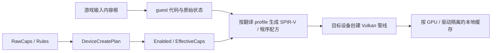

# Android GPU 兼容性与优化说明

版本：v1.1，2026-10-22。主文档：[Android 端实施方案](implementation-plan.md)。本文件作为按需查阅的源码/规范依据；实施必需的 GPU 优化与调度扩展点统一在主方案 §7.5 维护。

## 1. 分析范围与证据基线

本文分析高通、联发科、玄戒、海思等 ARM64 设备上运行 Switch 1 游戏的共用技术路径、差异、风险与验证要求，为多人实现提供同一份事实依据。

- 当前分支 `android/bootstrap` 的代码基线为 `ec14eaa4`，已合入远端 `main@f0a0621b`，两者代码文件树一致。初次分析基线为 `00b380c3/main@273ddde9`；随后两项更新仅影响自动正式局脚本与用例，不改变本文的 Android/GPU 源码判断。
- 早期 `android/bootstrap@1b4b50d8` 的 Android README 已落后，不能继续据此判断主线只有 Surface 探针。本文以合并后的代码为准。
- `origin/ohos/harmony-port@73b0cee6` 只用于对照核查 Maleoon 与鸿蒙接缝；其补丁未因本次合入 main 自动进入当前分支，也没有在本轮完成设备复验。
- 本轮完成源码、文档与官方资料核查，没有执行游戏出包、Android 真机运行或功耗测试。README 中的历史真机结果是已有项目记录，不是本轮新测结果。
- 本机没有仓外正式记分板、游戏素材和原始真机局，本文不填写游戏兼容率、达成帧率或功耗百分比。

本文服从既有[多终端架构](../../docs/架构_多终端.md)、[原生层接口](../../docs/接口_原生层.md)及[贡献指南](../../docs/贡献指南.md)。新增 API、schema、工作包均为待实现约定；源码中已有符号会明确标出，避免把规划误当实现。

## 2. 六项目标需要怎样验证

| 编号 | 产品目标 | 可验证命题 | 当前边界 |
|---|---|---|---|
| R1 | 通用 Switch 1 游戏 | 共用执行与服务语义；现有九款及未接触游戏，按相同规则验证真实局内场景 | 架构支持推广不等于所有游戏兼容；ARM32 游戏/模块不属于当前 ARM64 直接执行路径，须独立报告不支持 |
| R2 | 大型游戏导入到出包 <15 分钟，动森 5–8 分钟 | 指定硬件、输入版本、工具缓存状态和输出范围的分段墙钟记录 | Android shaderpack、APK 游戏打包尚需实施；若宣传包含装机可玩，设备准备时间也必须计入 |
| R3 | 无 AI 一键出包 | 确定性 CLI/API 管线可独立完成，前端只调用同一任务接口 | iOS 有 `tools/oneshot.sh`；Android 的游戏导入、准备与前端工作流尚未闭环 |
| R4 | iPhone 17 Pro Max 平均能耗 <3.5 W | 有效游戏负载窗口下的整机功率及采集方法 | 旧 iOS 记分板阈值为 ≤3.7 W，不能作为 <3.5 W 达标证据；Android 另按设备和测量条件验证 |
| R5 | 原生 60 帧运行 | 原生 60 帧场景测持续新帧率与实际显示帧时 | 原生 30 帧游戏单独记录，不计入 60 帧达标样本；刷新率与清屏测试帧率不代表游戏帧率 |
| R6 | 自适配全画幅 | 比例、视野、UI、裁剪、输入映射及截图同时正确 | 已有按构建号/档位验证的宽屏表；固定 16:9 图片/视频保留原比例。全屏窗口、Hor+ 视野、原生像素分辨率是不同指标 |

“所有 GPU 均可初始化”“游戏能玩”“画面正确”“达到原生帧率”“达到功耗目标”是独立结论，不能由其中一项推导其余项。

## 3. 芯片品牌、GPU、驱动与 OS 的关系

渲染兼容键至少包含 GPU、驱动、API 能力和系统适配。CPU 指令集、运行时 ABI、宿主页大小负责原生执行能否成立，单独检查。

| 设备线 | GPU 分组方式 | 可共用部分 | 不能直接继承的结论 |
|---|---|---|---|
| 高通骁龙 | 具体 Adreno 代际、专有驱动/其他驱动身份 | GAL、Vulkan 正确性路径、标准 SPIR-V 翻译 | 两台 Adreno 设备通过不能代表所有 Adreno；同 GPU 换驱动也要验证 |
| 联发科 | 按实际 Mali/Immortalis 型号与驱动；不由 SoC 商标硬编码 | Arm GPU 通用策略、格式与同步的标准回退 | 厂商版驱动、核心配置、内存与散热不同，不能按名称复用性能参数 |
| 玄戒 | 以实际 GPU 为准；玄戒 O1 是 Immortalis-G925 | 可与同族 Arm GPU 共享规则与实现 | 相同 IP 不证明设备管线缓存、驱动缺陷或功耗一致 |
| 海思麒麟 | 区分具体 GPU、实际 driver 与系统运行环境；Maleoon 独立识别 | Vulkan 后端与有证据的通用回退 | 华为手机不等于 Android APK 环境；鸿蒙窗口、运行时与打包由 OHOS 适配负责 |
| 未登记 GPU | 查询到的实际能力 | 满足基线时运行共用正确性路径 | 不默认按 Adreno/Mali 分类，不冒充通过认证 |

小米官方资料确认玄戒 O1 使用 16 核 Immortalis-G925，联发科官方资料也列出天玑 9400 的 Immortalis-G925。因此按四家 SoC 复制四套渲染器会重复实现同族 GPU 路径。[S1]、[S2]

硬件身份以 Vulkan `vendorID/deviceID`、`driverID`、原始 `driverVersion`、UUID 及能力为主；设备名只用于日志和有证据的辅助匹配。驱动版本编码不保证符合 Vulkan API 版本编码，未知编码必须保留原值，不能强行按 major/minor 比较。[S3]

## 4. 合并 main 后已经具备什么

| 部件 | 已有实现/记录 | 尚未证明的部分 |
|---|---|---|
| Android 外壳 | `android` 的 Activity、JNI、Surface、手柄快照、内存与 TSD 探针 | 完整游戏装载、触屏与导入工作流 |
| 原生改写 | Android TSD 目标、缓存目标区分、合成模块两线程执行自测 | Linux 栈下暂存风险根治、全模块和完整游戏执行闭环 |
| C# 运行时 | NativeAOT bionic、OpenSSL、静态单库 DirectPInvoke、异常/GC 的历史真机自测 | 正式原生核心替换 `s2a_native_stub.c`，所有宿主导出接通 |
| 声音 | Ryujinx AAudio 驱动与 C 实时回调，事件唤醒喂数 | 游戏持续负载下与渲染/GC/生命周期联调 |
| Android 测试呈现 | `runtime/presenter.cpp` 的清屏和角标、交换链、旋转、前后台记录 | 这是独立测试 device，不是 Ryujinx 的游戏帧输出；历史测量两台均为 Adreno |
| Vulkan 后端 | 仓内 Ryujinx 的 GAL 实现、格式与扩展探测、资源与同步 | Android 正式组合入口、统一能力启用、动态 surface 与设备缓存 |
| 宽屏 | GAL 包装、投影/布局改写、按构建号的验证表 | 不同 GPU profile 下重新验证；固定画布页的内容不会凭空变宽 |
| 测试设施 | GAL/IPC 录放、Windows 真值、路线、记分板、分配与读回闸门 | Android 严格数据契约、各 GPU 实机采集和能力兼容的回放 |

`android/README.md` 的概述与接入清单已按现有探针进展修正。后续实施状态以对应代码、章节和证据提交判断，`No renderer factory` 等历史注释也不代替实际组合入口核查。

## 5. 代码风险与优先级

下表引用合并基线中的符号/路径。P0 是正式游戏闭环或协作接口的前置条件；P1 是兼容认证前必须补齐的正确性与诊断；P2 是有基线后再做的性能与覆盖优化。静态风险不等于已经在每家驱动上复现故障。

| 编号/级别 | 证据 | 技术判断与影响 |
|---|---|---|
| A01 / P0 | `VulkanInitialization.CreateDevice` 与 `VulkanRenderer.GetCapabilities` | queried、enabled、向翻译器公开的能力不是同一来源；例如 raw ShaderOutputLayer/ViewportIndex、ShaderInt8 可被报告，但创建结构未统一启用。先收敛能力链，避免生成 device 未启用的 SPIR-V |
| A02 / P0 | `android/native/presenter.cpp`、`VulkanRenderer.SetupContext` | 测试 Presenter 与 Ryujinx 各自创建 device/swapchain，不能直接拼接。游戏模式需要唯一 Vulkan 所有者 |
| A03 / P0 | `runtime/rewriter/patch_nso.py`、Android `guest_signal.c`、架构 §4 | Linux AArch64 没有 Apple 栈下红区；补丁块仍可借用 `sp` 以下字节。Bionic 保留信号不能全部屏蔽，备用栈方案不构成完整保护 |
| A04 / P0 | `graphics/track/track.c`、`runtime/src/touch.c`、`s2a_native_stub.c` | 写跟踪仍含 Mach/宿主现场依赖；核心仍用占位导出。必须接真实平台接口、异常链与核心，再判游戏兼容 |
| A05 / P0 | `ShaderCollection.GetBinary` 返回 null；`VulkanRenderer.LoadProgramBinary` 抛未实现 | Android 没有可直接继承的完整 Vulkan 程序包读写。离线 SPIR-V、元数据、复合程序和运行时加载须成对实现 |
| A06 / P1 | `VulkanInitialization` 的版本常量、列举与实际选择入口 | instance 请求 1.2，列举入口要求 instance 1.2，device 列举要求 1.1；实际选择只查扩展/queue。不能据此简化成“物理 GPU 一律要求 1.2”，问题是 loader/instance/device/feature 链缺少一致协商 |
| A07 / P1 | `Window.CreateSwapchain` | 固定申请 ColorAttachment、TransferDst、Storage，需按 surface 用途及格式合法性选择路径；不支持 storage 时走中间图像+合法最终合成 |
| A08 / P1 | `Window` readonly surface、present 返回值、按 frameIndex 使用 render-finished semaphore、WaitIdle 后销毁；Android Presenter fence/idle waits | 缺少 surface 换代/安全退休闭环。present semaphore 按 acquired image 管理；submit fence/WaitIdle 不能单独证明呈现资源退休。回调超时不能返回后继续访问旧窗口，策略与受限路径按主方案 §7.3 实施。[S18]、[S19]、[S20] |
| A09 / P1 | `FormatCapabilities.ConvertToVkFormat`、`TextureStorage` | 低层部分格式不支持仅报错仍继续返回；需要精确 type/usage/flags/sample 组合的拒绝或回退。现有 ASTC/ETC2/BCn 上层 CPU 解码应复用 |
| A10 / P1 | `CreateDevice` 仅 NVIDIA 开 core robustness、robustness2 仅启用 NullDescriptor | 越界、空描述符与精确 guest 语义需分别处理；core robustness 不等于严格零读/丢写，也不能修复所有 image/descriptor/地址问题 |
| A11 / P1 | `BarrierBatch` TBDR attachment feedback 的 TODO 与清除 barrier 分支 | feedback loop 必须有合法扩展/依赖或拆 pass/复制回退，不能以少切遍为理由吞同步 |
| A12 / P1 | `HostMemoryAllocator.TryImport` | 当前按 SystemPageSize 对齐，需同时满足 `minImportedHostPointerAlignment` 与 memory requirements；扩大范围不能越出自有映射，失败须回 staging |
| A13 / P1 | `PipelineBase` 创建空 VkPipelineCache，未见持久化读写 | pipeline object、SPIR-V、driver cache 是三层；需要按兼容键持久化与损坏回退，不能用一个计数表示所有编译 |
| A14 / P1 | `ShaderBake` 固定 NxCaps；`shader_pack.sh` 只支持 ios/macos | 当前 shaderpack 的翻译结果带 Apple 能力假设，不是现成的跨 GPU Android 包 |
| A15 / P1 | `GalRecReplayer.CheckCompatible` | 录像带录制能力与已特化 SPIR-V，要求能力兼容是必要保护；现有 Apple 录像不能直接作为跨 GPU 统一输入 |
| A16 / P1 | `shader_pack.sh input_fp` | 文件名/长度与 main 内容不能捕获其他文件同长度变更；新导入需要所有输入的内容根，缓存一致性不能只靠 mtime/长度 |
| A17 / P1 | `zero_gate.py`、`score_cells.py`、`stage_shaders.sh` | 旧流程允许部分包、某些缺测计数继续；Android 新认证必须必需字段齐全、partial/gap 显式处理，不把缺失补 0 |
| A18 / P2 | `VulkanRenderer.IsTBDR`、固定 Constants、厂商判断 | 分类与资源上限尚粗；未知驱动保守处理。上限不足要做正确资源重排或拒绝，不可直接取 min 丢绑定 |

版本兼容不能只把常量改为 1.1：某些 1.1 功能的聚合查询结构实际由更高 API 提供，须按 core/extension 合法链查询和启用。功能、格式还存在不同的启用规则，不能机械把所有 raw bits 打开。[S4]

## 6. 哪些代码共用，哪些需要专属实现

| 层次 | 共用内容 | 允许的差异 |
|---|---|---|
| Switch 语义 | HLE、GPU 寄存器与命令、句柄、纹理布局、guest shader、正确性规则 | 按 guest 请求与格式选择算法，不写厂商或游戏名分支 |
| GAL 与共用变换 | 宽屏、录制、线程队列、逻辑帧统计 | 能力决定已实现的变换；宽屏表是带证据的产物，不塞入 GPU 厂商规则 |
| Vulkan 后端 | 资源、descriptor、pipeline、同步、格式回退、cache | GPU/驱动规则和有证据的策略参数；仍是一份 Vulkan 实现 |
| Linux 平台 | 虚存、时钟、AArch64 现场、同步基本实现 | Bionic 与 musl 的线程槽、信号保留行为由平台覆盖 |
| Android/OHOS 外壳 | 版本化事件与句柄协议 | JNI/ArkTS、窗口与 surface 扩展、输入、音频、包格式各自实现 |
| 工具 | 提取、内容寻址、profile 注入、统计、任务状态 | Metal 与 Vulkan 的目标产物阶段不同；最终驱动二进制不跨端混用 |

不建立四套后端，不另造一份 Switch 系统服务，不在核心广撒 `#ifdef Android`。新增共用 Vulkan 外壳直接使用既有架构的目标目录 `graphics/vulkan`；Ryujinx 实现仍保留在 `compat/tree` 并记录最小补丁。

## 7. 移动 GPU 最重要的差异

### 7.1 能力、限额和 shader 语义

geometry、tessellation、transform feedback、logic op、advanced blend、非均匀索引、subgroup、浮点控制、storage format 等均不能由“支持 Vulkan”推导。能力与主方案一致，记录 Native / Emulated / Unsupported / Unknown；未验证的能力不能当作可用或已证明不支持。必须同时核对每 stage 与总 descriptor 限额、绑定布局、共享内存和图像组合。[S3]、[S4]

Switch 的线程组/warp 行为不能假定等于宿主 subgroup 宽度；现有翻译和转计算机制需逐条盘点。没有原生功能时优先复用已存在的转换；尚无转换的语义不能用常量 0 或跳过 draw 假装成功。编译失败的 shader 保存最小可复现输入及 profile。

### 7.2 纹理格式与内存成本

`TextureCompatibility` 和 `Texture.ConvertToHostCompatibleFormat` 已有 ASTC、ETC2、BCn 解码。真正风险是目标用途是否合法，以及解码、上传和内存成本。格式的 sampled 支持不代表 attachment、storage、3D、view reinterpret 或 MSAA 组合都支持。

同尺寸 BC1 解为 RGBA8，基础数据约扩大 8 倍；BC3/BC7 约 4 倍；完整 mip 链另约增加 1/3。guest 压缩数据、解码临时数据、host 图像和上传缓冲可能同时存在。不能预先把所有纹理展开后仍假定 15 分钟、原包体和原峰值内存不变。

离线转码只处理可可靠识别、只读且采样语义可保持的资源。重新压缩 ASTC 等属于有损优化，需要色彩空间、alpha、法线、mip 与画面对拍；渲染目标、运行时写入、别名和读回保留通用正确路径。AFBC/UBWC 等驱动内部图像压缩不作为应用自行写入的文件格式。

### 7.3 分块渲染与同步

减少附件出入内存、精确 load/store、少切 pass 是可共用的优化方向，但不能假设所有 tile GPU 行为相同。保留资源读写和范围依赖，禁止随意重排透明绘制、查询、存储写、读回或同步点；只有证明依赖允许才移动命令。Arm 的同步建议也按具体架构范围解释，不能套到所有代际。[S5]

已有[帧级调度设计](../../docs/设计_帧级调度.md)中的“真实依赖优先”可作为统一原则；Metal 的编码器/临时缓冲实现不能直接搬成 Vulkan 实现。跨后端共享语义、测试和指标，后端分别落合法 API。

### 7.4 共用物理内存与零复制

ARM SoC 的 CPU/GPU 共用物理内存，不保证任意游戏指针都能直接绑定成 Vulkan buffer。宿主导入、AHardwareBuffer/OHNativeBuffer、普通 host-visible buffer 是不同机制；外部图像通常适用于视频/系统缓冲，也不能直接替代所有 guest 纹理。

基线保留 staging、flush/invalidate 和明确 fences；导入是经能力与对齐验证后的可选优化。需要统计复制字节、等待、脏区和峰值，不以“统一内存”取消同步。外部指针对齐以规范和实际查询为准。[S6]

### 7.5 呈现、宽屏与功耗

guest render size、逻辑显示尺寸、Android surface 尺寸和 swapchain 自然朝向要分开。预旋转放在最后的合成层，复用一个正反坐标变换处理画面、截图、触屏；不要求每个游戏自行修改相机才能正确横屏。[S7]

游戏节拍来自 guest 请求，显示刷新率只影响呈现调度。先实现明确的 FIFO/在途帧上限，再接帧节拍接口；若使用 Swappy，其 queuePresent 与销毁路径纳入同一个所有者。游戏原生帧率是源，不开启自动把游戏改成其他目标帧率的策略。[S8]

Android 功耗不能直接继承 iPhone 数值。须固定负载、亮度、刷新率、温度和采集方法；短时高帧率与持续热稳定性能分别测。后台不能只停屏幕提交而让游戏继续满负载。

实际显示时间与 guest 产帧、提交、present 调用分别记录；`vkQueuePresentKHR` 返回不等于上屏，没有 display timing 或可靠系统测量时显示慢帧记未测。低功耗通过同时要求同窗口帧率通过。[S21]、[S22]

## 8. 原生执行跨 CPU 的前置条件

1. 先验证 AArch64、Bionic/musl ABI、guest 指令需求与宿主 HWCAP。NEON/可选扩展、计数器、TLS、保留寄存器、cache 指令逐项确认；不按 SoC 商标假定指令全集一致。
2. Linux 目标改写块不借用 `sp` 下方红区；处理被搬移指令对 SP 的引用，增加改写 ABI 版本并拒载旧产物。Apple 默认产物按原门禁逐字节不变。
3. 区分 guest/GPU 页粒度、改写文件固定对齐、宿主 4/16 KB 页。只有宿主映射/保护/guard 使用动态页长，不能把所有 `0x4000` 机械替换。
4. 写跟踪同时覆盖 4 KB 和 16 KB；当前 `t_track` 非 16 KB 跳过的结果不能当 Android 验收通过。官方已要求原生库正确处理实际页大小，ELF/APK 对齐与运行时语义都要测。[S9]
5. ART、.NET、crash、写跟踪共享信号链：按 guest 线程、PC、地址与 fault 类型辨认归属；未知异常交还原处理器。signal handler 不进入 C#，需要 GPU 回写时使用正常线程 trampoline。
6. 静态 NativeAOT 链接与宿主函数表代替不可靠的主程序导出搜索；链接真实核心后检查没有占位实现。
7. 全部 guest 可见 NSO/NRO、TLS、栈与共享区受声明的地址宽度约束；自测模块的任意地址 `mmap(NULL)` 不能直接用于正式加载。每个 guest 线程均完成真实 key stamping、备用栈/现场和双栈登记，不只准备主线程。

## 9. 离线编译、缓存与首局目标的边界

SPIR-V 是可分发的中间码，Android 允许预先编入应用；它不是所有 GPU 的最终机器码。Vulkan pipeline cache 的兼容信息包含 vendor/device 与 UUID，应用还需绑定驱动和自身缓存版本。[S10]、[S11]

现有 shaderpack 固定 Apple 能力；Vulkan 的 `GetBinary/LoadProgramBinary` 尚未实现。新包至少分为 guest 原始资产、按明确 profile 的 SPIR-V/元数据、设备本地 pipeline cache 三层。同 profile 才可共享翻译结果；性能参数不应无故把缓存按每台手机切碎。

静态提取也有明确范围：目前调用只主动传 `exefs/main`；提取器存在 `--miss`；翻译器注释允许漏组合/猜错类型后运行时重翻；`known_gap` 不总导致工具失败。其他 NSO、NRO、补丁/DLC、未知容器与运行时修改 shader 均应进覆盖报告；“运行时生成 shader”是理论边界，本轮未证明具体测试游戏使用了它。

首局必须分开记录 guest→SPIR-V 翻译、pipeline 对象创建、驱动编译/阻塞。命中驱动 cache 后仍可能调用 vkCreatePipelines，不能把 API 调用次数直接等同编译次数；没有扩展或工具可测时，驱动编译计为 unknown，不补零。

导入、通用包生成、设备准备、首个可操作画面分别计时。可在准备阶段预热已知 pipeline，但若产品承诺导入到可玩 <15 分钟，该准备时间仍属总预算；不得通过改计时起点制造达标。

## 10. 跨 GPU 测试资产的可移植性

现有 `GalRecReplayer.CheckCompatible` 要求 GAL 签名和能力表匹配，仅有明确的共享内存上限例外。录像内已包含能力特化后的程序与转换结果，不能删检查后直接把 Apple 录像当作四家 GPU 的统一真值。

第一阶段建立显式保守 profile 的微型 GAL 用例；第二阶段提供按同一 profile 录制的游戏资产，或在更上游记录 guest shader 和原始状态、在目标设备重新翻译。设备能力无法满足 profile 时明确不支持，而非强行回放。

像素判据按用途分层：整数/拷贝/明确格式用精确值，浮点按手算用例与格式容差，完整游戏按稳定截图/结构与人工确认。Metal↔MoltenVK 的历史容差不能不经验证成为所有移动 GPU 的统一误差界限。跨设备 Vulkan API trace 同样不天然可移植；官方工具文档也明确提示 OS、芯片、驱动差异。[S12]

## 11. 专属优化应如何进入共用架构

- **Adreno**：保留上游已有专有驱动修正，后续以具体驱动/代际细化；有测量后再使用 QCOM 扩展、tile 内存或特殊 shader 调优，不作为共用基线依赖。工具参考高通官方指南。[S13]
- **Mali/Immortalis**：优先查 attachment 带宽、pass 边界、精确 barrier、几何中间输出和 shader 寄存器压力；通过同一策略点服务联发科与玄戒，分别采集驱动和热条件。
- **Maleoon**：先完成 descriptor/OOB/格式/WSI 微用例。鸿蒙实验中的强制 robust、dummy descriptor、identity 旋转是候选证据，需要绑定驱动范围后再合入；不能把实验字符串判断直接升为所有海思规则。华为 XEngine 属可选后续能力，不能替代标准正确性路径。[S14]
- **未知设备**：已知能力满足基线时运行保守路径，保留诊断；“未认证”与“已知不支持”分别显示。不开未知扩展，不推测某厂商内部实现。

厂商优化改变 shader/布局/同步语义时必须影响对应兼容键；仅改缓存额度、任务并行度等性能参数只改 tuning 版本。需要不同 VkDevice 功能的变化必须重建 renderer，不能热改布尔开关。

## 12. 需要团队共同坚持的判断

通用性来自可复用的 guest 语义、能力约束和可验证回退；专属优化来自在同一后端中的有限策略点。第一款游戏和第一台设备打通之后，仍要通过不同 GPU、不同驱动、4/16 KB 页及未知游戏验证，才能扩大支持声明。完整实施顺序、接口、依赖与退出条件见配套[实施方案](implementation-plan.md)。

## 13. 官方资料

以下资料于 2026-10-22 核查；作为 API/架构依据，不代表项目已在相应设备通过。项目具体事实优先以本轮代码基线和可追溯测试结果为准。

- [S1 小米官方玄戒 O1 GPU 资料](https://ir.mi.com/static-files/5aeb45ab-13ba-49aa-b57d-850b73472b58)
- [S2 联发科天玑 9400](https://www.mediatek.com/products/smartphones/mediatek-dimensity-9400)
- [S3 Vulkan 设备属性与身份](https://docs.vulkan.org/spec/latest/chapters/devsandqueues.html)
- [S4 Vulkan features 启用与规范例外](https://docs.vulkan.org/refpages/latest/refpages/source/VkPhysicalDeviceFeatures.html)
- [S5 Arm Mali 同步与硬件映射](https://developer.arm.com/community/arm-community-blogs/b/mobile-graphics-and-gaming-blog/posts/vulkan-synchronization-how-pipeline-barriers-map-to-mali-gpu-hardware)
- [S6 Vulkan 外部宿主指针对齐](https://docs.vulkan.org/refpages/latest/refpages/source/VkImportMemoryHostPointerInfoEXT.html)
- [S7 Android Vulkan 预旋转](https://developer.android.com/games/optimize/vulkan-prerotation)
- [S8 Android Vulkan Frame Pacing 接口](https://developer.android.com/games/sdk/frame-pacing/vulkan/add-functions)
- [S9 Android 16 KB 页支持](https://developer.android.com/guide/practices/page-sizes)
- [S10 Android SPIR-V 编译](https://developer.android.com/ndk/guides/graphics/shader-compilers)
- [S11 Vulkan pipeline cache](https://docs.vulkan.org/spec/latest/chapters/pipelines.html)
- [S12 Android Vulkan 调试/回放工具](https://developer.android.com/games/develop/vulkan/tools-and-advanced-features)
- [S13 Qualcomm Game Developer Guide](https://docs.qualcomm.com/bundle/publicresource/topics/80-78185-2/?product=1601111740035277)
- [S14 华为 XEngine/Maleoon 官方介绍](https://developer.huawei.com/consumer/en/doc/harmonyos-guides/xengine-kit-introduction)
- [S15 Android Vulkan Profiles](https://developer.android.com/ndk/guides/graphics/android-vulkan-profile)
- [S16 Vulkan robustness 与 robustness2 区别](https://docs.vulkan.org/guide/latest/robustness.html)
- [S17 Vulkan 能力、格式和限制查询](https://docs.vulkan.org/guide/latest/querying_extensions_features.html)
- [S18 Android Surface 销毁回调契约](https://developer.android.com/reference/android/view/SurfaceHolder.Callback)
- [S19 Vulkan 呈现信号量复用与退出限制](https://docs.vulkan.org/guide/latest/swapchain_semaphore_reuse.html)
- [S20 Vulkan 交换链重建与退休](https://docs.vulkan.org/samples/latest/samples/api/swapchain_recreation/README.html)
- [S21 Vulkan 呈现提交 API](https://docs.vulkan.org/refpages/latest/refpages/source/vkQueuePresentKHR.html)
- [S22 Vulkan 实际呈现时间](https://docs.vulkan.org/refpages/latest/refpages/source/VkPastPresentationTimingGOOGLE.html)

[S1]: https://ir.mi.com/static-files/5aeb45ab-13ba-49aa-b57d-850b73472b58
[S2]: https://www.mediatek.com/products/smartphones/mediatek-dimensity-9400
[S3]: https://docs.vulkan.org/spec/latest/chapters/devsandqueues.html
[S4]: https://docs.vulkan.org/refpages/latest/refpages/source/VkPhysicalDeviceFeatures.html
[S5]: https://developer.arm.com/community/arm-community-blogs/b/mobile-graphics-and-gaming-blog/posts/vulkan-synchronization-how-pipeline-barriers-map-to-mali-gpu-hardware
[S6]: https://docs.vulkan.org/refpages/latest/refpages/source/VkImportMemoryHostPointerInfoEXT.html
[S7]: https://developer.android.com/games/optimize/vulkan-prerotation
[S8]: https://developer.android.com/games/sdk/frame-pacing/vulkan/add-functions
[S9]: https://developer.android.com/guide/practices/page-sizes
[S10]: https://developer.android.com/ndk/guides/graphics/shader-compilers
[S11]: https://docs.vulkan.org/spec/latest/chapters/pipelines.html
[S12]: https://developer.android.com/games/develop/vulkan/tools-and-advanced-features
[S13]: https://docs.qualcomm.com/bundle/publicresource/topics/80-78185-2/?product=1601111740035277
[S14]: https://developer.huawei.com/consumer/en/doc/harmonyos-guides/xengine-kit-introduction
[S15]: https://developer.android.com/ndk/guides/graphics/android-vulkan-profile
[S16]: https://docs.vulkan.org/guide/latest/robustness.html
[S17]: https://docs.vulkan.org/guide/latest/querying_extensions_features.html
[S18]: https://developer.android.com/reference/android/view/SurfaceHolder.Callback
[S19]: https://docs.vulkan.org/guide/latest/swapchain_semaphore_reuse.html
[S20]: https://docs.vulkan.org/samples/latest/samples/api/swapchain_recreation/README.html
[S21]: https://docs.vulkan.org/refpages/latest/refpages/source/vkQueuePresentKHR.html
[S22]: https://docs.vulkan.org/refpages/latest/refpages/source/VkPastPresentationTimingGOOGLE.html
