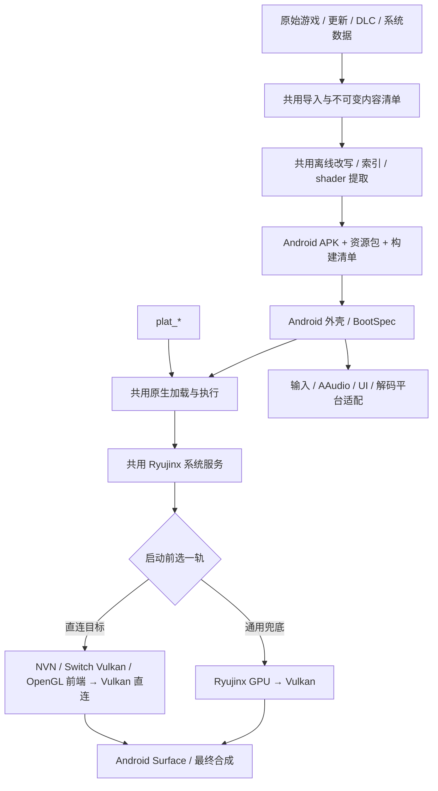

# Android 端实施方案

版本：v1.1，2026-10-22（2.1 状态更新 2026-10-23；快速通用模式流程修订 2026-10-25）。性质：遵循多终端架构的 Android 实施设计；新增契约的实现状态以代码与 [CHANGELOG.md](CHANGELOG.md) 证据为准，不因写入方案视为完成。图形模式、着色器优先级和启动流程的现行决定见[《Android 快速通用模式：目标与实现方案》](fast-generic-v3.md)；本文件旧的 A0–A8 顺序仅保留通用轨接线与兜底工程的依赖说明。

## 1. 上位约束与阅读方式

本方案以上位文件[《架构_多终端》](../../docs/架构_多终端.md)为准，延续其“共用核心、按图形 API 分后端、按终端实现外壳”的方向。本文细化 Android 的实现接缝、依赖顺序和验证方法；文档与进度记录维护在 `android/docs/`，上位架构的调整仍由总指挥维护。

必须保持的技术边界：

1. 游戏 ARM 代码经出包改写后原生执行；Switch 系统服务、GPU 命令与硬件语义继续使用仓内锁版本 Ryujinx。
2. 共用原生核心通过 `plat_*` 接口调用平台能力；Android/OHOS 共享 Linux 基础实现，Bionic/musl、窗口、输入与音频差异由各终端适配。
3. Android/OHOS 共用一份 Vulkan 后端；iOS/macOS 使用 Metal。芯片专属策略留在共用后端的能力与驱动策略边界内。
4. 改造只落正式系统接口和共用机制；不恢复旧库的 SDK 函数拦截、游戏地址特判或成功兜底。
5. 机械目录迁移与功能修改分开，沿用上位方案的迁移顺序。新平台目录可依贡献指南提前按目标路径创建，不能复制两份核心长期并存。
6. 同一个功能只保留一个真实状态来源：启动配置、屏幕尺寸、能力表、模块清单、内容版本和缓存身份均须上下游一致。

本文应能独立指导 Android 实施：目标、接缝、GPU 优化扩展点、依赖和验收均在正文。配套[GPU 兼容性与优化说明](gpu-compatibility.md)保存详细源码风险和官方依据，按需查阅。

本方案随实施维护：技术设计调整时修订对应正文，当前事实按需更新 STATUS/统一方案验收章节；仅里程碑达成、回滚或验收结论变化时更新 [CHANGELOG.md](CHANGELOG.md)。具体规则见 §11.1，不把初版方案当作不可修改的冻结文件。

## 2. 基线、目标与支持范围

### 2.1 代码基线与现状

当前代码基线为 `main@b3e5acff`（2026-10-23；Android 开发以 `android/integration` 为统一基线）。A0–A8、AN 里程碑、真机证据和开放工作的统一视图见
[STATUS.md](STATUS.md)；本节只保留摘要，历史证据在 [CHANGELOG.md](CHANGELOG.md)。

| 项 | 状态 | 摘要 |
|---|---|---|
| A0 契约与安装 | ✅ 完成 | 四份 v1 schema、run manifest、HostApi/stop、`current.json`/revision 安装、对象库链接、每游戏 APK/apk-asset、横屏启动已进 main |
| A1 平台与改写 | 🟡 第一批完成，迁移中 | `android-sp-safe-v1` 已进 main；`plat.h` 10 个原语 + Apple/Android 实现（#52）已进 main；#54 调用点迁移还是 draft；Linux 延后 |
| A2 服务与宿主 | 🟡 外围完成，核心未接 | NativeAOT/OpenSSL/AAudio/Opus/VP8、HostApi 外壳、BootSpec 外壳已接；`s2a_native_stub.c` 仍在，真实原生核心未替换 |
| A3 Vulkan/WSI | 🟡 诊断路径完成，游戏路径未接 | 诊断 Presenter、surface 生命周期、窗口租约已真机验证；`graphics/vulkan` 共用游戏渲染未落地 |
| A4 导入/Android 包 | 🟡 安装链完成，inspect/job 未接 | 导入、每游戏 APK、安装事务、apk-asset 已完成；`sources.inspect`/`games.resolve`/`GameInputManifest`/job engine 接入未完成 |
| A5–A8 | ❌ 未开始 | 设备准备/缓存、第一款完整可玩、九款矩阵、性能优化均未开始 |

证据口径不变：合成模块映射成功、清屏达到 60/120 Hz 只是接缝证据，不等于完整游戏兼容；
真机和门禁结果见 [STATUS.md](STATUS.md) 与 CHANGELOG。

### 2.2 实施目标

Android 通用版以用户给定的以下六项特性为对齐目标，使用一套共用实现和确定性出包流程推进。这里记录产品要求；当前 Android 达成情况须由 §9 的证据验收，不能直接沿用其他终端的结论。

| 编号 | 实施目标（产品要求） |
|---|---|
| G1 通用性 | 理论上直接兼容所有 Switch 1 代游戏移植。 |
| G2 极速出包 | 大型游戏从导入到出包在 15 分钟以内，大多数游戏如动森导出在 5–8 分钟。 |
| G3 无需 AI | 前端集成后可以一键出包，不需要 AI 参与。 |
| G4 高性能 | 对齐用户给定的 iOS 参照指标：iPhone 17 Pro Max 平均能耗低于 3.5 W；Android 同时建立按设备验证的能耗与持续性能指标。 |
| G5 高帧率 | 原生 60 帧运行。 |
| G6 全画幅 | 自适配终端全屏画幅，不需逐个游戏调整。 |

G1、G6 是通用机制的最终覆盖目标：用户导入新游戏时应由共用流程自动完成，不能要求人工改地址、源码、GPU 参数或布局。已有按构建号验证的产物由流程自动选择；尚未覆盖的游戏或页面记录缺项，继续补共用能力。

### 2.3 Android 验收口径与首版范围

| 目标 | 本方案采取的技术口径 |
|---|---|
| 通用性 | 先跑通一款，再覆盖既有九款和未接触的五款；按模块、图形、音视频、交互等共用能力修复，记录明确的不支持项 |
| 极速出包 | 原始 NSP/XCI 的校验、解包、改写、shader、APK 和资源包全部进入导入到出包计时；目标 <15 分钟，动森目标 5–8 分钟，最终以指定机器实测为准 |
| 无需 AI | CLI/job engine 可独立完成；前端通过同一协议调用，无提示词决策和人工改源码步骤 |
| 性能/帧率 | 原生 CPU 执行、NativeAOT、Vulkan；原生 60 帧场景验证持续 60 帧能力。原生 30 帧游戏保留其节拍，单独记录，不计入 60 帧达标样本；调整其帧率须另有通用语义与正确性验证 |
| 能耗 | Android 按设备、亮度、刷新率、温度和采集方法出有效数据；iPhone <3.5 W 是既定参照目标，旧 ≤3.7 W 记分板不能作为达标证明 |
| 自适配画幅 | 自动取得终端画布，窗口、最终合成、输入映射与宽屏机制共用尺寸来源；验证视野、UI、裁剪均正确，用户无需逐游戏设置。固定 16:9 素材保持原比例，其黑边与未扩宽页面单列，不计为全画幅已覆盖 |

首个正式执行范围为 Android 10/API 29+、`arm64-v8a`、AArch64 guest，宿主 4 KB/16 KB 页均验。最低 Vulkan 路径按 §7 完整实现，不能只改版本常量。导入必须识别 guest ISA；AArch32、未实现的代码生成/模块行为等准确报不支持，不能宣称已兼容全部 Switch 1。若要扩大至 AArch32，另补有明确成本与验收的执行路径，继续复用服务和 GPU 层。

输出沿用现有 iOS“一款独立应用+资源包”形态：同一套 Android ARM64 运行时可构建多款游戏，各款按稳定 title ID 生成应用身份。测试用固定探针 APK 保留为独立模式。聚合游戏库式 Android 启动器不作为本轮闭环前置条件；Mac 前端可统一编排导入、出包和设备部署。

## 3. 目标执行链与目录落点



目录遵循上位方案。迁移前在现有位置改实现，迁移后一次性映射；同一功能不同时维护新旧两份。

| 现有/起步位置 | 上位方案目标位置 | 内容边界 |
|---|---|---|
| `runtime/src`、`runtime/include`、`runtime/rewriter` | `core/native`、`core/rewriter` | 模块装载、系统调用、线程、句柄、改写与 guest 语义 |
| `services` | `core/services` | Ryujinx 服务接入、宿主接口注入，不依赖 Android UI 类型 |
| `graphics/loop`、`graphics/track`、`graphics/widen` | `core/gpu/*` | 渲染循环、跟踪协议、宽屏与共用统计 |
| 新建 `graphics/vulkan` | `graphics/vulkan` | Vulkan 组合入口、设备计划/规则、WSI 协调与设备缓存；依赖 Ryujinx，不复制其 GAL 实现 |
| `compat/tree`、`compat/patches` | 不变 | 上游 Vulkan/服务实现与最小补丁；不反向依赖 Android 工程 |
| 新建 `platform/plat.h`、`platforms/linux` | 同左 | 版本化平台接口和 Linux 共用实现 |
| `android` | 不变 | Bionic、JNI、Activity、ANativeWindow、AAudio、Android 系统信息/权限/打包 |
| 现有 `pack` 公共阶段 | `pack/common` | 输入、改写、索引、资源清单和版本化快照 |
| 新建 `pack/android`；现有 `graphics/tools` 工具 | `pack/android`、`tools/shader` | Android 打包、profile shader 产物、CLI/job engine 适配 |

不以全仓搬目录代替功能进展；正式共用核心接入必须使用已经落实的 `plat_*`，不能为绕过迁移临时增加一套 Darwin 替身头。目录搬迁提交不同时改 ABI、算法或产物格式。

## 4. 先统一的接缝契约

本节为实施 API 的语义约定。列出的 `BootSpec`、状态和新方法名称是设计名，不是已经存在的导出。落代码时同时提交头文件/schema、生产者、消费者和兼容检查。

### 4.1 启动配置与宿主接口

`BootSpec v1` 在设备准备完成、guest 启动前一次性冻结，至少包含：

| 字段组 | 必需内容 |
|---|---|
| 身份 | session ID、title/application ID、guest build ID、输入内容根、artifact ID |
| 执行 | guest ISA、`target=android`、改写 ABI、全部 NSO/NRO 模块清单引用、主入口与 NPDM |
| 目录 | 只读 gameDataRoot、可持久化 user/system/save 根、可丢弃 cacheRoot；由 Android 注入绝对私有路径 |
| 用户设置 | 稳定 user ID、语言、地区、IANA 时区、掌机/主机设置、联网策略 |
| 显示/能力 | 会话逻辑屏幕配置、包内候选 profile 及选择约束、规则版本、正式/诊断模式；设备创建后的实际 profile 另存 effective_profile |
| 诊断 | 统计 schema、日志目录、测试路线/时钟/存档模式，仅测试模式可用的开关 |

`HostApi v1` 复用 `s2a_native.h` 已有原生↔C# 协议，新增能力以版本化函数表扩展：语言/时区、内存诊断、输入、显示控制、UI 请求、解码和停止通知。每张表有 `size/abi_version`，跨语言字段宽度、对齐、字符串编码、内存所有权和错误码固定；不允许异常穿越 C ABI。

共用层不猜 Android 的 `HOME/Personal/Documents`，不直接 P/Invoke CoreFoundation；正式配置不依赖可变环境变量。现有 `S2A_*` 可以作为测试入口适配到同一 BootSpec，不能继续形成第二套配置来源。

### 4.2 会话与停止

当前核心有大量静态单例，因此首版规定：**一个运行时进程的生命周期只启动一场 guest session**。第二次 Start 返回明确状态；切换游戏或完整重启由 Android 外壳确保进入新进程。`Activity.finish()` 本身不证明原生/.NET 运行时已重置。

状态为 `Created → Validating → Starting → Running → Pausing/Paused → Stopping → Stopped`，失败进入 `Failed`。JNI Start 只投递 guest 启动请求，完整启动在宿主 worker 上执行；UI 线程继续接收 Surface 回调，渲染器缺窗口时进入可唤醒的 WaitingSurface，不能在 UI 线程等待它。Android 外壳可在 guest Start 前进入 Preparing，创建窗口并准备资源；这不消耗一次 guest session，准备与启动的衔接见 §8.2。

停止先拒绝新请求，取消可取消的阻塞等待/UI，在安全点停住 guest，确认在途 svc/touch/UI 回调已退出且不会重新进入；再排空 GPU 模拟到后端的工作，停止音频/GPU 接单并退休相关资源。完成游戏已经接受的存档 Commit，保持最后提交态，关闭或丢弃未提交事务，不替游戏盲目提交。服务与客体线程完成屏障后才释放 GuestMemory/映射，最后发布结果。任何屏障超时都不能继续拆仍在使用的内存。正常退出、启动失败、设备丢失三条路径分别验收；不能用同进程再次 Start 规避清理问题。

所有停止等待带截止时间并有失败状态。GPU 驱动卡住时不能承诺某个线程可被安全强杀；进入不可恢复状态后终止本次运行时进程，保留日志，重新启动用新会话。

### 4.3 通用能力与错误

每项能力用 `Native / Emulated / Unsupported / Unknown` 表达实际状态。Unsupported 返回精确错误与缺项，Unknown 阻止相应认证。正式游戏模式下 RendererFactory、音频、必要模块或资源缺失不能静默降为桩/哑设备后显示启动成功；单元测试/诊断可显式使用桩。

错误至少含 `code、stage、session/job ID、相关模块/资源、可重试性、logRef`。正式服务保持现有“未实现报红、不给假成功”的原则。

## 5. 原生执行与 Linux 平台接入

### 5.1 平台接口落地

按上位架构 §3 抽取内存、线程槽、时钟、锁、信号现场、内存查询、代码映射和诊断接口；Apple 实现继续跑原判据。Linux 公共实现不含 JNI、ANativeWindow 或 Bionic 专有布局，Android 在平台覆盖中接 TSD、信号保留行为和系统信息。

区分三类粒度：guest/GPU 页、改写产物约定的固定对齐、宿主运行时页。宿主 reserve/map/protect/guard 使用实际页长；产物格式中的固定对齐须在 manifest 声明，不机械替换所有 `0x4000`。

### 5.2 先修 Linux 改写 ABI

`S2A_TARGET=android` 补丁块不得将存活寄存器暂存在当前 `sp` 下方。采用合法调整 SP 的保存/恢复方案时，同步修正块内原指令的 SP 寻址语义，并验证分支、异常现场、栈对齐、通用/向量寄存器和 PSTATE。若改用线程暂存区，同样证明嵌套调用和异步异常不覆盖。

新增 Android 改写 ABI 标识并进入缓存与模块清单；装载器拒绝旧的不安全产物。Apple 目标沿用原字节级对拍。备用信号栈继续保留，但不作为栈下暂存问题的完整解法。

实现状态（2026-10-22）：Android 目标 ABI 为 `android-sp-safe-v1`。`patch_nso.py` 在 `.fixups.tsv` 写 `# REWRITE_ABI`；改写后仍有 sp 下方访问时写 `android-below-sp-v1`，供装载器拒绝。合成模块的 Apple 逐字节对拍、Android 无 sp 下方访问扫描见 `tests/rewrite_target_test.sh`。

### 5.3 真正的模块启动

复用共用 loader 与 host 启动顺序，抽出 Android 可调用的启动入口；自测 `native/module.c` 不能升级名义后充当完整 loader。

1. 原生 bootstrap 先校验 artifact/输入清单、NPDM、模块 build ID/hash、改写目标与执行 ABI，识别全部主/辅助/SDK 模块；在首次启动 NativeAOT/Vulkan 前探测并持续持有低于 39-bit 限制的所需虚拟窗口。这一步不依赖尚未形成的最终 BootSpec。
2. 按 §8.2 完成窗口、profile 与设备资源准备后，冻结并校验最终 BootSpec；再按 NPDM 排堆、栈、TLS、别名及共享区，区分虚拟预留与实际提交。
3. 装入所有 NSO，完成符号/重定位、门与线程槽、数据/BSS 等静态准备；此阶段不执行 guest 构造或 SDK 代码。权限按实际代码/数据分别设置，刷新指令缓存。
4. Android 代码从合法的匿名映射装入并封为 RX；不依赖 targetSdk 限制下的 app-data 文件可执行映射，也不长期保持 RWX。
5. 构建阶段已链接真实 native 核心与 NativeAOT，启动时先执行 `S2A_Init / Application.Register / 回调登记`；通过服务就绪屏障后准备 guest 主线程，再执行 SDK 初始化、共用 loader 规定顺序的模块构造（DT_INIT 逆序）与 nnMain。检查不存在占位导出。

地址约束覆盖全部属于 guest 地址空间的指针：NSO/NRO 的 text/ro/data、guest TLS、栈和共享映射都必须落在声明的 guest 地址宽度内。`plat_code_map` 与 guest 分配使用同一受控低地址分配机制，不能沿自测的 `mmap(NULL)` 接受任意高地址；纯 host 内存/函数指针单独界定。地址窗口从 bootstrap 持续持有，含 Preparing 路径。

统一线程进入/退出契约覆盖主线程与全部 CreateThread 路径：执行首条 guest 指令前，完成真实 pthread key 分配、每线程 Bionic key sequence stamping、线程槽、备用信号栈/touch 现场预分配及 host/guest 双栈登记。svc 和可能深入 C# 的宿主回调使用宿主栈；已验证的叶子直通沿原边界保留。退出清理对应槽和现场；验收子线程首次 svc、异步信号与嵌套 host→guest→host，不能只测主线程。

先核对 guest AArch64 指令需求与宿主 HWCAP；不支持的可选指令按已定义改写/模拟路径处理，尚未实现则报告。地址映射失败给出可用窗口/大小/errno，不能无限换地址尝试或截短游戏需要的别名区。

### 5.4 写跟踪、异常与共享内存

通过 `plat_fault_*` 与统一现场 capture/restore 接入 Linux；保留 ART/.NET 的处理链。guest 代码改道必须验证线程、guest PC、地址与 fault 类别；host/native/C# 访问受跟踪 guest 页的缺页另走本模块拥有的信号安全基础路径，不能一概要求 fault PC 在 guest。无法判定由本模块拥有的异常链到原处理器。

signal handler 内只进行异步信号安全动作，不进入 C#、分配、等待 GPU 或拿可能被打断线程持有的锁。GPU 修改页的读回经正常上下文 trampoline 完成；内存保护与缓存可见性按共用跟踪协议保持。

4 KB 与 16 KB 设备都运行保护、并发脏页、别名、GPU 回写、页重保护测试。现有非 16 KB 页跳过的 `t_track` 必须变成 Android 真跑用例，跳过不计为通过。

### 5.5 NRO 动态模块

`ldr:ro` 解析存在不等于原生装载已完成。NRO 必须核对授权/原始 hash，查找同内容对应的预改写产物，走原生映射、改写补丁绑定和权限通道，并在卸载时清掉门、跟踪和缓存引用。保持 ro 服务与 guest 动态链接器的职责分界，不无条件套 NSO 的宿主符号重定位或构造流程，避免重复执行 guest 动态重定位/构造。未知 NRO 不执行原始 text，准确报出缺产物。

导入时能识别的 NRO 一并进入模块清单和离线改写；无法静态枚举的模块记录覆盖边界。Android 未来若支持按需改写，也必须调用同一确定性改写器并保持 ABI/权限校验，不能另外加入游戏专用装载方式。

## 6. 系统服务、音视频、输入与持久化

### 6.1 服务组合

`services` 保留系统语义，平台通过组合入口注入 RendererFactory、AudioFactory、HostUI、DecoderFactory、语言/时区和诊断。工程引用把 Apple 后端默认依赖移到 Apple 组合层；Android 不通过“IsLinux 就返回成功”绕过服务。

NativeAOT 路径禁用依赖运行时动态代码生成的 MacroJit，继续复用按宏内容命中的离线表与解释器回退。解释器命中率和开销单列统计，不能另建按游戏名挑宏的表。

修正 `SystemLocale.Preferred()` 的 CoreFoundation 默认路径；Android 用系统首选 BCP 47 语言和 IANA 时区注入，共用层仅做语言枚举映射。系统字体、时区和其他内容按显式 system-data lock 供给，不依赖 `/usr/share/zoneinfo` 在手机存在。

账号与存档用户保持稳定，账号存在性与服务返回一致。初期可明确只提供一个本地用户和一个手柄，但不能以自动选用户/自动输入文本代替正式交互。

### 6.2 音频

复用已合入 AAudio 后端，实时回调继续只读 C 环形缓冲；托管线程按事件喂数。补齐 NDK 目标的 libopus、libvpx 等实际链接依赖；`s2a_opus` 缺库不能被短音成功掩盖。

验收 audren 与 audioout、PCM/Opus、持续播放、欠载恢复、焦点丢失、耳机/蓝牙切换、设备断开、暂停/恢复和停止。游戏时钟、音频累计帧数与视频呈现使用明确时基；不借加快/减慢 guest 时间掩盖不同步。发生静音、xrun 或丢缓冲须有计数。

### 6.3 视频

当前 Android 不会自动获得 Apple VideoToolbox；现有分支会走 FFmpeg 路径，而 Android 构建尚未打包完整所需解码库。先落可重复、可验证的软件解码基线：固定版本与 ABI，打包所需库，提供支持 codec/像素格式/参考帧行为清单，以测试向量和游戏过场验证。

通过 DecoderFactory 隔离宿主实现；MediaCodec 作为后续可选优化。Switch Nvdec 的提交/参考帧/同步语义与系统解码 API 未必一一对应，必须证明等价后启用，失败回已验证的软件路径。AHardwareBuffer 共享视频输出也只在格式和同步合法时启用。

### 6.4 输入与 Applets

先将现有 Android 手柄快照通过明确函数指针接到 InputPump/Npad；不依赖 `GetMainProgramHandle()` 搜索 App .so 导出。补触屏虚拟手柄，确认多点、按住/松开、方向/摇杆、失焦清零、设备插拔和反向横屏坐标。

Switch 原生触摸、多手柄、体感、震动分别报告能力；虚拟按键不能自动证明原生触摸服务完成。

键盘、消息框、错误对话框等通过 `sessionId/requestId` 异步主线程 UI 桥：请求 → 显示 → 应答/取消。UI 线程不等待游戏线程；游戏等待支持停止/Activity 销毁取消，迟到应答不作用到新会话。移除正式路径中自动输入 `Player/0` 的替代行为。amiibo、ExecuteProgram 等未实现能力保留精确缺项，不给成功结果。

### 6.5 存档、升级与目录

Android 根据私有目录注入以下逻辑区域，实际路径由平台实现统一解析：

```text
files/games/<titleId>/revisions/<contentRoot>/   已验证只读内容
files/games/<titleId>/current.json              当前激活版本
files/user/<userId>/...                        Ryujinx 用户/系统持久化根
files/user/<userId>/saves/<titleId>/            玩家存档（实际映射沿 LibHac 语义）
files/deploy/<deploymentId>/                   接收中的事务
cache/shaders/<profileHash>/                   可重建翻译缓存
cache/gpu/<driverKey>/<profileHash>/            可重建设备管线缓存
```

A0 契约用 `modules[].source` 区分模块来源：正式每游戏 APK 的预改写模块走 `apk-asset`（`apk.assetRoot` + 路径），开发/探针包走 `revision`（revision 目录下的文件）。`current.json` 只切资源 revision，不因模块来源变化。

上述 save 路径是逻辑区域，不另造与 LibHac 冲突的存档格式。测试种子与正式存档分离，首次初始化以后不重复覆盖玩家数据。升级应用保持 applicationId 和签名身份；资源切换不删除 save 根。持久性以游戏 Commit 成功为准，不能依赖 Android 一定调用 onDestroy 或退出回调。备份只在存档提交完成或会话安全停止后做一致性快照，恢复前验证身份/版本并保留原副本；磁盘满、写入中进程终止后仍须恢复最后提交态。

## 7. Vulkan 与多芯片兼容实现

### 7.1 唯一后端与能力链

Android 正式游戏模式由一个 C# 共用 Vulkan 后端实例统一拥有 instance/device 及其资源生命周期，WSI 和主呈现队列由指定后端线程操作；native 壳仅持有窗口租约、投递控制事件和执行在该线程调用的 WSI 适配。现有后台 pipeline/资源任务可依法借用同一 device，使用各自 command pool、队列外部同步与共享 cache 锁；不以“唯一所有者”禁止所有合法 worker。整机后端 Stop/销毁必须停止接单并完成所有 device 使用者的退出屏障。现有 C++ Presenter 留在互斥的 diagnostic 模式；禁止 game 与 diagnostic 同进程同时创建两套呈现链。

初始化顺序固定为：

```text
查询 loader/instance/device RawCaps
  → 匹配已知 DriverRules
  → 验证最低需求并生成 DeviceCreatePlan
  → 创建设备，得到实际 EnabledCaps
  → 生成 EffectiveCaps / TranslationProfile
  → 创建 shader/cache、资源与呈现路径
```

影响 device feature 启用的规则必须在 vkCreateDevice 之前生效。翻译器与 GAL 只读 EffectiveCaps；禁止重新查询 raw feature 后绕过 enabled 直接公开给上层。能力声明和 enable 路径建立对应检查。

API 29、Vulkan 1.1 是第一阶段兼容目标，AVP 2022 可作盘点基准而非 Switch 全能力保证。loader/instance/device 版本分别记录，只有落实相应 core/extension 查询与创建链后才声明 1.1 支持。对首次实现要求 graphics+compute+present 共用 queue family；缺此条件明确诊断，后续若做分 queue，须同时交付 ownership transfer 和同步测试。

### 7.2 功能、格式和安全回退

建立如下需求矩阵，每项以 pipeline 实际需要为准；能力未知或无已实现回退时不创建错误 pipeline。

| 需求 | 原生路径 | 共用回退/实施要求 |
|---|---|---|
| vertex/geometry 转计算、transform feedback | 对应已启用功能 | 审核现有 vertex/geometry 转计算与反馈输出接口、缓冲布局；缺语义则 Unsupported |
| tessellation | 已启用的原生曲面功能 | 当前 Vulkan 没有已证实完整的 tess→compute 回退；缺原生功能先准确报 Unsupported，完整通用替代作为 A7 的独立实现任务，不能套用现有 V/G 转换冒充完成 |
| subgroup/ballot/shuffle、浮点/整数能力 | 对应 feature、stage 与 subgroup limits | 按 guest 语义翻译或模拟，不把宿主 subgroup 宽度当 Switch warp |
| descriptor/UBO/SSBO/图像限额 | queried limits 与合法布局 | 有明确资源重排才降级；不截断绑定或把上限静默取 min |
| ASTC/ETC2/BCn | 具体格式及用途可用 | 复用已有 CPU 解码，统计扩张、解码/上传和内存；不能只凭族 feature 位判断全部用途 |
| depth/stencil、storage、3D、MSAA、view | 查询精确格式/类型/用途组合 | 明确替代格式与转换/读回规则，无合法回退就拒绝 |
| OOB 与空描述符 | core/robustness2 的实际启用能力 | 明确 guest 精确语义，必要时按 guest 边界改写和 dummy 资源；descriptor 范围保护不自动等于 guest 子区间保护，不以 clamp 到末元素替代零读/丢写语义 |
| framebuffer feedback | 合法扩展、layout 和 dependency | 拆 pass/复制等保守实现；不删除所需 barrier |
| guest 内存直接导入 | external_memory_host 与合法 memoryType/对齐 | staging/flush/invalidate 回退；导入范围不得越出自有映射 |

先保留正确、保守的同步与资源生命周期。Vulkan 的内存可见性、布局、queue 所有权和 host coherency 单独审核；TBDR 优化不能让 API 合法性变成厂商偶然行为。

### 7.3 WSI 生命周期契约

窗口身份为 `{sessionId,generation}`；每次新 surface 增 generation，同代尺寸/旋转/insets/刷新率变化增 revision。ANativeWindow 指针可能复用，不能作为身份。

| 事件 | 行为与完成条件 |
|---|---|
| Offer/Update | native 保留准确窗口引用；可合并同代最新状态；实际建立/更新在后端线程 |
| Foreground false | 停新 acquire/present，并触发 guest/音频的协调暂停；不是只停屏幕 |
| Revoke/Detach | 不可丢弃的屏障；撤销代永久失效，迟到 Update 不复活 |
| Release ACK | 该代停止 acquire/submit/present，在途窗口工作安全退休，依序释放 swapchain/surface/window 后才发成功 |
| Stop | 唤醒所有等待并阻止新提交；正常/失败路径均完成对应回执 |
| DeviceLost/DetachTimeout | 进入 Failed，不回 Running，不将超时当成功释放；无法安全撤销时由外壳执行运行时进程终止路径 |

无游戏帧时也必须处理控制事件：用现有 FIFO 的唤醒机制唤醒 GPU 循环，并给 ThreadedRenderer 后端增加非阻塞控制请求/唤醒入口。不得从 UI 调用会同步等待后端的私有 Interrupt；长 GAL 批在安全边界让出处理控制，reset 等待事件后重查序号，避免丢唤醒。

旧代 Present 命令带 generation，失效后不能触碰新代句柄；跳过呈现时仍完成该帧的 guest 释放/限流通知，避免 guest 永等。

`surfaceDestroyed` 立即投递 Revoke，在回调内等待有界安全 ACK；回调返回前应用渲染线程必须停止访问旧 Surface，持有 ANativeWindow 引用不延长该有效期。未获安全 ACK 时不得只记 Failed 后返回并留下仍在访问窗口的线程。外壳执行不依赖 GPU worker 自愿退出的既定进程终止路径；首版同进程则结束自身，结束前不再返回正常运行。该失败路径不算正常前后台恢复通过。[Android 回调契约](https://developer.android.com/reference/android/view/SurfaceHolder.Callback)

正常销毁以现有 1 秒目标做检查，但 GPU 驱动调用不保证可抢占。现有 Presenter 仍有无限 fence/idle 等待，不能继承“必定一秒完成”的声明；实现超时诊断和上述终止路径。任何成功 ACK 之后不得再访问该代窗口。

Surface Release ACK 只等待该 generation 相关的窗口工作安全退休；不因无关 shader 编译而等待整台 device。renderer/device 的完整 Stop 才等待所有后台 device 使用者，两种屏障不能混为一个全局 idle。

GPU 提交完成与呈现资源退休分别跟踪：present-wait semaphore 按实际 acquired image 索引管理，完成对应 acquire 等待后才可复用；不能沿用现有 `Window` 的 frameIndex 复用假设。启用 swapchain maintenance1 的合法路径使用 present fence；无扩展时，重建采用重获图像/延迟退休策略。硬 detach/退出无法继续 acquire 且没有独立退休依据时走运行时进程终止，记录生命周期能力受限，不能仅以 submit fence 或 `vkDeviceWaitIdle` 作为安全释放证明。A3 同时交付有/无扩展的验证结果。[同步指南](https://docs.vulkan.org/guide/latest/swapchain_semaphore_reuse.html)、[重建示例](https://docs.vulkan.org/samples/latest/samples/api/swapchain_recreation/README.html)

交换链用途查询后选合法路径；storage 不可用时用中间目标+graphics 最终合成。处理 acquire 与 present 的 OUT_OF_DATE、SUBOPTIMAL、零尺寸和 surface 丢失。自然朝向预旋转只作用最终合成，逻辑显示、截图与输入共用正逆变换。

### 7.4 屏幕尺寸与宽屏资源

首版覆盖手机/平板横屏启动，`ScreenConfig` 在会话初始化时按实际可用画布生成，统一供显示服务、改写值槽、GAL 宽屏和输入使用，不沿用 iPhone 默认宽 2346。窗口旋转/尺寸与 guest 渲染尺寸仍分开；会话中改变长宽比时先保持原 guest 画幅做正确合成，完整动态视野切换须验证 guest 显示事件、值槽、布局与资源更新后再开放，不能只重建 swapchain 就宣称动态全画幅完成。

现有 `stage_uilayout` 的产物带目标宽度，不能把一种屏幕的布局覆盖包用于所有手机。将布局变换抽成可移植纯算法，以现有工具输出逐文件对拍；目标设备准备阶段按 `gameBuild + ScreenConfig + layoutTransformVersion` 生成只读覆盖缓存，包内保留原始资源。换屏幕/回收缓存后重建，覆盖内容不直接修改源 RomFS；不支持的布局保持原样并给覆盖报告。

游戏侧宽屏点只使用与构建号/档位匹配的已验证启用表，无表则按既有机制保持原比例，不在玩家的一键导入中盲试补丁。自动闭环是研发验证工具，其耗时不能从导入总账隐去。未知游戏可以不改专用配置运行，但未扩宽的游戏/页面不得计为全画幅达标。

### 7.5 厂商优化边界

硬件身份记录实际 GPU、driver ID、原始版本、UUID 和 OS。高通 Adreno、Arm Mali/Immortalis、Maleoon 等可注册有证据的策略；联发科/玄戒按实际 GPU 复用，未知设备走满足能力的保守路径。

`DriverRules` 修已复现缺陷，`Tuning` 调性能，两者分开。规则至少有稳定 ID、匹配范围、行为、复现用例、证据、引入/移除条件；由仓内版本化表编译进入程序，第一期不引入远程下发或任意插件机制。规则只能限制/选择已有合法路径，不能强行开启不支持功能。

只改变并行度/缓存额度的 tuning 不分裂 shader profile；改变生成 shader、绑定 ABI、格式或同步语义的策略进入对应兼容键。改变 VkDevice features 的设置重建 renderer。专属优化用同设备关闭/开启 A/B 验证，再跑通用回归。

不同 GPU 的专属优化和调度直接通过以下共用边界接入；首版用版本化数据和已有实现分支，不需要另建插件体系：

| 扩展点 | 可按设备/驱动选择的内容 | 约束 |
|---|---|---|
| 设备计划/正确性规则 | feature/extension 组合、格式/上传路径、已有 shader workaround | 创建前决策；实际能力允许且有复现/回退，影响代码或 ABI 时进入兼容键 |
| 编译与资源任务调度 | shader/pipeline worker 并行度、预热批量、上传预算、缓存额度 | 共用线程/队列机制；遵守 queue、command pool、cache 的外部同步，不改 guest 命令顺序 |
| 呈现与在途预算 | 合法 present mode、在途帧上限、帧节拍与后台停工策略 | 保持依赖、guest 节拍及窗口契约；分别测延迟、慢帧、功耗，不用多排队掩盖卡顿 |
| Android 调度适配 | 可用 CPU 拓扑、系统调度能力、热状态/内存压力观测及降载建议 | Android 外壳提供能力与观测；经测试再启用亲和性/性能提示，不硬编码某品牌的核心编号 |

设备策略统一输出选择原因、rules/tuning 版本和禁用开关，未知 GPU 使用保守默认值。调度算法与同步实现在共用后端；芯片差异收敛在策略选择处，不在服务、GPU 命令语义或各游戏里复制厂商分支。

## 8. 导入、出包与前端共用任务链

### 8.1 不可变输入与内容选择

复用 `pack/nx_unpack` 的 LibHac 容器、CNMT 和更新/DLC 逻辑，新增机器可读 inspect/resolve 输出。构建任务开始前冻结基础版本、更新、DLC 与系统数据，不在任务中反复扫描可变目录后改变选择。

`GameInputManifest v1` 包含：title/application ID、base/update 的内容 ID/版本/hash、DLC 每项的数据状态、NACP/图标、所有模块的类型/build ID/hash、RomFS 内容根、system-data lock 和工具版本。密钥通过本地引用使用，密钥值不进事件、日志或导出包。

导入边读取边计算内容 hash，生成每文件清单和内容根。对不可变快照复用这些 hash；不能仅用路径/size/mtime 认定用户文件没变。Mac APFS clone 是加速实现，Linux/Windows 需要安全复制退路和磁盘预检，不把 `cp -c/libc.dylib` 变成共用格式的一部分。

注意现有链路：`seed_root` 不带完整 DLC/图标/解包清单，DLC 又由 refresh 扫源补齐。Android 新链路须一次保留完整选择与结果；用户选择的数据型 DLC 解不开不能以完整成功告终，license-only 与内容缺失分开。字体/时区阶段不等于完整 firmware 导入器，按实际需求锁定 system-data ID/版本/hash。

首版系统数据输入明确接受已提取的目录，inspect 校验所需字体/时区等条目、来源标识、版本信息与逐文件 hash 后生成 lock；无可验证版本则记录来源未知及内容 hash，不猜固件版本。复用宿主时区生成工具时同时锁定源 tzdata、生成器版本和输出 hash。原始 firmware 容器导入另列能力状态，未实现时明确拒绝该输入，不能由阶段名推断已经支持。

### 8.2 阶段图与原子发布

```text
inspect → resolve/preflight → 输入内容快照
  → 解包/更新合成/metadata/DLC → system-data lock
  → [Android 全模块改写 | 宽屏/布局分析 | 共用运行时库构建]
  → 资源最终索引 + guest shader 提取
  → 根据构建策略打包声明需求的翻译 profile 变体、SPIR-V/程序配方
  → 每游戏 APK + 资源包 + manifest → 校验 → 导出
  → 设备预检 → 资源暂存/校验 → 安装或升级 APK → artifact 核对/资源激活
  → Android 外壳 Preparing（取得实际 Surface/画布/能力）
  → 布局与设备管线准备 → ReadyToPlay → 启动 guest session
```

仅无依赖阶段并行；布局/资源变更后才生成最终索引和 shader 对应产物。Android 公共 NativeAOT/原生库按源码和工具链缓存，不每款重编整个公共运行时。任务始终引用自己的快照，发布时才原子切当前版本。

`GameBuildArtifact v1` 绑定输入内容根、目标 OS/ABI、改写 ABI、模块清单、runtime/backend 版本、APK hash/签名身份引用、资源索引/hash、shader profile、系统数据和构建报告。首版把预改写模块放 APK 的 assets/受控只读包内区，启动时按清单匿名映射；不为每家 GPU 再生成一份应用身份。

同游戏升级保留 applicationId/签名，versionCode 按 Android 升级规则单独管理，不能直接复用 guest 内容版本。升级分两段：先经兼容接收通道暂存并验证新资源，再安装新 APK，由新代码核对完整 artifact 后原子切 `current.json`。APK 安装与私有资源激活没有跨域原子事务：APK 更新后失败进入 UpgradePending，保留旧资源/存档、禁止代码资源错配启动，继续补齐或修复；不承诺 Android 允许无条件降级回旧 APK。首次安装没有接收通道时先安装，保持 Preparing 直到资源齐全。release 资源通道由应用受控接收或系统文件选择器授权导入，不能依赖 debug-only `run-as`。

设备准备先经 §5.3 的原生 bootstrap 校验输入并持有地址窗口，再准备 Activity/Surface 与本次选中的 Vulkan 后端，不执行 guest：取得 ScreenConfig、present 支持和实际 profile 后完成本模式必需的布局准备，再冻结 BootSpec 并进入 ReadyToPlay。完整管线预热不是直连启动的必需条件，缺组合按 [统一方案](fast-generic-v3.md)现场正确创建。`games.launch` 装载并启动 guest；RendererFactory 接收已准备的同一后端及其 profile，不能在 S2A_Init 中重新创建一套 Vulkan。冷启动进入新进程时先重新核对 artifact、屏幕、驱动/profile 与缓存；准备发生变化则回 Preparing，不能因上次 ready 标志直接进入 guest。窗口未就绪时报告 WaitingSurface，避免把“先 Ready 才能创建窗口”实现成循环等待。

### 8.3 shader 与设备缓存

native Vulkan 直连的源码采用、启动时序、shader 输入/现场编译、资源/WSI 所有权及 DV0–DV7 验收，详见[统一目标与实现方案](fast-generic-v3.md)、[实施契约](direct-mode-contracts.md)与[D2R 经验清单](direct-mode-d2r-study.md)。D2R 和 S2Arm 的 NVN 对象/记录不兼容，需要明确适配；这部分不能通过给 generic shader 包改标签完成。

首版直连的确定接口与边界见[实施契约v1](direct-mode-contracts.md)：services request v2为80字节、relocation前选择；shader从真实NVN driver/literal/绑定生成查询，统一四set及SupportBuffer；首版VS/FS/CS和EXT present fence设备准入，HLE视频进同native owner。出包用typed graphics requiredFeature，attempt保存在持久stateDir，C0–C7通过后才正式启用。原设计八项待定已明确，尚未实施/验证的项目不能标完成。

系统输入法通过同一 Ryujinx applet/AndroidHostUi 供两种模式共用，独立工作包 DV-UI 和请求/取消/中文组字/Unicode 验收见[系统输入法方案](system-ime-plan.md)。它与 GPU 实施并行，modal 系统键盘通过是首款直连完整闭环的前置；合并 integration 后有界 typed broker/JNI/Activity 及停止撤销已接线；实际 session 绑定、中文组字、后台竞态、inline 和 direct 验收仍待完成。

直连主流程按[《Android 快速通用模式：目标与实现方案》](fast-generic-v3.md)：结构和设备条件满足时首启直连，离线缺条目时用真实输入现场同步编译并跨局复用，直连失败下局整局通用；没有“先通用收集齐/发布 ready/提示重启切直连”的步骤。当前 Android 直连尚未联通，正式 APK 暂走通用，直连接缝与兜底安全需分别验收。通用轨的 Vulkan 程序读写、离线包、driver cache、管线配方和预热技术细节见[《Android 着色器与管线缓存实施方案》](shader-plan.md)；其 S0–S4 全部完成不是直连试点前置。

现有 Apple 烘焙器改为显式 profile 注入，保留 Apple 原 profile 与缓存兼容判据；Vulkan 必须实现程序序列化/加载，覆盖 SPIR-V、反射、specialization、布局、vertex/geometry 转计算复合程序等所需元数据，后续 tess 回退另扩 schema。不能只保存 `.spv` 后假定完整程序已可重建。

构建可以使用目标设备预检得到的 profile，也可以打包经过验证的保守 profile 及可选变体，每个变体声明 requiredCaps 与绑定 ABI。最终由设备创建后的 EffectiveCaps 选定兼容变体；未知设备不靠商标猜 profile。没有可用变体时，普通运行可用同一翻译器按实际 profile 生成并缓存，明确报告发生翻译；严格首局零翻译认证则记不通过。若该语义本身没有合法实现，返回 Unsupported，运行时翻译不代表能模拟缺失硬件语义。

requiredCaps 满足后还要锁定该变体的 TranslationProfile：GPU 层 specialization/cache 匹配、翻译与 GAL 路径使用同一有效语义。设备额外支持的原生功能不得悄悄改变转计算、属性或绑定路径；若选择另一语义路径，则换 profile 并加载/生成对应产物。

| 产物 | 可共享范围 | 键的必要内容 |
|---|---|---|
| 原始 guest shader/状态/来源 | 跨目标 GPU | 输入内容根、提取器/状态 schema、模块与资源内容 |
| SPIR-V/程序元数据 | 相同翻译 profile | translator 版本、实际影响代码的 EffectiveCaps、shader rules、安全/宽屏变换、绑定 ABI、specialization |
| pipeline 配方 | 满足其需求的 profile | shader/profile hash、layout、render-pass/attachment、固定状态、specialization |
| Vulkan driver cache | 兼容设备/驱动域 | vendor/device、driver ID/raw version、pipelineCacheUUID、API/feature/profile、backend/cache schema |
| 转码纹理 | 相同格式与语义域 | 输入内容、格式/色彩/mip/layer、转换器与质量版本 |
| Android 改写模块 | Android 执行 ABI 域，GPU 无关 | 模块内容、S2A_TARGET、改写器/改写 ABI、所有影响字节的变换版本/参数（含宽屏扫描/启用表与档位） |

profileHash 来自规范化的生成代码/执行语义字段，不 hash 整份 device report 的温度、内存余量或显示名称。切 profile 必须切缓存域并重建相应资源；设备内存压力改变不应无故导致所有 shader 重翻。

设备 cache 用 temp→校验→rename 持久化，限制体积并做可重建回收。截断/损坏/驱动更新只作 cache miss，不破坏游戏资源。VkPipelineCache 的创建/保存并发遵守 Vulkan 同步规则，不能为了后台落盘与创建管线无锁并发操作。

每次启动重新验证准备状态。系统回收 cache、驱动升级或 profile 变化后先进入 Preparing，再恢复 ReadyToPlay；持久化过的 ready 标志不能越过此检查。

静态提取覆盖 main、subsdk/sdk 等全部模块和可识别 NRO/容器，输出 extracted/unpaired/unknown-container/known-gap 等分类；不以工具退出码 0 代替无漏项。开发包可有显式回退，但带 partial/gap 的包不能授予“所测范围首局零翻译”认证。

### 8.4 一键任务接口

前端只调用一个 job engine。首版用版本化 JSON 请求与 NDJSON 事件，CLI 与 Mac 前端同用，不先引入常驻服务依赖。以下为规划命令语义：

| 操作 | 输入/输出 |
|---|---|
| sources.inspect / games.resolve | 容器引用→候选游戏与版本→冻结的输入清单；不自动选另一份同名文件 |
| jobs.create / get / events | idempotencyKey+inputManifestRef+target+buildPolicy→job ID、阶段与产物 |
| jobs.cancel / resume | 仅控制本任务；续跑只复用已校验且依赖未变的阶段 |
| artifacts.export | 已验证 artifact→指定输出；传完整构建与兼容报告 |
| devices.preflight | ABI/API/页长/内存磁盘/GPU profile/升级签名条件→缺项与准备状态 |
| deployments.create / get | artifact+device→安装、接收、激活与准备的独立进度 |
| games.launch | 已激活的 artifact→外壳核对/补齐准备→ReadyToPlay→新的 guest session；不要求此前没有 Activity/Surface |

事件字段固定为 `schema、jobId、seq、timestamp、stage、state、doneUnits/totalUnits/unit、bytesDone/bytesTotal、cacheHit、artifactRef、error/logRef`。未知总量用 null；不解析 emoji 或末行中文判断成功。状态为 queued/running/needs_input/cancelling/cancelled/succeeded/failed，事件可按 seq 续读。

构建成功、已安装、资源已激活、设备已准备、可运行是不同状态。前端完成页显示对应真实结果，不把“APK 导出”直接显示为“游戏兼容通过”。取消仅结束本任务子进程及私有临时根，不全机 kill 编译器。

## 9. 验收与观测契约

### 9.1 证据必须可追溯

Android 新增独立 `run schema v1`，必需字段缺失即未测/认证不通过，不继承旧设施的缺计数补零、跳过仍绿等宽松行为。一次运行至少包含：

| 文件/记录 | 内容 |
|---|---|
| run_manifest.json | app/backend 提交、artifact/input/module 身份、设备/OS/驱动、profile/rules/tuning、路线/时钟/存档与缓存模式 |
| device_caps.json / effective_profile.json | raw、enabled、effective、选择原因、被拒绝能力 |
| host.log / lifecycle.jsonl | 启动阶段、未实现项、停止原因、surface 代号、ACK/超时、资源存活 |
| frames.tsv | 关联 frame/present ID 的 guestProduced、submit、presentCall、actualDisplayed 时刻及来源；CPU/GPU 可测时长、GC、读回、上传/解码、内存与编译相关计数 |
| compile_events.jsonl / cache_report.json | guest 翻译、程序加载、pipeline 创建、可测的驱动编译反馈、cache miss 原因和各阶段耗时 |
| memory.tsv / power.json | guest/host/GPU/临时内存、采集范围/方法/误差/条件、有效功率窗口 |
| shots / truth.tsv / result.json | 真实检查点、画面比较、场景有效性、各能力结论和缺测原因 |

驱动无法提供精确 GPU 时间或编译反馈时标记 unknown。诊断插桩改 shader 副作用时，其画面/性能结果不能直接当无桩产品结果。

`vkQueuePresentKHR` 的调用/返回时间不等于实际显示时间。actualDisplayed 由可用的 display-timing 扩展或可信系统采集提供，记录时钟域和对应关系；没有来源则填 unknown，显示慢帧认证记未测，不能用 CPU present 调用间隔替代上屏间隔。guest 新帧率仍按独立计数报告。[呈现 API](https://docs.vulkan.org/refpages/latest/refpages/source/vkQueuePresentKHR.html)、[实际呈现时间](https://docs.vulkan.org/refpages/latest/refpages/source/VkPastPresentationTimingGOOGLE.html)

### 9.2 冷启动与出包计时

分别测工具链冷缓存、游戏输入首次导入但公共工具已就绪、应用可控的翻译/管线缓存已清三种状态。驱动内部缓存是否为空另记 empty/unknown 及证据，不能假定应用可清空它。普通卸载会同时影响存档和缓存，不用清存档模拟冷缓存。

计时拆为输入校验/解包、改写、索引与布局、shader 翻译、公共库构建、APK/资源包、验证、设备安装/传输、设备准备、到首帧/到可操作。记录实际读写字节和排队时间。若承诺导入到可玩，后四项也进总计时；已解包目录播种的旧 oneshot 不代表原始 NSP/XCI 端到端。

首局至少分别报告：guest→SPIR-V 次数、玩家操作窗口 pipeline 创建次数/阻塞、驱动编译可测反馈。cache 命中仍可能创建 pipeline 对象，不能一律要求 `vkCreatePipelines=0` 来冒充“驱动零现编”。计数缺失不能判 0。

### 9.3 测试层级与设备矩阵

| 层级 | 验收内容 |
|---|---|
| 单测/无设备 | ABI/schema/缓存键、改写语义、manifest、输入、取消/恢复、资源事务；模拟不支持能力验证选择路径 |
| 原生接缝真机 | 全模块启动、地址/页长、异步信号与寄存器、GC/ART 共存、真实服务调用 |
| GPU 微用例 | enable→shader、格式/用途、OOB/dummy、feedback/alias/读回、shader loader/cache、旋转及生命周期；开发态开启 validation/sync validation |
| 回放与真值 | 相同语义/profile 的微型 GAL；游戏回放保持兼容检查，必要时上游 guest 状态重翻；按整数/浮点/完整场景分别判 |
| 一款可玩闭环 | 操作、音频/视频、正确画面、存档提交、正常退出、重启读档、前后台恢复，未实现项为 0 |
| 通用游戏矩阵 | 动森、马车8、暗黑2、塞尔达、暗黑3、巫师3、丝之歌、怪猎、八方2；再做未为其改配置的五款盲测 |
| 设备/驱动矩阵 | Adreno 至少两代，Arm GPU 联发科与玄戒分别验证，目标海思按实际 OS/GPU 验证；覆盖 4/16 KB、不同刷新率和 unknown-device 路径 |

现有 GAL 录像已经按能力特化，不能删除 `CheckCompatible` 再宣称跨 GPU 一致。复用现有 Windows 真值/截图工具，但不将 MoltenVK 结果当作所有移动驱动的独立正确性证明。

性能有效窗口在真实局内 MARK 后连续至少 60 秒，按 guest 请求帧率测平均新帧率和显示慢帧；沿用现有 ≥目标 99%、>1.5 倍预算的慢帧 ≤1% 判据作为起点。场景未到、停帧或窗口不足时帧率/能耗不判绿。GC gen0/gen1 零回收与分配均值不是同一指标，分别列出，不能混写为每帧严格 0 字节。

每局沿既有 ≤300 秒契约；热稳定另用连续多段记录并报告会话边界，不能将重启后的短局数据冒充同一场连续长稳。需要更长单局时同笔更新测试契约、超时和设备调度，性能声明绑定实际测试范围。

功率数据必须记录整机/SoC/GPU 范围、测量方法、充电状态、亮度、刷新率、温度、采样窗口和误差。能耗达标结论必须同时满足同一有效窗口的帧率要求；降频掉帧取得的低功耗不能判为目标达成。不同采集方法不直接横排名次；无法取得可信功率则标未测。

## 10. 实施顺序与退出条件

下表记录原通用轨和 Android 基座的技术依赖及历史里程碑；它不再规定“先完成 A5/A8 通用 GPU 优化，再做直连”。快速通用模式的直连接缝、离线/首遇翻译、故障回退与验收按[统一方案的实施顺序](fast-generic-v3.md#8-实施顺序与完成标准)推进。接口先行，内核、WSI、工具可并行实现；有共同退出条件后再合成完整链。

| 步骤 | 实施内容 | 前置 | 完成条件 |
|---|---|---|---|
| A0 对齐基线 | 登记当前方案/上位架构基线与 BootSpec/HostApi/manifest/profile/run schema 版本；盘点直接 Apple 调用与未实现能力 | 已合 main | 消费者/生产者有同一契约和最小样例；没有两套同义配置；后续变更按 §11.1 维护 |
| A1 平台与改写 | `plat_*`、Linux/Bionic、SP 安全改写、实际页长、signal/写跟踪、受控低地址映射与逐线程进入/退出 | A0，目录按上位迁移 | 4/16 KB 真跑；模块/TLS 地址宽度、子线程 svc/切栈、全寄存器/异步信号用例过；Apple 默认改写对拍不退 |
| A2 服务与宿主接线 | 真实核心替换 stub，语言/路径/输入函数表，AAudio/Opus/解码/UI 注入 | A0；原生联调依赖 A1，正式启动依赖 A3 | 显式诊断模式的服务/合成 guest IPC 通过，必要资源/导出齐，无 Apple 路径调用；正式游戏启动在 A6 合验，不用隐式桩替代 A3 |
| A3 Vulkan 正确性 | 单所有者、Raw→Plan→Enabled→Effective、格式/资源限额、WSI 控制、呈现资源退休与同步回退 | A0；微用例可独立于 A1 | 能力/格式/销毁/损失微用例通过；无帧也能撤销；安全回执与终止失败路径均实测，无双 device 呈现；受限恢复路径单列 |
| A4 导入与 Android 包 | 原始包 inspect/resolve、提取目录型系统数据校验、完整内容清单、快照、每游戏 APK/资源、部署事务、job engine | A0；复用现有工具 | base/update/DLC/systemdata 不丢；取消/断线/升级不损存档；APK 更新后激活失败进入可修复状态；CLI 能独立跑 |
| A5 设备准备与缓存 | profile 注入烘焙、Vulkan 程序读写、pipeline cache、屏幕相关布局覆盖、覆盖/编译计数 | A0；联调依赖 A3/A4 | 选错 profile 被拒，坏/被回收缓存和换屏可重新准备，布局输出与共用工具一致，同长输入变更能失效，cold/warm 数据完整 |
| A6 第一款完整闭环 | A1–A5 接成实际游戏，含UI、声音视频、操作与存档 | A1–A5 | 到真实可玩场景，退出再开读档、后台恢复正确，零占位/零未实现报红 |
| A7 通用能力补齐 | NRO、Applet、复杂解码/格式、多输入；九款和盲测，多 GPU/OS组合 | A6，能力各自先有微用例 | 每项有支持/回退/不支持证据；无游戏名绕过；覆盖报告准确 |
| A8 性能与首局优化 | 减复制/分配/切遍、分阶段预编与准备、帧节拍、驱动专属 tuning | 相关正确性基线 | 同设备 A/B 有收益、画面与语义不退；出包/首局/帧时/功耗逐项目标有数据 |

Android 里程碑使用 `AN0–AN4`，不改写总方案的 `M0–M5` 含义：

- AN0：A0 完成，探针和实施状态可追溯。
- AN1：A1/A2 原生与服务启动；此时不宣称游戏完整兼容。
- AN2：A6 一款完整可玩、可保存恢复、生命周期闭环。
- AN3：A7 九款及独立能力测试，跨 GPU/OS 的支持矩阵和缺项明确。
- AN4：盲测与正式发布目标出数；原始包一键构建/设备准备、性能与画幅按声明范围通过。

优先打穿当前总方案的动森路径，缺陷落共用层；同时用独立微用例推进 NRO、Opus、视频、键盘，避免第一款恰好没用到就遗漏通用能力。

## 11. 多人协作时的技术一致性规则

1. 以本方案的契约作为实现接缝；改动已实施的字段、ABI、格式、状态机或缓存键，同一变更同步文档、生成方、消费方和兼容用例。生产者不能先改格式让其他分支猜；未实施的设计调整按 §11.1 更新设计与依赖。
2. 已有机器可读头文件/schema 是最终执行依据，文档同步；未实现的设计名不能被调用方当成已存在导出。第一批 A0 提交落真实 schema 和最小端到端样例。
3. 共用 core 不依赖 Java/JNI/ArkTS/Metal 类型；项目外壳依赖共用契约。Ryujinx 定义需要的最小通用 hook，项目在外实现，不能形成 `Ryujinx → Android 工程` 反向依赖。
4. 目录迁移、公共接口、平台实现、功能接通、性能调优分别提交；小步集成，不在同一个 PR 同时搬目录、改缓存格式和换渲染路径。
5. 修改 Ryujinx 继续使用 patches/series 和改动清单，上游+补丁=树内源码；补丁号交既有机制处理。
6. 共用改动保持 Apple 原判据：改写字节、服务回放、shader profile/缓存、画面及 iOS 编译按影响面回归。不以 Android 编过代替这些证据。
7. 新 Android/backend/平台路径同时补门禁路由与实际执行数；没有设备的 CI 结果不能输出设备认证绿。共享设备沿既有锁/调度协议使用。
8. 开发兼容包、诊断包、正式认证包清晰标记；测试 seed/自动键盘/关闭音视频/静置/缺计数不能进入正式通过结论。
9. 优化遵循既有帧级调度“依赖正确后再移动”的原则；不能因为某厂商跑通就放宽规范。每条厂商规则有复现和移除条件。
10. 状态更新同时写提交、能力/profile 和证据引用；README、方案与实际构建不同步时修正描述，不把设计目标填成已完成。

### 11.1 方案修订与进度更新

**技术设计修订正文；当前事实按需更新 STATUS/统一方案验收章节；CHANGELOG 只在里程碑达成、回滚或验收结论变化时更新。普通开发、排查、测试与文档整理不追加流水记录。**

| 发生的变化 | 必须同步维护的内容 |
|---|---|
| 技术选型、接口、流程、依赖或验收方法调整 | 修改受影响的正文章节和 A0–A8 退出条件，说明原因/证据、影响范围与当前有效方案版本 |
| 已实施的 ABI/schema/profile/cache 契约变化 | 同步生成方、消费方、兼容用例及版本，写明迁移/缓存失效/旧包处置 |
| 尚未实施的设计调整 | 更新正文与依赖即可；不要求为文档中的设计名先造占位 API，也不把设计修订记作功能完成 |
| 普通实施、集成、测试或排查进展 | 细节留提交/PR/测试报告；可依赖事实变化时更新 STATUS/统一方案验收章节，不追加 CHANGELOG |
| 里程碑达成、回滚或验收结论变化 | 在 [CHANGELOG.md](CHANGELOG.md) 合并记录该里程碑的结果、固定提交、验收和限制 |
| 发现回归、结论错误、方案与代码不一致 | 核查证据后修正当前描述；只有影响已有里程碑结论才追加 CHANGELOG 更正并引用原条目，保留历史 |

涉及实质技术方向或契约调整时递增本文版本；里程碑记录使用唯一条目 ID 标识。方案版本与运行时 ABI/schema 版本分别管理，改文档版本不代表改变 ABI。当前正文说明有效设计，[CHANGELOG.md](CHANGELOG.md) 只记里程碑变化，二者不能互相替代。

同一 PR 中同步受影响的 Android README/GPU 说明文档入口或事实说明；没有变化的文档不用改。影响上位分层、公共目录或平台职责边界的建议先记录“待上位对齐”，在总指挥更新架构前继续遵守现有架构，不由 Android 方案单方面改写总指挥文件。

本文未改应用运行逻辑、未创建上述新 API，也未对项目兼容率作新增承诺。实施首先完成 A0 的机器可读契约与 A1–A5 的关键接缝，再按 AN 里程碑扩大可运行范围。

## 12. ChangeLog：里程碑

目标与实现顺序统一见[快速通用模式方案](fast-generic-v3.md)，当前事实见 STATUS/统一方案验收章节，提交与实验细节留在 PR/测试报告。[CHANGELOG.md](CHANGELOG.md) 仅记录里程碑达成、回滚或验收结论变化，同一里程碑合并为一条。方案修订和日常工作不触发追加，具体标准见该文件维护规则。
