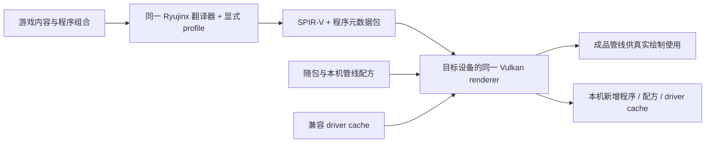

# Android 着色器与管线缓存实施方案

日期：2026-10-24；v3 流程修订：2026-10-25。范围：主方案 [§8.3](implementation-plan.md#83-shader-与设备缓存) 的 A5，以及 A8 的首帧与场景切换优化。本文是可拆分实施的设计，**不表示下列缺项已经实现，也不承诺所有游戏首次启动零编译**。

源码核对基线：S2Arm `9858d51b54316f17ab394f02690e5400e23c4165`（本地 Android 候选，含 Vulkan 1.1 路径），D2R Mobile `e3756f8942b40eba6c851e881828a5b1bda17fd6`。这里的 Android 候选不等于统一集成分支或用户 APK 的精确版本。iOS 机制按同一 S2Arm 基线核对；新增实现先复核合入时的代码。

## 1. 决策与实施边界

本文 S0–S4 记录**通用兜底轨**的离线程序包、设备管线缓存、预热和按需生成设计；其全部完成不再是首次直连的前置门槛。Android 当前产品流程及优先级以[《Android 快速通用模式：目标与实现方案》](fast-generic-v3.md)为准。

1. 先补齐 Vulkan 程序的序列化/加载，使同一路线再次启动不重复翻译已经缓存的程序；同时补驱动管线缓存的保存/恢复。
2. 再将现有 ShBake 的显式能力注入接成 Android 出包入口，产出版本化的 SPIR-V 与完整程序元数据。Mac/Linux/Windows 出包端无需目标手机的驱动编译器。
3. 最后记录并随包携带可重建的管线配方，在目标设备上提前创建管线；新场景仍允许按需创建并记录。
4. 游戏 ARM 改写后原生执行、托管服务 NativeAOT、Maxwell→SPIR-V 翻译、驱动创建 VkPipeline 是四项不同工作，分别统计。

可分发的是满足指定 profile 的程序与管线配方。`VkPipelineCache` 是兼容设备/驱动域内的不透明数据；桌面产物不能被称为通用 Android GPU 机器码包。Metal 的 metallib、基础管线快速特化、函数体动态链接不作为 Vulkan 1.1 基线依赖。[V1]、[V2]

### 1.1 v3 双轨流程：首次可用即直连

native Vulkan 直连的具体架构、D2R 采用清单、装载器重定位前冻结 mode 和逐步退出条件，见[统一目标与实现方案](fast-generic-v3.md)。本节仅保留两轨缓存隔离的概要，不另立一套实施任务。

Android 的直连目标为 NVN / Switch Vulkan / OpenGL → Vulkan，通用兜底仍为 Ryujinx GPU → Vulkan；两轨共用原生执行、系统服务、写跟踪入口及可共用的宽屏机制。启动时在构造 GPU 消费者前选定一轨，整局不切换。[统一方案](fast-generic-v3.md)定义启动、现编、故障退回和分步验收。

出包时尽量生成直连和通用两份互相隔离的图形产物；`graphicsMode + backendId + 绑定 ABI + profileHash` 区分程序、管线配方和缓存。即使都输出 SPIR-V，也不能把通用轨的程序包充当直连包。宽屏第三层共用库按实际抽取/验证状态接入。

Android 直连前端、后端和现场翻译器尚未交付时，正式包只能明确走通用；不能以没有逐款名单、shader 未收集齐为理由长期把已经具备直连能力的包留在通用轨。直连缺离线条目时用真实客体输入和状态现场生成；不能生成正确产物则报红，并使下次启动整局通用。通用轨的事实收集用于离线库回填，不向玩家显示“补齐后下次切换”。

GameBuildArtifact/BootSpec 的模式与产物 manifest 应通过两端协调的版本化契约演进，不能改冻结 v1 字段；模式在 renderer/device 和写跟踪消费者创建前冻结。一次只登记当前模式的图形消费者。当前模式、前次 attempt、回退原因和包身份应成为可诊断数据，不能靠持久 ready 布尔值跳过校验。

D0 的数据身份/事实变体契约仍有用，但只约束**具体翻译输入是否真实且足够**，不再发布逐游戏的 direct-ready 门槛。后续交付顺序为直连接缝、离线产物与运行时同步编译、跨局持久化、故障下一局兜底；通用 S0–S4 的正确性工作可并行收尾。iOS 的 Metal 函数体桩管线机制不适用于 Android Vulkan 1.1 基线，首遇缺管线要等待正确 VkPipeline 创建，不跳绘制。

### 1.2 D0 前置契约：身份映射与事实变体

通用缓存的客体记录只有代码及 Cb1，不能直接还原 NVN 对象身份。[nxsh_extract.py](../../graphics/tools/shbake/nxsh_extract.py) 的直连兼容键来自控制段与代码；[ShaderBake.cs](../../graphics/tools/shbake/ShaderBake.cs) 的 `--ref-guest` 路径却会为运行时独有代码补零头/零控制段。这类合成条目只表示通用输入，不能作为真实控制段或直连就绪证据。

| 记录 | 必须保存与匹配的字段 |
|---|---|
| `ExtractedStage` | contentRoot、阶段、原始代码/控制段的完整摘要与长度、规范化规则版本、容器/模块内相对来源；原始字节保存在本机资源域 |
| `GuestStage` | contentRoot、阶段、GPU 实际读取的代码、Cb1 的有效区间/字节及完整摘要；明确图形头和计算头的剥离规则，不能靠补零恢复原始内容 |
| `StageMapping` | ExtractedStage ↔ GuestStage 的候选关系、映射依据与 schema；短键只作兼容查找，确认时校验完整身份及字节 |
| `FactVariant` | GuestStage、程序阶段组合、查询 schema；每项查询的种类/阶段/逻辑资源位置及参数、答案、依赖的绑定/状态快照、采集出处；未知、缺失、实际零值分别编码 |

出包时从同一抽取记录生成两端身份映射并随包携带。通用运行导出事实时，按规范化代码、阶段与已知 Cb1 区间核对候选；同代码可能对应多个真实控制段，不能取第一个或按代码哈希合并。无法唯一关联的记录保留为 `mapping_ambiguous`，没有真实控制段来源的记 `control_missing`。未来若补充采集控制段，必须先证明来源与本次程序绑定对应；本阶段不依靠游戏地址或通用层 SDK 拦截猜测。

查询事实按变体保存。例如同一代码在两个绘制中绑定 2D 和数组纹理，要保留两组带选择条件的事实，不能后写覆盖前写。纹理 handle/cbufSlot 等按查询语义编码并映射到直连逻辑槽；宿主地址、VkHandle 和池实例地址不作为持久身份。相同完整上下文出现不同答案时记 `fact_conflict`，停止该条目准备并保留双方出处。直连 accessor 若请求录制中没有的事实，记 `fact_missing`；通用翻译器没问过不代表直连翻译器也不需要。

直连在程序绑定/绘制或派发前，按真实控制段/代码和当前 NVN 状态选择唯一 FactVariant，再取该直连 ABI/profile 的产物。D1 必须实现并验证这些选择条件；直连侧无法观察或换算的条件记 `selector_unsupported`，不得把多变体压成单阶段默认答案。离线清单绑定已验证的映射、变体和产物摘要；上述缺口使对应条目无法直接复用。现场翻译能从真实状态取到完整输入时可以生成，否则准确报错并安排下局通用。

D0 验收至少覆盖：同代码不同控制段、同控制段不同代码、同代码不同 Cb1、图形/计算头规范化、同代码不同绑定类型、同上下文冲突、缺查询事实、零控制段合成条目、内容更新及短键碰撞。分别证明精确映射、正确分出变体或明确拒绝；再让两端 accessor 回放同一查询清单核对答案。D1/D2 另验真实绘制中变体选择与输出，纯数据往返不能代替画面验证。

## 2. iOS 通用图形路径，Android 怎样对应

| iOS 现有机制与源码 | Android 对应方案 | 直接复用边界 |
|---|---|---|
| [shader_pack.sh](../../graphics/tools/shader_pack.sh)：抽取→ShBake→SPIR-V→gal_xc/MSL→metallib→GPU 管线归档 | 保留抽取、程序组合与 Ryujinx 翻译；在 SPIR-V/程序元数据处输出 Vulkan 包 | 不运行 gal_xc、Metal 编译和 applegpu-nt，不继承 NxCaps |
| [ShaderPack.Mount](../../graphics/loop/ShaderPack.cs)：登记离线库，按包指纹种入缓存 | Android 独立装包器校验 profile、内容根和包版本，导入对应程序缓存 | 不调用依赖 NxProgram 的 Apple Mount；不让旧包覆盖新运行时缓存 |
| [NxProgram](../../graphics/metal/cs/NxProgram.cs) 与 [gal_prog.m](../../graphics/metal/gal_prog.m)：程序二进制记录阶段键与布局，再按键找函数 | Vulkan 程序二进制内保存 SPIR-V、ResourceLayout 等重建信息 | Apple 的 GALP 只有键与 Metal 布局，不是 Vulkan SPIR-V 包 |
| [DiskCacheHostStorage](../../compat/tree/src/Ryujinx.Graphics.Gpu/Shader/DiskCache/DiskCacheHostStorage.cs)：启动索引、按需实化、后台预读 | 保留索引和实化；Vulkan 预读只读盘/解压，按 §6.3 交接 | 旧“载入再释放”依赖 Metal 行为；不能直接作为 Vulkan 成品预热，旧序号不能指向新包 |
| [gal_state.m](../../graphics/metal/gal_state.m)：按首用表取管线、归档/设备缓存命中、基础管线特化 | SPIR-V 程序与完整管线配方分开；在设备上创建 VkPipeline 并保存 driver cache | Vulkan 创建管线仍有成本，不能把 ShaderModule 创建成功当作管线已编好 |
| 通用链接版（10-30 删除，日志 0 次顶上） | 第一版缺正确管线时等待必需任务完成 | 不移植链接版，不用占位着色器、旧管线或跳绘制代替 |

iOS 也有静态覆盖不全、特化不符、归档架构/系统版本不匹配与运行时现编。[实时着色器编译研究](../../../docs/研究/实时着色器编译.md)明确记录了这些限制。Android 采用其分层和保留学习结果的机制，不继承“离线库肯定命中”的假设。

## 3. D2R Mobile 的参考价值与限制

D2R 源码及笔记均固定到上述提交，链接见 [D1]–[D5]。只参考机制与实验结论；本次没有导入它的代码、数据表或游戏衍生产物。

| 已有实现 | 本项目采用什么 | 需要改变什么 |
|---|---|---|
| `dmsh_vk.py` + `pack_game_shaders.py`：SPIR-V、绑定、输入、常量信息装成 XGS1，校验 SPIR-V 哈希 | 离线字节必须和解释它的元数据一起发；使用 spirv-val 验目标环境 | D2R 按控制段键和专用 facts 表取答案；通用轨保留 Ryujinx 多集布局，直连轨另定 ABI，两轨均不搬单款 XGS/facts |
| `xbg_game.cpp` 的 `load_pipeline_cache`/`write_pipeline_cache`：检查 vendor/device/UUID，临时文件替换，后台保存 | driver cache 读取、身份校验、原子保存和独立 I/O | 增加 profile/schema/驱动身份、损坏报告与生命周期约束；不能把“创建超过 2 ms”当作编译/命中的可靠证据 |
| `warm::record/build/start/take`：记录创建配方，启动时预建，绘制取成品 | 两轨可共用配方存储/调度机制，配方数据与 ABI 分开；首用顺序、按内容去重 | 通用轨需覆盖 compute、多个 descriptor set、specialization、实际 pNext 与 V/G 转计算；不复制只接受单 subpass/单集的解码器 |
| `merge_warm_lists.py`：合并设备列表、按创建信息去重、保留先后次序 | 按兼容 profile 合并配方作为随包预热输入 | 禁止无条件混合设备特有字段；损坏、截断与不支持记录必须计数，不能静默丢掉尾部后报全成功 |
| `warm::shutdown` 与 `cache_save_join`：后台使用者退出后释放 device 对象 | 编译和保存线程必须加入 Stop 的所有权账本 | WSI Surface 回收与 device 整体停止分开；不拿 QueueWaitIdle 证明呈现退休 |

[D5] 记录了 Redmi K50 Ultra、120 秒固定路线的历史对照：无预热种子时帧内创建 215 条管线、驱动调用累计约 3294 ms；随包种子预建 436 条、约 6 秒墙钟完成，随后该路线帧内现建为 0。后台线程累计 10.6 秒不是玩家等待 10.6 秒。实验中跳绘制让物体平均晚出现约 132 ms，因此未作为默认路径保留。

这些读数只证明“预热配方在已有覆盖路线可行”。它没有证明所有区域已覆盖、所有厂商均可复用、S2Arm 会得到相同耗时，也没有证明驱动内部缓存已清空。D2R 当前源码仍保留显式异步跳绘制实验，S2Arm 不启用它。

## 4. 通用轨历史基线的缺口与日志解释

下表来自本文 2026-10-24 的候选提交核对，只用于定位通用兜底轨问题；不能当作 2026-10-25 集成分支的完成状态或直连工程缺口清单。合入前逐项按当前源码重新核对。

| 源码事实 | 影响 | 实施接点 |
|---|---|---|
| `ShaderCache.EnqueueProgramToSave` 固定 `binaryCode = null`，等待后端 `GetBinary` | 已不走原先的 SPIR-V Pack 路径 | 保持共用入口，补成对后端接口 |
| `ShaderCollection.GetBinary` 返回 null；`VulkanRenderer.LoadProgramBinary` 抛未实现 | guest/shared 可有记录，host 程序没有可保存或加载的内容 | S1 |
| `S2AMaterializeCore` 缺 host 时返回 null，转当前状态的按需翻译 | 每次启动可能再次出现“缺主机代码”；该日志不是编译耗时 | S1、S2 |
| `PipelineBase` 只创建空 VkPipelineCache，没有导入/导出 | 应用没有显式跨进程保留驱动结果；驱动内部缓存是否命中未知 | S1 |
| ShBake CLI 默认 `NxCaps.Build`，`shader_pack.sh` 仅接受 ios/macos | 改平台字符串不能得到 Android 包 | S2：接入已有 `MakeContext(Capabilities)` |
| Android 打包工具复制 shaders/，但运行时不调用 Apple ShaderPack.Mount | 包里有目录不等于读取过 Android 离线程序 | S2：成对 producer/consumer |

缓存保存队列并非完全无人消费：`AndroidVulkanRuntime.Run → Switch.ProcessFrame → Gpu.ProcessShaderCacheQueue` 已有调用。S1 核对最后一批完成任务的停止时排空与 writer 退出，不另建第二条每帧 writer。

用户 17:34 日志中的 `No presentation retirement proof...` 是另一条 WSI 失败，不能由着色器预热代修。先确保能持续呈现并排除退休失败，再测启动耗时；原日志约两秒，没有覆盖此前完整等待。

## 5. 产物、profile 与失效边界



| 层 | 内容与键 | 失效处理 |
|---|---|---|
| 客体输入 | input/contentRoot、原代码/真实控制段/Cb1、程序组合与事实变体、抽取及映射 schema（§1.2） | 游戏更新按内容失效；缺控制段/映射歧义时不能把该条目认作直连离线命中；不改源资源与存档 |
| 翻译程序 | graphicsMode/backendId、translator/codegen、显式 TranslationProfile、绑定 ABI、规则/安全/宽屏变换、阶段字节、程序特化状态 | 不兼容时拒绝该变体，按当前真实状态生成；不得载入其他图形轨/profile 的字节 |
| 管线配方 | 程序内容 ID/profile、layout、render-pass 定义、固定/动态状态分类、specialization、配方 schema | 驱动更新后可重新预热；语义或 profile 不符拒绝 |
| driver cache | vendorID、deviceID、driverID（不可取得时标明）、原始 driverVersion、pipelineCacheUUID、实际 API/feature/profile、backend/schema | 不符仅丢弃可重建缓存，保留程序包和配方 |

已有 `HostCacheCapabilities.GetIdentity` 是 host 文件准入摘要，不是完整 TranslationProfile，更不是 driverKey；继续保留其逐字段分类及共享代际检查。profile 必须补齐目标 SPIR-V 环境、实际改变翻译的选择、代码生成版本和变换版本；不把温度、线程数、Surface generation/revision 放进去。[当前托管生成器](../../compat/tree/src/Ryujinx.Graphics.Shader/CodeGen/Spirv/CodeGenContext.cs)固定产生 SPIR-V 1.3，不能把 Vulkan GLSL 路径的目标版本设置当成托管生成器已经改版。

第一版只接受目标设备实际导出的 profile，构建与运行时严格匹配，不先造一个未经验证的“全安卓最低 profile”。后续满足 requiredCaps 的保守变体仍按主方案 §8.3 锁定翻译语义；不能因设备额外支持某 feature，悄悄改用另一条路径。

## 6. S1：先实现 Vulkan 程序的保存与重建

### 6.1 成对接口与格式

实现 `ShaderCollection.GetBinary()` 与 `VulkanRenderer.LoadProgramBinary()`，不恢复第二套独立翻译器。内部拟议格式称为 **VKPB v1**；正式实现时冻结版本与负例。它是应用程序记录，不是 VkPipeline 或驱动机器码。

纯 C# codec 源码放 `graphics/vulkan/core/ProgramBinary.cs`，仅依赖 System/GAL；像已有 DeviceFeatureSnapshot 一样，由 Vulkan csproj 和 ShBake csproj 显式 source-link 同一文件。离线工具因此不引用整个 Vulkan renderer、不创建 VkDevice，也不需要加载 libvulkan。若合入时目录已迁移，映射到同一后端位置，不复制实现。

| 必须保存 | 重建时怎样消费 |
|---|---|
| magic、schema、总长、各段长度、profile/内容摘要 | 先验格式和身份，再分配/读段；显式小端写字段，不写 C# struct 原始内存 |
| 各阶段 enum、入口、SPIR-V 字节与摘要 | 建 ShaderSource，调用现有 ShaderCollection/Shader 创建模块 |
| `ResourceLayout.Sets` 全部 Binding/Count/Type/Stages | 重建 descriptor/pipeline layout；保留空 set 的位置 |
| `ResourceLayout.SetUsages` 的 Binding/ArrayLength/Type/Stages/Write | 还原绑定分段与读写屏障信息；只保存 Sets 会漏同步信息 |
| FragmentOutputMap、可选 ProgramPipelineState 的逐字段表示 | 保留现有 CreateProgram 的状态预编行为；不能丢 State 后声称预热能力等同 |
| 非空 SpecDescriptions 的常量 ID/类型/映射 | 必须明确支持；内部 minimal-layout helper 首版不进入游戏程序缓存，非空却未支持时禁止写出成功记录 |

ShaderCollection 保留创建时不可变 sources/metadata 的快照；GetBinary 不尝试从 VkShaderModule 反取源代码。Android 游戏程序使用 SPIR-V；其他宿主仍走 GLSL 时先明确不写 VKPB，不能保存空字节当成功，亦不改变它们既有运行路径。

`LoadProgramBinary` 必须从记录自身恢复 ShaderInfo：当前磁盘 loader 传的是 `S2AHostBinaryInfo = default`，不能直接把它交给依赖 ResourceLayout 的 Vulkan 构造器。已有 `ShaderBinarySerializer.Pack` 只存 stage+SPIR-V，缺 ResourceLayout/SetUsages，不能直接拿来替代完整 codec。

读取校验包括：段长/总长/数量上限、溢出、完整读满、阶段组合与重复、SPIR-V 四字节对齐及头、profile、枚举、绑定范围。坏数据由该 codec 的 TryDecode 明确失败；Load 返回 `CheckProgramLink = Failure` 的程序对象，使现有 lazy loader 记录原因并按需生成。OOM、device lost、真实 Vulkan 创建失败按会话错误上报，不伪装为 cache miss。

### 6.2 共用缓存与复合程序

沿用 guest/shared/host 文件格式和 `HostCacheCapabilities` 命名，不整体清空缓存来“修复”一个 host 缺口。缺 host 的旧条目按需实化失败后，用当前状态翻译；首次修复允许新增一个可用程序记录，后续相同输入必须命中新记录，不应每次启动无限追加。共享程序序号、host 稀疏槽位、token、warm 预读身份检查继续执行。

`S2AVtg` 的图形/顶点计算/[几何计算] 外层容器及 ResourceReservations 保持；各后端子程序改装 VKPB。覆盖原生 geometry、V→compute、V/G→compute、transform feedback 与独立 compute。不能只缓存图形段，重启后又翻译计算段。缺 tessellation 的通用替代尚未完成，准确报 Unsupported。

cache miss 仍按需生成并有原因计数，启动不批量重翻。缓存功能失败不能伪装渲染成功；容量被系统回收属于可重建 miss，不视为未实现图形语义。

### 6.3 S1/S2 前置：接管旧预读与后台创建入口

当前 `DiskCacheHostStorage.S2AWarmStart` 自建线程，在读盘/解压之后调用 `LoadProgramBinary → CheckProgramLink(true) → Dispose`，且未持有可等待的线程句柄。Vulkan 的 `ShaderCollection.Dispose` 会释放实例内管线；照搬后既不能把成品留给实际绘制，也会让该线程与 GPU owner 并发修改 `VulkanRenderer.Shaders`。另外 `ShaderCollection.BackgroundCompilation` 当前会自行创建管线并直接写实例字典，不能绕过新调度器继续运行。

启用 Android VKPB 加载之前交付以下改造；Apple 的既有载入/预取行为通过明确的后端策略保留并回归，不能全局关闭：

1. Vulkan 的旧 warm 入口仅做有界读盘/解压，结果仍带缓存身份、代际和 token；不在该线程调用 renderer。持有取消令牌和可 join 的任务句柄，Stop 时先取消并等待，再关闭其缓存流。S1 可先关闭 Vulkan 预读、保留按需加载，不能启用旧的后台载入/释放分支。
2. `ShaderCollection` 注册、程序实例和字典归 GPU owner；模块/管线的驱动创建统一交给 §9.2 的单 worker。现有 BackgroundCompilation 的 `ProgramPipelineState` 是预编请求输入，改投同一队列；普通绘制 miss、compute、V/G 子程序和内部 helper 的创建接点一并审计，不留下可阻塞 owner 的旁路。
3. `S2AMaterializeCore` 当前持 `_lazyLock` 调用 renderer 并等待 link。改为锁内取得不可变数据快照、锁外加载/等待、发布前复核缓存身份及代际；不在持有 lazy/VM/队列锁时进入控制事件循环。`CheckProgramLink(true)` 等待按 §9.2 执行，解析失败与真实驱动错误仍按 §6.1 分流。
4. 实化仍保留共用 GPU 的特化匹配与首次真值校验。S3 的预热成品由设备级池交接给实际 ShaderCollection（§9.4），不把“warm 程序对象建成”算作绘制命中。S1/S2 尚未实现配方池时只验程序重建与 driver cache，不宣称成品预热完成。

## 7. S1：设备 driver cache 的最小实现

在 `PipelineBase` 当前 CreatePipelineCache 接点导入字节，覆盖 graphics、compute 以及 ShaderCollection 的后台创建入口。所有使用者由同一 device owner 管理。

1. 读取有体积上限的应用封套，检查 schema、身份、长度与摘要；再按小端解读 Vulkan header 的 version/vendor/device/UUID，不直接 Marshal 为宿主 struct。检查通过才作为 pInitialData。[V2]
2. 首版维持默认 cache flags，不要求新扩展。创建与快照任务交 §9.2 的同一 worker，后端 cache gate 只在该执行侧取得；GPU owner 不阻塞抢 gate，不持 QueueLock、VM 锁或 UI 锁等待创建/导出。销毁只在使用者已退出之后执行。先交付正确版本，再量同 cache 并行或 worker 私有 cache + merge；排队/锁等待单独记账。[V3]
3. 空闲安全点只投递低优先级快照请求；worker 在 gate 内查询大小并读取，检查返回长度与体积上限。若 VK_INCOMPLETE，记录并有界重试或推迟本次保存，不把未核验字节当完整收据。锁外由单一 I/O worker 写临时文件、校验、rename；保存失败保留旧文件，退出时加入所有权等待。[V4]
4. 新创建使 dirty generation 递增，成功保存后只确认此次快照对应的 generation；写盘期间的新管线仍 dirty。采用去抖和大小额度，避免每帧写整份缓存。不采用 D2R 的 2 ms 阈值来判断“是否真正编译”。
5. 驱动内部可能仍有缓存；应用可控冷缓存和系统驱动冷缓存分别标识。导入了 driver blob 不等于创建了 VkPipeline，仍需配方重建成品对象。[V1]

持久化只改善后续启动。要减少首装第一次游玩时的帧内编译，需要下一节的程序包与配方；不能把保存功能单独验收成“首装无卡顿”。

## 8. S2：把现有 ShBake 接成 Vulkan 程序包

保留 `nxsh_extract.py`、程序组合读取器和 ShaderBake 的甲/乙翻译阶段，接入已有 `MakeContext(Capabilities)`。新增显式 Vulkan profile 输入和 VKPB 输出分支；Apple 默认入口、NxCaps、GALP、工具键与产物字节保持原判据。

现有 `--xc` 不传时只写 guest/shared、hostCode 为空，**不是 Android 离线包实现**。Vulkan 分支必须用翻译后的各阶段、同一 ShaderInfoBuilder/状态和 VKPB codec 写出 host；V/G 转计算用每个子程序自己的布局，不能套图形布局。

拟议包内容（内部格式，须与 A0 artifact 契约两端同步后启用）：

```text
shaders/vulkan/<graphicsMode>/<profileHash>/
  manifest.json       内容根、translator/codec/profile、逐文件摘要、覆盖与失败统计
  profile.json        规范化翻译输入及 requiredCaps
  shcache/<titleId>/  guest/shared/完整 VKPB host，同一生成代际
  warm-recipes.bin    可选：完整管线配方，不是 driver blob
```

离线产物用 `spirv-val --target-env <profile环境>` 验证；工具链和转换选项进键。验证环境由 profile 得出，不复制 D2R 固定 vulkan1.1、单集 binding 重写或专用 facts。静态无法确定纹理类型/程序组合/状态时列覆盖缺口，运行时从真实命令状态生成。禁止把各阶段做全笛卡尔积，或靠某游戏地址/函数名补答案。

Android 的 Mount 在实际 EffectiveCaps/profile 确定后、InitializeShaderCache 之前执行。借鉴 iOS 的包版本检查：同包保留学习结果；旧 translator/profile 的包不得反复覆盖新缓存；新包用独立暂存目录核验后发布。包与运行时追加缓存使用同一规范化输入身份去重，不能跨包信任程序序号。始终保留原资源与用户存档。

## 9. S3：完整管线配方与目标设备预热

### 9.1 配方必须能重建真实创建参数

接在 `PipelineState.CreateGraphicsPipeline/CreateComputePipeline` 最终形成 create-info 的位置，记录**实际使用的**状态；不以反射或着色器阶段配对推测全部 PSO。随包种子与本机增量列表按 profile+内容 ID 去重并保持首用顺序，优先菜单/首帧，再扩到后续路线。

配方至少包含：阶段程序内容 ID/入口与 specialization map/data、descriptor set/pipeline layout 定义、完整 render-pass/subpass 或 dynamic-rendering 定义、顶点格式/stride/divisor、拓扑/patch、光栅化、多采样、深度模板、颜色格式/混合/写掩码、dynamic-state 列表及所需 pNext。只记录非动态值；随 capability/rule 改变的动态状态分类进入 profile。实际 VkHandle、guest 地址、对象指针、struct padding 不进持久键。

哈希只是索引，命中仍核对规范化记录。未实现解码的 pNext/状态不进入持久配方，明确记 `recipe_unsupported`，当前帧仍走原来的合法实时创建；不能丢字段后预热一条“差不多”的管线。D2R 的编码原则可参考，它对 specialization、未知扩展等主动拒绝缓存，不代表 S2Arm 可忽略这些状态。

### 9.2 首版使用单编译 worker，GPU owner 保持控制事件可响应

当前 Android 壳层 `window.cpp` 的 revoke 期限是 1000 ms，托管 `AndroidWindow.Poll` 的退休检查是 1500 ms；二者不能互相替代。单次 `vkCreate*Pipelines` 没有应用可设的返回时限 [V3]，所以首版也不能在 GPU owner 上同步预热，或只在两条之间 Poll。S1 的创建/等待接点先接单 worker，S3 再给同一队列增加配方任务；worker 与 owner 使用同一个 renderer/device。

owner 校验输入、快照化状态、固定模块/layout/render-pass 的原生资源使用权，再投递有界任务。托管强引用本身不能阻止 Dispose：活跃任务计数/租约必须使这些对象延迟销毁，包含预热临时程序。worker 只做对应驱动调用并投递结果，不能修改 `Shaders`、HashTableSlim、PipelineState 或 command pool。已有 CreateGraphicsPipeline/CreateComputePipeline 拆出“查找/参数快照—驱动调用—owner 发布”，不能直接在线程池调用带字典副作用的整个方法。

owner 等待程序就绪、必需管线或快照时运行受控等待循环：唤醒/短等待→处理窗口租约与停止事件→排空结果并发布→检查目标任务状态。禁止无期限 `Task.Wait/Join`；等待循环不重入 guest 命令解码或下一次绘制。完成通知在结果可读取时发出，发布由等待中的 owner 自己完成，避免“owner 等任务、任务等 owner 插字典”的死锁。Stop 后迟到结果只回收，不发布到下一会话；发生 detach 时终止当前绘制等待并按现有 WSI 状态机处理，不能使用旧 Surface 继续提交。

当前绘制所需任务优先于未开始的预热和快照；已经进入驱动的调用不可抢占，实际等待照实计数。S3 按完整规范化配方去重，同一配方在途时共享任务；命中/等待后核对 profile/device generation，再按 §9.4 交给实际绘制。首遇无正确管线就等待必需任务，不跳绘制、不换材质。先验证单 worker；增加并行度须另做同设备 A/B。

Preparing 的进度、取消与 ready 接缝按主方案 §8.2 拆分，在同一后端实例上交接；不能把全量预热塞进现有 Start 的 30 秒等待并简单延长超时。配方 seed 缺失是覆盖不足，已知数量处理完不代表全部管线已准备完成。

### 9.3 Surface 与 device 的生命周期

预热创建与 swapchain 无关的离屏 render-pass/layout，不能握住旧 Surface 或交换链 view。Surface detach 只等该 generation 的真实呈现义务，owner 处理它不获取 compile/cache gate、不等待无关编译；着色器缓存不能把它改为成功。停止 session 时：拒绝新任务→取消未开始任务与旧预读→owner 持续处理控制/结果事件，等待活跃驱动任务、预读和快照退出→回收任务引用及 §9.4 成品池→停止 writer→按既有 GPU 提交完成规则回收后端并释放 device。旧 `S2AWarmStart` 和被改造的 BackgroundCompilation 也必须在此账本内。

驱动调用不能被安全强杀；到 Stop 的期限仍未返回则报告失败并保留资源，交既有 host 终止策略，不销毁仍被 worker 使用的 device。保留现有 lease/fence 证明规则，不能用“预热完成”或 QueueWaitIdle 替代。

### 9.4 设备级成品池与实际绘制交接

首版采用 device owner 管理的 `PipelineReadyCache`（拟议内部类型），按 `device generation + mode/backend/profile + 完整规范化配方` 查找；程序内容身份包括阶段字节/入口、绑定布局和 specialization，不使用 ShaderCollection 对象地址。状态为 queued/creating/ready/failed，哈希命中后核对规范化字节。这样预热与实际绘制可以创建不同的 ShaderCollection，成品仍能复用。

实际绘制先查实例字典；miss 时在最终 create-info 接点生成同一配方并查成品池。ready 则取得管线引用，owner 用**本次绘制的** PipelineUid/SpecData 插入实例字典；creating 则提升优先级并按 §9.2 等待。不能从最终 Vulkan 状态反推旧 PipelineUid，也不能为已在途/ready 的同一配方再次创建。无法编码的合法状态走单 worker 的实时创建，记录 unsupported，不伪造共享命中。

成品池持有一份 `Auto<DisposablePipeline>` 引用，每个实例缓存槽另持一份，命中时显式增加计数，槽释放时配对递减。现有 `Auto.Dispose` 是幂等的单所有者释放，不能让多个槽都对同一 Auto 调 Dispose 代替引用计数；须同步改造这类槽的释放入口，并保留 command buffer/fence 已有的引用。池回收只放掉池持有的引用，正在绘制的对象继续由实例/提交持有；预热临时 ShaderCollection 的释放不能释放池内成品。设置池的数量/内存预算并报告 unused/evicted，回收后的再次创建单独记账，不算预热成功。

S3 必须用“预热对象 A 释放后，实际加载对象 B 绘制”验证交接：同配方取得相同管线句柄，驱动创建计数不增加；两个 B/C 实例分别取用再释放时，无提前销毁或泄漏。还要验证在途 demand 与 warm 合并、旧 generation 结果拒绝及 Stop 并发退出。driver cache 命中、warm task 完成数都不能代替这些成品命中证据。

## 10. 诊断与验收

日志分清五个层次：guest→SPIR-V 翻译、VKPB 加载、ShaderModule 创建、VkPipeline 创建、driver cache 命中反馈。每阶段记 begin/end 单调时钟、数量与字节数；当前只写“改走离线库 + 按需”的通用日志应补后端和 miss 原因，不能据此判断离线命中。

| 指标 | 判据 |
|---|---|
| `host_hit/missing/invalid/profile_mismatch`、`guest_translate_count/ms` | 程序缓存/离线覆盖率；重复路线中先前已成功持久化的程序不应再次翻译 |
| `module_create_count/ms` | 模块重建成本；不冒充驱动编译耗时 |
| `pipeline_create_count/ms/max`、`queue_wait_ms`、`first_use_wait_ms` | 区分预热请求、绘制按需请求的驱动执行时间及排队/首用等待 |
| `warm_total/ready/failed/unsupported/late/unused` | 配方覆盖与预热效果；不是只报“起了多少线程” |
| `ready_pool_hit/inflight_join/evicted`、`control_poll_gap_ms`、`detach_ack_ms` | 成品确实交给真实绘制；等待编译不饿死窗口控制事件，不能用计数代替实际退休证明 |
| `mapping_ambiguous/control_missing/fact_conflict/fact_missing/selector_unsupported` | 直连离线输入缺口；若现场也无法取得正确输入则报错并下局通用 |
| `driver_cache_loaded/saved_bytes`、导入拒绝原因、dirty generation、保存耗时 | 保存确实发生且下一进程确实导入；失败不能沿用旧 PASS |
| `driver_hit`、`compile_required` | 仅有有效反馈/已启用 cache-control 时记录；否则 unknown，不按耗时阈值猜 [V5]、[V6] |
| click→Preparing→guest entry→首个 QueuePresent→可操作、帧时 p95/p99/最长 | 首个 QueuePresent 不是已证实用户看到画面；不能只把成本从游戏内挪到启动页后报告变快 |

准备阶段显示真实已处理/总数、当前阶段、取消/失败状态。进度和里程碑进入已有 job/session 通道，不把 profile 哈希、驱动字段做成玩家必须手调的选项。未遇过的任务总量未知时如实显示，不伪造百分比。

### 10.1 可直接拆分的实施顺序

下表是**通用兜底轨缓存专项**的建议任务范围，并非 Android 直连的总顺序或首次直连门槛；当前总顺序见 [统一方案的实施顺序](fast-generic-v3.md#8-实施顺序与完成标准)。正式领取后由 issue 明确允许目录；共享目录改动同步 Ryujinx 补丁、清单与两端回归。

| 顺序 | 最小交付与目录 | 进入下一步的证据 |
|---|---|---|
| S0 读数 | `graphics/vulkan/runtime`、Vulkan/共用 GPU 必要接点 | 原 APK 版本与新候选各有完整启动时间线；WSI 失败单列，当前等待分段可解释 |
| S1a 程序闭环 | `graphics/vulkan/core`、Ryujinx Vulkan/必要 GPU 接点与补丁、Android tests | §6.3 旧入口和 §9.2 单 worker/控制等待先闭环；普通 graphics/compute/转计算 VKPB round-trip；新进程 host 命中，坏记录拒绝，输出一致 |
| S1b driver cache | 同后端 cache owner、Android 私有目录适配与 tests | 两进程读取/写入证据；driver/profile/UUID 不符与截断负例；验证层无生命周期/并发错误 |
| S2 离线包 | `graphics/tools/shbake`、Android 打包/装包、A0 契约生产消费两端 | 实际 profile 出包，清应用缓存后从包加载；启用 warm 时只走可停止的 Vulkan 数据预读；旧包不覆盖学习结果；Apple 回归 |
| S3 配方预热 | Vulkan pipeline/调度、Android Preparing 与 tests | §9.4 跨实例成品命中/引用释放通过；录制→退出→重启→真实绘制不重复创建已命中管线；慢编译时 detach 可处理，画面不变，准备成本计入总耗时 |
| S4 覆盖扩展 | 按失败证据补抽取/组合/状态与兼容路径 | 首款→九款→未见游戏；原生/V/G 转计算、不同资源状态和厂商分别出证据，禁止按游戏硬编码 |

S1a/S1b 共用单 worker 与可响应控制事件的等待基础，格式/持久化可独立验证，联调后再做 S2/S3；D0 的身份/变体契约先于把相关产物当作已验证的离线命中，但不阻止真实运行时现场翻译。首版无需 Vulkan 1.3、graphics pipeline library 或 pipeline binary 扩展。可选扩展以后只按查询、实际启用、实测收益开放，不作为未知设备的默认承诺。

### 10.2 测试矩阵与回退

- **主机/无游戏**：生产 codec 的合法往返、逐段截断/超长/枚举/布局读写负例；缓存槽位、代际、profile 与 warm 预读校验；配方逐字段扰动确保键变化；同长度输入变化不能误命中。使用真实 codec/loader，不以 recorder 返回的任意字节证明 GPU 编译正确。
- **真实 Vulkan 微用例**：正常 CreateProgram 与 VKPB Load 的同图/同缓冲输出；compute、graphics、多 set、整数/浮点资源、写屏障、V/G 转计算；单/后台线程、Stop、driver cache 保存时并发创建。开发态开 validation/sync validation。
- **慢任务与窗口控制**：受控驱动调用在管线创建或 cache 快照处阻塞 2 秒，分别在 Preparing 和运行中触发 Surface detach；先满足真实呈现退休条件或使用无未完成呈现的场景，要求编译未返回时仍在壳层 1000 ms 期限内完成 ACK。另设退休证明缺失负例，必须继续拒绝 ACK。补测 demand 等待、旧预读、Stop 及迟到结果；真机重跑旋转/后台切换，模拟通过不代表 WSI 原故障已修。
- **预热交接**：生产路径覆盖 §9.4 的 A→B/C 实例转换、句柄/创建计数、在途合并与引用回收；在真实 GPU 上再验输出。D0 的身份、歧义与事实变体负例按 §1.2 执行，直连现场仍缺必需事实时明确失败，下局通用；不发布逐款 ready。
- **真机路线**：至少一台 Vulkan 1.1 Adreno、一台更新的 Adreno、一台 Mali/Immortalis；设备不足时逐项记未验证，不能拿 Qualcomm 路线认证其他家。
- **四种条件**：空可控应用缓存+同离线包；保留程序但无 driver cache；完整 warm cache；移走 driver cache 后保留配方重新预热。另测内容更新/profile 变化/系统回收/截断/退出中断；不清存档模拟首装。
- **性能口径**：同包同路线各条件至少三次，记录温度/频率/driver 内部缓存 empty 或 unknown。S1 先要求重复翻译消除；S3 要求已覆盖配方命中成品且像素/缓冲不退，报告准备与游玩总耗时分布，不预填固定加速倍数。
- **Apple 保护**：纯 Vulkan codec 不改变 NxGal/GALP 解释；ShBake 默认路径与现有 host admission/旧包保留用例回归。改共用代码时跑匹配范围的 Mac/iOS 构建、录像/真机；Android 成功不代替这些证据。

实现分阶段可回退：程序持久化失败保留按需正确创建；driver cache 被拒用空 cache；配方不支持走真实创建并记录缺口。真实图形语义不支持、着色器编译失败、device lost 必须报红，不给成功兜底。产品缺省不启用跳绘制实验。

## 11. 本次验证范围与来源

本次为源码及官方规范核对，没有构建新 APK、创建真实 Vulkan 管线或复跑 D2R/iOS 游戏；D2R 的数字是其仓内历史报告。方案具备现有类型/API、文件落点、依赖顺序与失败处理，是否达成性能目标由 §10 的实际实验决定。

S2Arm 入口：[主方案 §8.3](implementation-plan.md#83-shader-与设备缓存)、[GPU 风险 A05/A13/A14](gpu-compatibility.md)、[host cache 准入现状](../../graphics/vulkan/core/README.md#host-program-cache-admission)、[真实运行链验证范围](../../docs/validation/android-first-game-runtime.md)。

以下 D2R 链接固定在 `e3756f8942b40eba6c851e881828a5b1bda17fd6`，避免把后续实现变化当成本次证据：

- [D1：Vulkan 离线转换 dmsh_vk.py](https://github.com/jhaizhou-ops/d2r-mobile/blob/e3756f8942b40eba6c851e881828a5b1bda17fd6/dm/gfx/tools/dmsh_vk.py)、[SPIR-V/绑定打包](https://github.com/jhaizhou-ops/d2r-mobile/blob/e3756f8942b40eba6c851e881828a5b1bda17fd6/dm/gfx/tools/pack_game_shaders.py)。
- [D2：driver cache、warm 与 pipeline_lookup](https://github.com/jhaizhou-ops/d2r-mobile/blob/e3756f8942b40eba6c851e881828a5b1bda17fd6/dm/gfx/vulkan/engine/xbg_game.cpp)（load_pipeline_cache、write_pipeline_cache、namespace warm、xbg_game_shutdown）。
- [D3：无指针管线键与不支持状态的拒绝](https://github.com/jhaizhou-ops/d2r-mobile/blob/e3756f8942b40eba6c851e881828a5b1bda17fd6/dm/gfx/vulkan/engine/xbg_pipeline_key.h)。
- [D4：预热列表合并工具](https://github.com/jhaizhou-ops/d2r-mobile/blob/e3756f8942b40eba6c851e881828a5b1bda17fd6/dm/android/tools/merge_warm_lists.py)。
- [D5：首次游玩卡顿与预热种子实验](https://github.com/jhaizhou-ops/d2r-mobile/blob/e3756f8942b40eba6c851e881828a5b1bda17fd6/docs/android-notes/2026-10-22-first-play-stutter.zh-CN.md)。

官方资料（2026-10-24 核对；Vulkan 1.1 基线与可选扩展分开）：

- [V1：Khronos Pipeline Cache 指南](https://docs.vulkan.org/guide/latest/pipeline_cache.html)：跨进程复用有助减少创建成本，不能承诺省掉全部创建工作。
- [V2：VkPipelineCacheHeaderVersionOne](https://docs.vulkan.org/refpages/latest/refpages/source/VkPipelineCacheHeaderVersionOne.html)：固定布局、小端、设备与 UUID 身份。
- [V3：vkCreateGraphicsPipelines](https://docs.vulkan.org/refpages/latest/refpages/source/vkCreateGraphicsPipelines.html) 与 [cache flags](https://docs.vulkan.org/refpages/latest/refpages/source/VkPipelineCacheCreateFlagBits.html)：不同 flags 的并发要求；本文先选保守 gate。
- [V4：vkGetPipelineCacheData](https://docs.vulkan.org/refpages/latest/refpages/source/vkGetPipelineCacheData.html)：大小查询、实际返回字节及 VK_INCOMPLETE。
- [V5：PipelineCreationCacheControl feature](https://docs.vulkan.org/refpages/latest/refpages/source/VkPhysicalDevicePipelineCreationCacheControlFeatures.html)：先查询/启用再使用 FAIL_ON_PIPELINE_COMPILE_REQUIRED，不列为 1.1 必备。
- [V6：PipelineCreationFeedback](https://docs.vulkan.org/refpages/latest/refpages/source/VkPipelineCreationFeedback.html) 与 [反馈 flags](https://docs.vulkan.org/refpages/latest/refpages/source/VkPipelineCreationFeedbackFlagBits.html)：VALID 与应用 cache 命中信号，缺有效信号时为 unknown。
- [Apple Metal binary archives](https://developer.apple.com/documentation/metal/metal-binary-archives)：iOS 预编思路的官方边界；Android 不直接消费其产物。
