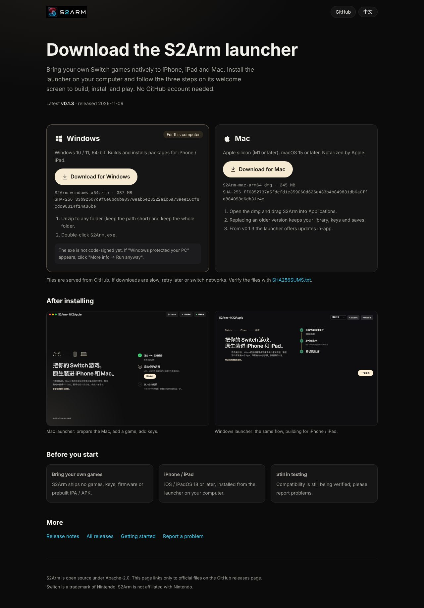
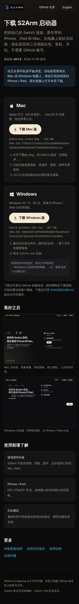

# 下载页（GitHub Pages）

给不用 GitHub 的玩家一个直接下载启动器的页面：<https://jhaizhou-ops.github.io/S2Arm/>。

## 怎么工作

- 页面只有一个文件 [index.html](index.html)，样式和脚本都内联，不引外部资源。
- 两个下载按钮直接指向 `releases/latest/download/<产物名>`，GitHub 自动跳到最新正式版的同名文件。**发版时 Mac / Windows 产物名必须保持 `S2Arm-mac-arm64.dmg`、`S2Arm-windows-x64.zip` 不变**，否则按钮会 404；改名要同步改 `index.html`。
- `releases/latest` 只认正式版：标成「预发布」的版本不会出现在按钮上。
- 页面脚本调用一次 `api.github.com/repos/jhaizhou-ops/S2Arm/releases/latest`，补上版本号、发布日期、文件大小和 SHA-256。接口不通（未登录用户每个 IP 每小时 60 次）时只少这几行字，按钮照常可用；关掉脚本也能下载。
- 发版不用重新发布页面：按钮和版本信息都是访问时现取的。

## 发布

[.github/workflows/pages.yml](../../.github/workflows/pages.yml) 在 `main` 上本目录或用到的图片有改动时，把 `index.html` 和三张图（`docs/images/` 的标志、Mac / Windows 启动器截图，`launchers/macos/Branding/AppIcon-1024.png` 作图标）拷进 `_site/` 发布，不构建、不下载依赖。也可以在 Actions 页手动运行。

首次启用需要仓库管理员做一次：Settings → Pages → Build and deployment → Source 选 **GitHub Actions**；然后在 Actions 页手动运行一次 Pages 工作流。

## 本地预览

```sh
mkdir -p build/site/images
cp docs/site/index.html build/site/
cp docs/images/s2arm-wordmark.png docs/images/launcher-welcome.png docs/images/launcher-windows.png build/site/images/
cp launchers/macos/Branding/AppIcon-1024.png build/site/images/icon.png
python3 -m http.server -d build/site 8000
```

## 预览

[preview/](preview/) 里是本地用 Chromium 截的整页图，只供审阅和文档引用，不会发布到 Pages：

| Mac（中文） | Windows（英文） | iPhone |
|---|---|---|
|  |  |  |
