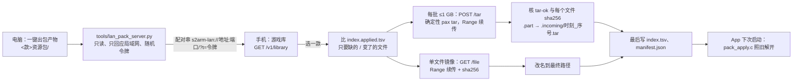

# 设计：局域网拉取资源包

> 状态：草案（电脑端服务 + 参考客户端 + 单测已实现；iOS / Android / 鸿蒙外壳的「从电脑拉取」入口尚未实现）。

## 要解决什么

资源包现在只能由电脑**推**到手机：iOS 走 usbmuxd / devicectl，要数据线或配对，Windows 还要 CoreDeviceProxy 隧道，已知的坑见 #380、#641、#192。
本方案让手机**拉**：电脑在局域网开一个只读服务，手机在同一 Wi-Fi 下选游戏、点下载，断了能续，校验后落到 App 原有的解包入口。

只发**已经出好的资源包**（目录里有非空 `manifest.json` 和 `index.tsv`），不发游戏原文件、keys、存档，也不从电脑以外的地方取任何东西。

## 流程



## 与现有推送的关系

手机端口径与 `tools/push_pack.py` 完全相同，`runtime/src/pack_apply.c` 不改：

| 环节 | 推送（现有） | 拉取（本方案） |
| --- | --- | --- |
| 机上已有什么 | `index.applied.tsv`，没有时退回 `index.tsv` | 同左 |
| 开始时 | `manifest.json` 置空；有镜像时 `.applied` 置空 | 同左 |
| 批次 | ≤1 GB，`.incoming/<时刻>_<三位序号>.tar` | 同左（同一种名字，两种方式可以混用） |
| 已传未解的账 | `.pushed` | `.pulled` |
| 单文件镜像 | 直接写最终路径 | 先写 `<路径>.part`，sha256 对了再改名 |
| 收尾 | 最后写 `index.tsv`、`manifest.json` | 同左 |

## 续传为什么可行

服务端按「路径列表」现打 tar，同一列表、同一份资源包得到的字节流逐字节相同：mtime / uid / gid 都是 0，权限 0644，只有普通文件；
pax 扩展头只在路径非 ASCII 或过长时出现；末尾正好 1024 字节全零（满足 tar-ok）。所以总长度事先就能算出，任意偏移都能映射回「哪个文件的第几个字节」，
HTTP Range 直接可用，电脑上也不用落临时 tar。客户端在 `.incoming/<名字>.tar.list` 记下这一批要了哪些行（路径、大小、sha），下次接着拉；
服务端那份变了（sha 不同），这一批作废重拉。

## 安全边界

- 只回应私有、回环、链路本地地址，其余一律 403。
- 每次启动随机令牌（或 `--token` 指定），`Authorization: Bearer` 不对一律 401。
- 只发 `index.tsv` 里登记的路径；`manifest.json` / `index.tsv` 只走专门接口；包号不能含 `/`、`..` 或以 `.` 开头。
- 文件大小与索引对不上（正在出包）返回 409，不发半截。
- 只读：服务端没有任何写接口。

## 接口

全部要 `Authorization: Bearer <令牌>`。

| 方法 | 路径 | 返回 |
| --- | --- | --- |
| GET | `/v1/library` | `{"schema":1,"packs":[{id,title,version,files,total,index_sha256}]}` |
| GET | `/v1/packs/<包号>/manifest.json`、`index.tsv` | 原样 |
| POST | `/v1/packs/<包号>/tar` | 正文为路径列表（UTF-8，每行一个），返回确定性 tar，支持 Range |
| GET | `/v1/packs/<包号>/file/<路径>` | 单个文件（单文件镜像用），支持 Range |

## 怎么试

```sh
python3 tools/lan_pack_server.py <资源包库目录>          # 打印配对串
python3 tools/lan_pack_pull.py list <配对串>
python3 tools/lan_pack_pull.py pull <配对串> <包号> <本机资源包根>
bash tests/lan_pack_test.sh
```

## 还没做

- iOS / Android / 鸿蒙外壳：游戏库加「从电脑拉取」入口，照 `tools/lan_pack_pull.py` 实现（URLSession / OkHttp / ArkTS http 都支持 Range）。
- 自动发现（mDNS / DNS-SD `_s2arm-pack._tcp`）与扫码配对；目前手动填配对串。
- Mac / Windows 启动器加一个「允许手机从这台电脑拉取」开关，由启动器起停服务、显示配对二维码。
- 服务端走 HTTP 明文（只在局域网、有令牌）；是否需要 TLS 或令牌派生的完整性校验，等维护方意见。
